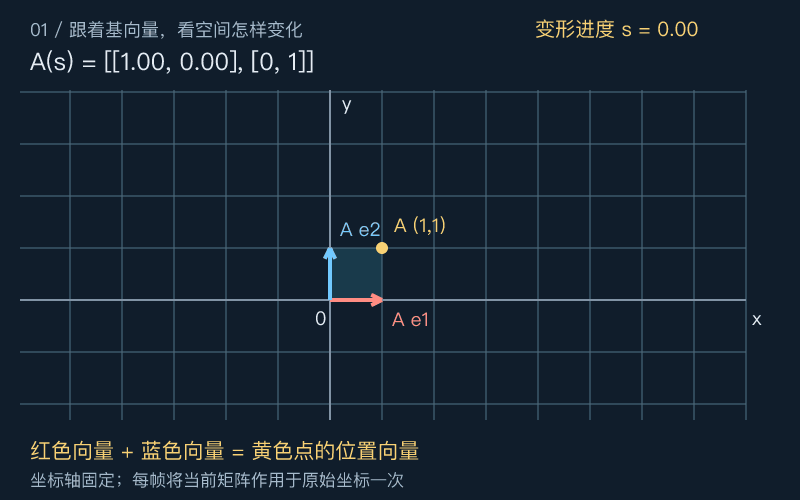
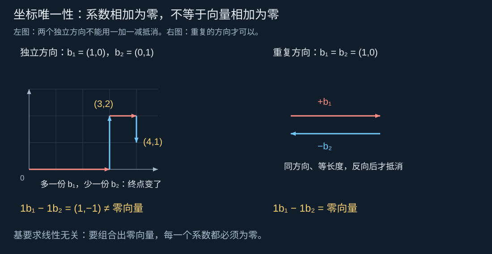
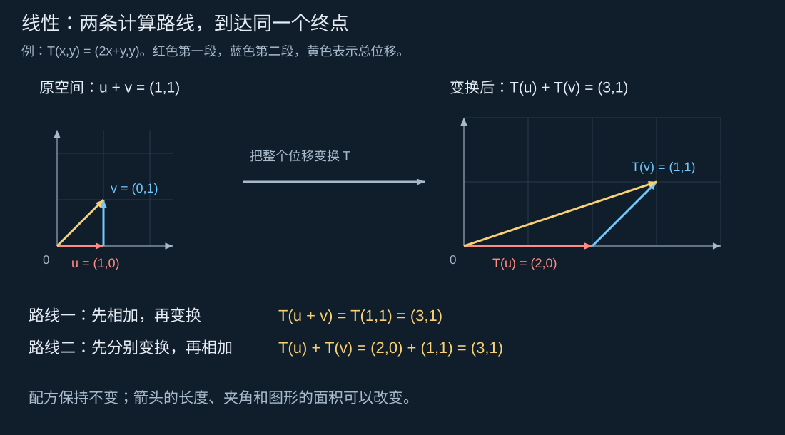
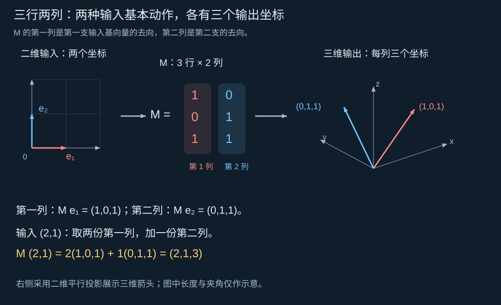
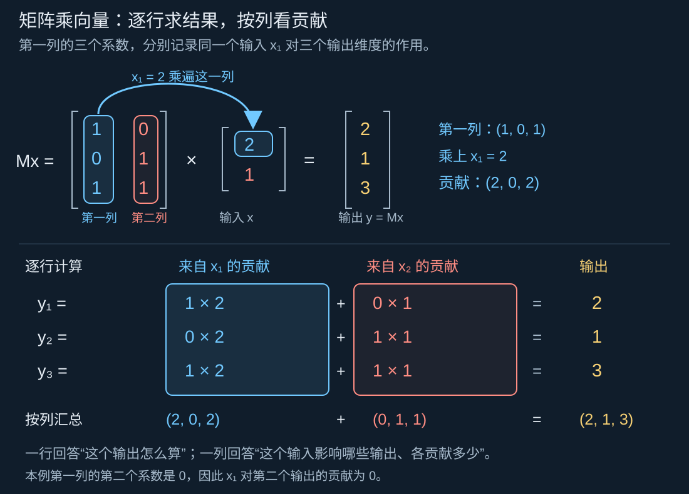
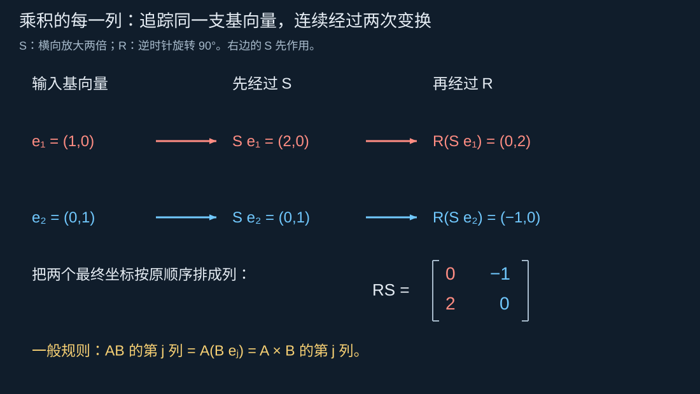
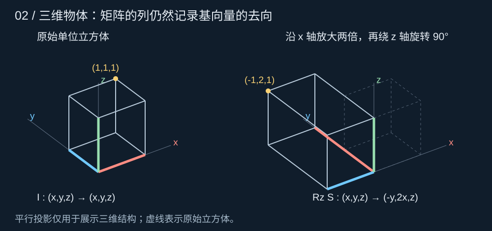
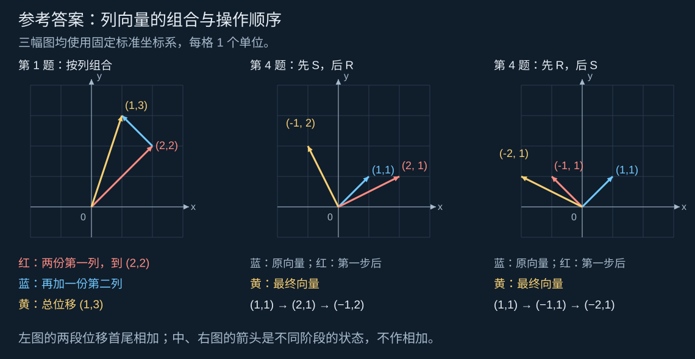

# 第 1 天：矩阵是怎样改变空间的？｜向量、基、线性变换、矩阵乘法与换基

[返回六天路线](../README.md)

今天的目标：看到一个小矩阵，能解释它把基向量送到哪里，并据此预测一个点、一条线、一个物体会怎样变化。秩与特征值会在后面专门学习，今天先为它们建立可用的空间语言。

建议安排：问题与画图 25 分钟，概念及推导 55 分钟，三维例子与实验 40 分钟，思考题 30 分钟，中间休息。首次阅读可把“同一变换在另一组基下的矩阵”留到第二遍。

## 阅读导航

1. [从移动一块三角形开始](#从移动一块三角形开始)
2. [向量、坐标与基](#向量坐标与基)
3. [线性究竟限制了什么](#线性究竟限制了什么)
4. [矩阵的列就是基向量的去向](#矩阵的列就是基向量的去向)
5. [乘法是在连接两次变换](#乘法是在连接两次变换)
6. [从平面进入三维](#从平面进入三维)
7. [移动物体与更换坐标](#移动物体与更换坐标)
8. [亲手实验](#亲手实验)
9. [留给你的思考题](#留给你的思考题)
10. [思考题参考答案](#思考题参考答案)

## 从移动一块三角形开始

想象屏幕上的三角形，顶点为 $(0,0),(1,0),(0,1)$。把横向尺寸放大两倍，再把每个点向右移动“与它原来的高度相等”的距离。顶点会到哪里？

对任意点 $(x,y)$，规则是

$$T(x,y)=(2x+y,y).$$

所以三个顶点分别到 $(0,0),(2,0),(1,1)$。如果物体有一百万个顶点，也都遵守同一个规则。我们希望找到一种紧凑的记录方式，既能算出每个顶点的位置，又能看出整个物体怎样改变。这正是本课要建立的矩阵视角。

下面的动画把这个变形慢慢展开。灰色网格和坐标轴固定，彩色网格从原样逐渐过渡到目标形状，再返回起点。



图中的 $s$ 是 **变形进度** ，可以想象成一个从 0 拧到 1 的旋钮：0 表示尚未变形，1 表示达到目标，中间数值表示过渡状态。它没有长度单位，也不是点的某个空间坐标。播放时，旋钮会缓缓前进、停顿、再退回，因此 $s$ 也不等于以秒计的播放时间。

每个进度对应一种变换设置。图上用 $A(s)$ 记录该进度下的矩阵；这个记号表示“给定进度 $s$，取出对应的矩阵”。它的具体数字怎样控制网格，将在[矩阵的列就是基向量的去向](#矩阵的列就是基向量的去向)一节中推导。

**先观察三个位置：** 红箭头从 $(1,0)$ 走向 $(2,0)$，蓝箭头从 $(0,1)$ 走向 $(1,1)$，黄色点从 $(1,1)$ 走向 $(3,1)$。黄色点的位置始终能由红、蓝两支箭头首尾相接得到。理解这个关系，需要先把“箭头”“坐标”和“组合”说清楚。

## 向量、坐标与基

### 箭头与两项数字不是同一层东西

在平面里，用箭头表示一次位移：向右 3 米、向上 2 米。把箭头平移到别处，只要长度和方向相同，它仍表示同一个位移向量。位置点则需要指定原点；用“从原点到该点”的位置向量，可以暂时把点和箭头联系起来。

选定向右、向上的单位向量

$$e_1=\begin{pmatrix}1\\0\end{pmatrix},\qquad e_2=\begin{pmatrix}0\\1\end{pmatrix},$$

就能写 $v=3e_1+2e_2$。列向量 $(3,2)^\top$ 是 $v$ 在这组基下的 **坐标** ：第一种基本位移取三份，第二种取两份。换一套基，同一箭头的坐标可能改变。

本文只讨论实数域，统一使用列向量；$\mathbb R^n$ 表示所有 $n$ 个实数构成的坐标列，$\top$ 表示转置。图中的无量纲网格可理解为选定单位后的坐标。

### 线性组合、张成与自由方向

$\alpha u+\beta v$ 叫线性组合，系数可以是任意实数，包括负数与零。

$$\operatorname{span}\{u,v\}=\{\alpha u+\beta v:\alpha,\beta\in\mathbb R\}.$$

它问的是：使用这些基本位移，究竟能到达哪些位置？

- 两个非共线的平面向量可以张成整个平面。
- $(1,0)^\top$ 和 $(2,0)^\top$ 无论怎样组合，都只能到达横轴；第二支箭头没有带来新的独立方向。
- 三维中的 $(1,0,0)^\top,(0,1,0)^\top$ 只能到达 $z=0$ 平面；两个向量有三个坐标，不等于它们张成了三维空间。

一组向量是某空间的 **基** ，需要同时满足：能张成该空间；线性无关，即只有全零系数才能组合出零向量。两个要求一起保证每个向量都有唯一坐标。

### 从独立方向到唯一坐标

先取最简单的基 $b_1=(1,0)^\top,b_2=(0,1)^\top$。到达 $(3,2)^\top$ 必须向右走 3 份、向上走 2 份。如果向右多走 1 份、向上少走 1 份，就到了 $(4,1)^\top$，没有回到同一个终点。



图左先走到 $(3,2)$，再多走一份 $b_1$、少走一份 $b_2$，终点变成 $(4,1)$；右边特意用两支相同的箭头作对照，它们不是一组基。

这次调整使用了 $1$ 和 $-1$ 两个系数。虽然系数之和为零，实际位移却是 **系数乘上各自向量后再相加** ：

$$1b_1+(-1)b_2=\begin{pmatrix}1\\0\end{pmatrix}-\begin{pmatrix}0\\1\end{pmatrix}=\begin{pmatrix}1\\-1\end{pmatrix}\ne\begin{pmatrix}0\\0\end{pmatrix}.$$

“向东一米”和“向南一米”不会互相抵消。$1b_1-1b_2=0$ 只有在 $b_1=b_2$ 时才成立；但这样的两支箭头已经重复，不能作为平面的基。更一般的多个向量能否用非零系数抵消，正是“线性相关/无关”要判断的问题。

这个区别也是证明坐标唯一性的关键。假设 $b_1,\ldots,b_n$ 是一组基，某个向量 $v$ 有两套表示，第一套系数叫 $c_1,\ldots,c_n$，第二套叫 $d_1,\ldots,d_n$。$\sum_{i=1}^n$ 只是“把第 1 项加到第 $n$ 项”的简写：

$$v=c_1b_1+\cdots+c_nb_n=d_1b_1+\cdots+d_nb_n.$$

两种走法到同一终点，差值必须是零向量：

$$(c_1-d_1)b_1+\cdots+(c_n-d_n)b_n=0.$$

而 **线性无关的定义就是：要用这些向量组合出零向量，每个系数都必须为零** 。这里的系数是 $c_i-d_i$，所以逐个得到 $c_i-d_i=0$，也就是 $c_i=d_i$。因此两套坐标完全相同。这个推理只用到线性无关的定义，对任何一组基都成立。

基不必垂直，也不必单位长度。空间的维数是任意一组基的向量个数。更一般的向量也可以是信号、系数列表；今天先用箭头理解加法和数乘。

## 线性究竟限制了什么

有了基，每支箭头都能写成基本位移的组合。接下来考察：变换以后，原来的组合配方是否仍然有效？

回到三角形的变换 $T(x,y)=(2x+y,y)$，取两段最简单的位移：

$$u=(1,0)^\top,\qquad v=(0,1)^\top.$$



- **路线一：先相加。** 先走 $u$ 再走 $v$，总位移 $u+v=(1,1)^\top$；再变换，得到 $T(u+v)=(3,1)^\top$。
- **路线二：先变换。** $T(u)=(2,0)^\top$，$T(v)=(1,1)^\top$；把变换后的两段首尾相接，总位移还是 $(3,1)^\top$。

图中的箭头可以平移以便首尾相接；平移箭头的画法不改变它代表的位移。黄色箭头代表总位移。

数乘也有同样的关系：两份 $u$ 的像是两份 $T(u)$，即 $T(2u)=(4,0)^\top=2T(u)$。把这个性质从“两支箭头各取一份”推广到任意份数，就得到线性的定义。

设 $T:\mathbb R^n\to\mathbb R^m$，这个记号表示 $T$ 接收 $n$ 维向量、输出 $m$ 维向量。若对任意输入向量 $u,v$ 和实数系数 $\alpha,\beta$，都有

$$T(\alpha u+\beta v)=\alpha T(u)+\beta T(v),$$

就称 $T$ 为 **线性映射** 。$\alpha,\beta$ 表示各取多少份，负数表示反向。等号左边先组合再变换，右边先变换再按原系数组合；线性要求两条路线对所有输入都得到相同结果。上图展示的是 $\alpha=\beta=1$ 的一个例子。

直观地说，变换后基本位移的长度和方向可以变，但原来的“几份这支箭头，加几份那支箭头”的配方仍然有效。保留的是这个组合关系，不是原来的形状：本图 $u,v$ 原本垂直，变换后两支箭头不垂直；$u$ 的长度也从 1 变成 2，单位正方形面积从 1 变成 2。

对本例，把任意 $\alpha u+\beta v$ 代入 $T(x,y)=(2x+y,y)$，再按分量展开，就能验证上述等式。绕原点旋转、沿轴缩放、错切、投影也都符合这种组合规则。

组合规则也解释了直线的去向。沿非零方向 $u$、经过点 $p$ 的直线可写成 $p+\tau u$，其中实数 $\tau$ 控制在线上的位置。线性性给出 $T(p+\tau u)=T(p)+\tau T(u)$：变换后的点仍沿固定方向排列；若 $T(u)=0$，整条线就塌缩为一点。本课用“线性映射”包含输入、输出维数不同的情况；空间到自身的线性映射也称线性变换。

### 固定原点的线性映射与整体平移

零向量表示“没有位移”。线性映射尊重加法，而 $0+0=0$，所以

$$T(0)=T(0+0)=T(0)+T(0).$$

这里每个 $0$ 都表示相应空间中的零向量。设 $q=T(0)$，上式只是 $q=q+q$；两边减去 $q$ 就得到 $q=0$。因此 $T(0)=0$。直观上，零份输入不能凭空产生一段输出位移。

保持原点是线性的必要条件，却不能单凭它判定线性。例如 $F(x,y)=(x^2,y)$ 也保持原点，但 $F(2,0)=(4,0)\ne2F(1,0)$，不满足数乘规则。

现在让所有位置点向右挪 2 格。用 $t=(2,0)^\top$ 记录这段平移，规则为 $F(v)=v+t$。于是原点也被搬到 $(2,0)^\top$，违反了刚刚推导出的性质，所以这个平移不是线性映射。

也可以直接看加法为什么失效：取 $u=v=(1,0)^\top$，先相加后平移得到 $F(u+v)=(4,0)^\top$；分别平移再相加却得到 $F(u)+F(v)=(6,0)^\top$。原因是后一路把额外平移 $t$ 加了两次。

**仿射变换** 是“先做线性变换，再加一段固定平移”的名称：

$$F(v)=T(v)+t.$$

这里 $T$ 是线性映射，$t$ 是与输入无关的固定向量；当 $T(v)=v$ 时，就是纯平移。可以想象先围绕原点旋转、缩放机器人，再把它整体搬到场景里的某处。$t=0$ 时，它就退回线性映射。

仿射变换仍保留点之间的一些几何关系。例如中点还是中点：

$$F\!\left(\frac{p+q}{2}\right)=\frac{F(p)+F(q)}2.$$

右边两份平移各乘 $1/2$，合起来恰好一份 $t$，所以这里能成立。这不等于保留任意向量加法。现在只需记住“线性部分 + 固定平移”，下文用齐次坐标说明怎样把这两步装进一次矩阵乘法。

线性映射保留组合配方，因此描述它时不必逐点记录所有去向。只要找到能组合出所有输入的基本向量，再记录它们的去向，就可以利用线性性重建其余结果。

## 矩阵的列就是基向量的去向

平面中的标准基 $e_1,e_2$ 正是这样一组基本向量。对开篇的变换，已知

$$T(e_1)=\begin{pmatrix}2\\0\end{pmatrix},\qquad T(e_2)=\begin{pmatrix}1\\1\end{pmatrix},$$

那么对 $v=xe_1+ye_2$，由线性性直接得到

$$T(v)=xT(e_1)+yT(e_2)=x\begin{pmatrix}2\\0\end{pmatrix}+y\begin{pmatrix}1\\1\end{pmatrix}=\begin{pmatrix}2x+y\\y\end{pmatrix}.$$

把两个像并排存放，就得到

$$A=[T(e_1)\;T(e_2)]=\begin{pmatrix}2&1\\0&1\end{pmatrix},\qquad Av=T(v).$$

**列组合读法：** 输入坐标就是给各列的系数。例如

$$A\begin{pmatrix}2\\1\end{pmatrix}=2\begin{pmatrix}2\\0\end{pmatrix}+1\begin{pmatrix}1\\1\end{pmatrix}=\begin{pmatrix}5\\1\end{pmatrix}.$$

**逐行读法：** 第一行告诉我们输出横坐标 $x'=2x+y$；第二行告诉我们输出纵坐标 $y'=y$。两种读法是同一件事，列读法解释空间如何变化，行读法解释每个输出怎样计算。

### 用行和列读懂开篇动画

上面的矩阵 $A$ 记录了最终变形。为了显示从原样到目标的过程，我们把横向缩放倍数从 1 逐渐增加到 2，同时把高度对横向位置的影响从 0 逐渐增加到 1。用开篇的进度 $s\in[0,1]$ 表示，这两个系数分别是 $1+s$ 和 $s$，于是中间状态的坐标规则为

$$x'=(1+s)x+sy,\qquad y'=y.$$

这里 $x,y$ 是点的原始坐标，$x',y'$ 是当前显示的坐标。固定高度 $y$ 后，同一排两点原本相差 $\Delta x$，变换后的横向间距就是 $(1+s)\Delta x$，所以网格逐渐拉宽。额外的 $sy$ 则让不同高度的横排错开：正高度向右、负高度向左，这种效果称为 **错切** 。

按照刚学过的逐行读法，把两条输出规则的系数排好，就得到图中的矩阵：

$$A(s)=\begin{pmatrix}1+s&s\\0&1\end{pmatrix}.$$

第一行的两个系数随着进度改变，控制横向拉伸和错切；第二行始终为 $[0\;1]$，保留 $y'=y$。动画只改第一行，是因为这个例子选择只改变输出横坐标；旋转或竖向缩放通常还需要改变第二行。


从列看，同一个矩阵又告诉我们：红色基向量的像是 $(1+s,0)^\top$，蓝色基向量的像是 $(s,1)^\top$。黄色点的原始坐标为 $(1,1)^\top$，所以它的像始终等于这两列之和，即 $(1+2s,1)^\top$。开篇看到的三者关系，现在可以直接从矩阵中读出。

| 进度 $s$ | 当前矩阵 $A(s)$ | 黄色点当前的位置 |
| --- | --- | --- |
| $0$ | $\begin{pmatrix}1&0\\0&1\end{pmatrix}$ | $(1,1)$ |
| $0.5$ | $\begin{pmatrix}1.5&0.5\\0&1\end{pmatrix}$ | $(2,1)$ |
| $1$ | $\begin{pmatrix}2&1\\0&1\end{pmatrix}$ | $(3,1)$ |

每给定一个 $s$，就得到一个确定的矩阵。因此，$A(s)$ 是一个 **以进度为输入、以矩阵为输出的函数** 。让 $s$ 遍历 $[0,1]$，得到的这一组相关矩阵称为 **一族矩阵** 。计算分为两步：先用 $s$ 选定矩阵，再用这个矩阵变换点的坐标。

起点矩阵 $A(0)$ 使每个向量保持原样，称为 **单位矩阵** ，记作 $I$；终点矩阵 $A(1)$ 就是本节的 $A$。把各个元素从起点数值过渡到终点数值，可以统一写成

$$A(s)=(1-s)I+sA.$$

这叫线性插值，是本动画选用的一种过渡方式，并非所有变换都必须这样制作动画。每帧都将当前矩阵作用于原始坐标，而不是把上一帧的输出继续送入下一次变换。例如黄色点始终按 $A(s)(1,1)^\top$ 计算；反复乘固定的 $A$ 则会使它依次到达 $(3,1)$、$(7,1)$，是另一种过程。

### 从二维矩阵推广到不同维度

无论是固定的 $A$，还是动画中选出的某个 $A(s)$，每一列都记录一支输入基向量的去向。这个读法不依赖二维图像；它同样适用于输入、输出维数不同的映射。

一般地，$A\in\mathbb R^{m\times n}$ 表示 $n$ 维输入到 $m$ 维输出；它有 $n$ 列，每列是一个输入标准基向量在输出标准基下的坐标。对任意 $x$，

$$Ax=\sum_{j=1}^n x_j a_j.$$

这里 $a_j$ 为第 $j$ 列。矩阵不是“天然不变的变换本身”：它是选定输入、输出基后，线性映射的一种记录方式。

把符号逐个拆开：$m\times n$ 是 $m$ 行、$n$ 列；$x_j$ 是输入 $x$ 的第 $j$ 个坐标；$a_j\in\mathbb R^m$ 是一整列，不是一个数。$\sum$ 要把这些加权列向量相加，最后得到 $m$ 个输出坐标。



图中取一个与前文不同的矩阵 $M$，专门展示输入、输出维数可以不同：

$$M=\begin{pmatrix}1&0\\0&1\\1&1\end{pmatrix},\qquad M\begin{pmatrix}2\\1\end{pmatrix}=2\begin{pmatrix}1\\0\\1\end{pmatrix}+1\begin{pmatrix}0\\1\\1\end{pmatrix}=\begin{pmatrix}2\\1\\3\end{pmatrix}.$$

把输出记作 $y=Mx$，同一次计算就有两种观察方向：横着看，每一行算出一个输出坐标；竖着看，同一个输入分量通过一整列系数，分别对所有输出坐标作出贡献。



图中的蓝色部分始终追踪 $x_1=2$：第一列的三个系数 $1,0,1$ 分别乘上这个 2，得到贡献向量 $(2,0,2)^\top$。其中第二个系数为 0，表示 $x_1$ 对第二个输出坐标没有贡献；另一个输入 $x_2=1$ 则沿第二列贡献 $(0,1,1)^\top$。两份贡献相加才是完整输出 $(2,1,3)^\top$。因此， **一列记录一个输入分量对各输出维度的作用系数；乘上这个输入值，才得到它的实际贡献。**

输入只有两种基本位移，所以需要两列；每一种去向都要用三个坐标记录，所以每列有三行。输入坐标不是原封不动复制到输出，而是用来指定“取几份第一列、几份第二列”。

**不那么形式化地说：矩阵像一本“基本动作去向表”。** 第一列记“沿输入第一根轴走一步，输出会怎样动”，第二列记第二根轴，依此类推。输入 $x$ 是配方；$Ax$ 就是按这个配方，把表里的输出动作组合起来。基像一套描述方向的尺子，换了尺子，同一个动作的数字记录可以变；后面的换基例子会让这个比喻具体起来。这个说法只解释已选好基的线性映射，不表示任意动作都能用一个矩阵记录。

### 这已经碰到了秩

所有可能输出都由列向量组合出来，所以输出集合是列空间 $\operatorname{span}\{a_1,\ldots,a_n\}$。它的维数就是矩阵的秩。

今天先记住这个几何问题： **输出还拥有多少个独立方向？** 不是数非零元素，也不是数非零列。例如 $\begin{pmatrix}1&2\\0&0\end{pmatrix}$ 两列都非零，输出却都在横轴上，秩为 1。第二天再研究它如何决定方程的解及信息损失。

## 乘法是在连接两次变换

设横向拉伸与逆时针旋转 90° 分别为

$$S=\begin{pmatrix}2&0\\0&1\end{pmatrix},\qquad R=\begin{pmatrix}0&-1\\1&0\end{pmatrix}.$$

对列向量先做 $S$，再做 $R$，结果是 $R(Sv)=(RS)v$。 **右边的变换先作用。**

取 $v=(1,1)^\top$：

$$v\xrightarrow{S}(2,1)^\top\xrightarrow{R}(-1,2)^\top,$$

$$v\xrightarrow{R}(-1,1)^\top\xrightarrow{S}(-2,1)^\top.$$

顺序改变结果，因为第二种操作的横向拉伸仍沿固定世界横轴进行。对应矩阵为

$$RS=\begin{pmatrix}0&-1\\2&0\end{pmatrix},\qquad SR=\begin{pmatrix}0&-2\\1&0\end{pmatrix}.$$

### 把两次变换的最终去向排成列

计算复合变换的矩阵，仍然可以沿用刚才的列读法。分别追踪两支基向量经过 $S$、再经过 $R$ 的结果：



第一条：$e_1=(1,0)^\top\xrightarrow{S}(2,0)^\top\xrightarrow{R}(0,2)^\top$，所以 $RS$ 的第一列是 $(0,2)^\top$。

第二条：$e_2=(0,1)^\top\xrightarrow{S}(0,1)^\top\xrightarrow{R}(-1,0)^\top$，所以第二列是 $(-1,0)^\top$。把这两列并排放好，就是上面的 $RS$。

再换成通用名字：先经过矩阵 $B$，再经过矩阵 $A$。$e_j$ 表示“第 $j$ 个坐标为 1，其余为 0”的标准基向量；$Be_j$ 恰好选出 $B$ 的第 $j$ 列。这个输出再经过 $A$，终点是 $A(Be_j)$。所以 $AB$ 的第 $j$ 列，必须是 $A$ 乘 $B$ 的第 $j$ 列。

计算每一列时，再把矩阵乘向量按输出坐标展开，就得到“行乘列”。直观上，乘积矩阵把“两次动作的最终去向”预先记进一张新表。

维数也来自过程：若 $B:\mathbb R^n\to\mathbb R^k$，$A:\mathbb R^k\to\mathbb R^m$，则 $(m\times k)(k\times n)$ 得到 $m\times n$；中间维数相同才能连接。

## 从平面进入三维

机器人模型的每个顶点可以用 $p=(x,y,z)^\top$ 表示。下面的矩阵先沿 $x$ 轴放大两倍，再绕 $z$ 轴旋转 90°：

$$S_3=\begin{pmatrix}2&0&0\\0&1&0\\0&0&1\end{pmatrix},\quad R_z=\begin{pmatrix}0&-1&0\\1&0&0\\0&0&1\end{pmatrix},\quad R_zS_3=\begin{pmatrix}0&-1&0\\2&0&0\\0&0&1\end{pmatrix}.$$

因此 $(1,1,1)^\top$ 先到 $(2,1,1)^\top$，再到 $(-1,2,1)^\top$。不用对所有顶点分别推公式，只要对它们应用同一个矩阵。



图中是三维线框的二维平行投影示意，虚线是原始立方体参照。投影仅用于把三维画在纸上；屏幕上的角度和长度不代表三维中的实际角度和长度。实体的边仍相互垂直，$z$ 方向仍保持不变。图上红、蓝、绿边分别追踪原来的 $e_1,e_2,e_3$。

如果再做

$$P=\begin{pmatrix}1&0&0\\0&1&0\\0&0&0\end{pmatrix},$$

任意 $(x,y,z)^\top$ 都到 $(x,y,0)^\top$。不同高度的点可能重合，立方体压成平面。三列中只有两个独立方向，故秩为 2。这个例子也提醒我们：线性变换不必可逆。

### 齐次坐标：给平移留一个固定入口（进阶选读）

前面的缩放、旋转和投影都固定原点。把机器人放入场景时，还需要把模型整体搬到指定位置：先用 $A$ 变形，再让每个点平移同一段位移 $t$，就得到 $p'=Ap+t$。这正是前面介绍的仿射变换，其中线性部分已写成矩阵。若以模型原点作为机器人的参考点，这个参考点就会被送到 $t$。

由于 $A0=0$，单独使用三维矩阵无法把原点移走。要把变形和平移合并成一次矩阵乘法，需要额外留出一个入口，无论输入点在哪里，都能加入同一段 $t$。

先看纯平移例子：$p=(1,2,3)^\top$，$t=(10,0,0)^\top$，希望得到 $p'=(11,2,3)^\top$。给位置点末尾添一个固定的 1，就能写成

$$\begin{pmatrix}11\\2\\3\\1\end{pmatrix}=
\begin{pmatrix}1&0&0&10\\0&1&0&0\\0&0&1&0\\0&0&0&1\end{pmatrix}
\begin{pmatrix}1\\2\\3\\1\end{pmatrix}.$$

第一行是 $1\cdot1+0\cdot2+0\cdot3+10\cdot1=11$；第四行把末尾的 1 保留下来。 **多出来的 1 像一个固定开关，让第四列的平移量总能加进来。** 它不是机器人在真实空间里多出的一个方向。

一般情形，把 $A$ 放在左上角，把 $t$ 放在最后一列：

$$H=\begin{pmatrix}
a_{11}&a_{12}&a_{13}&t_x\\
a_{21}&a_{22}&a_{23}&t_y\\
a_{31}&a_{32}&a_{33}&t_z\\
0&0&0&1
\end{pmatrix},\qquad
H\begin{pmatrix}x\\y\\z\\1\end{pmatrix}
=\begin{pmatrix}Ap+t\\1\end{pmatrix}.$$

其中 $a_{ij}$ 是 $A$ 第 $i$ 行第 $j$ 列的元素，$t=(t_x,t_y,t_z)^\top$。常见的简写

$$\begin{pmatrix}p'\\1\end{pmatrix}=\begin{pmatrix}A&t\\0\;0\;0&1\end{pmatrix}\begin{pmatrix}p\\1\end{pmatrix}$$

是在用大块表示同一个 $4\times4$ 矩阵：$p$ 和 $p'$ 各占三行，$A$ 占三行三列。不是一个普通的 $2\times2$ 数字矩阵。

位置点的末位固定为 1，而两点之间的位移由相减得到。取位置点 $p,q$，从 $p$ 到 $q$ 的位移是 $d=q-p$，扩展后的差为

$$\begin{pmatrix}q\\1\end{pmatrix}-\begin{pmatrix}p\\1\end{pmatrix}=\begin{pmatrix}q-p\\0\end{pmatrix}=\begin{pmatrix}d\\0\end{pmatrix}.$$

所以 $H(d,0)^\top=(Ad,0)^\top$，平移部分乘上 0。两点同时向右搬 10 格，它们之间的位移不会因此多出 10 格；也可直接相减验证 $(Aq+t)-(Ap+t)=A(q-p)$。

这套扩展记法称为 **齐次坐标** ，本课只使用位置点末位 1、位移末位 0 的仿射情形，不展开透视投影。$H$ 是四维向量空间中的线性运算，但表示三维位置点的“末位恒为 1”的集合不是线性子空间：两个这样的向量相加末位会变成 2。因而这套写法并没有使原来的三维非零平移变成线性映射。

如果第一次读觉得信息多，可以先掌握具体的 $4\times4$ 平移算例，之后再回来核对位置点和位移的区别。

## 移动物体与更换坐标

### 同一支箭头，换一种描述

取另一组基 $b_1=(1,0)^\top,b_2=(1,1)^\top$，列矩阵为

$$B=[b_1\;b_2]=\begin{pmatrix}1&1\\0&1\end{pmatrix}.$$

同一几何向量 $v=(3,2)^\top$ 可以写成 $v=1b_1+2b_2$。这给出了两种描述：标准基下要取 3 份横向位移、2 份纵向位移；新基下则取 1 份 $b_1$、2 份 $b_2$。

把后一份“份数清单”记为 $[v]_B=(1,2)^\top$。这里的方括号连同下标构成 **坐标记号** ：$[v]_B$ 读作“向量 $v$ 在基 $B$ 下的坐标”。下标指定用哪组基，它不是 $v$ 与 $B$ 相乘。前面 $B=[b_1\;b_2]$ 的方括号则表示把两列并排拼成矩阵，两种写法的用途由完整记号区分。

矩阵 $B$ 中存放的是新基向量的标准坐标，因此按新坐标给出的份数取各列，便能重建向量的标准坐标：

$$B[v]_B=\begin{pmatrix}1&1\\0&1\end{pmatrix}\begin{pmatrix}1\\2\end{pmatrix}=\begin{pmatrix}3\\2\end{pmatrix}=v.$$

反过来，若已知标准坐标 $v$，需要寻找新坐标，可以暂把未知的份数清单叫作 $c$，求解 $Bc=v$。$B$ 的列是一组基，保证这个翻译过程可逆；撤销乘 $B$ 的矩阵称为它的 **逆矩阵** ，记作 $B^{-1}$，满足 $B^{-1}B=I$。因此等式两边左乘 $B^{-1}$，就得到 $c=B^{-1}v$。这里的逆不是逐个元素取倒数。本例中

$$B^{-1}=\begin{pmatrix}1&-1\\0&1\end{pmatrix},\qquad B^{-1}\begin{pmatrix}3\\2\end{pmatrix}=\begin{pmatrix}1\\2\end{pmatrix}.$$

把 $c$ 换回坐标记号，两种翻译方向便写成

$$v=B[v]_B,\qquad [v]_B=B^{-1}v.$$

本文在矩阵运算中用 $v$ 简写其标准基坐标。若严格区分几何箭头与坐标数字，用 $E$ 表示标准基，这两个式子应写为 $[v]_E=B[v]_B$、$[v]_B=B^{-1}[v]_E$。省略的是标准坐标上的 $[\ ]_E$，新基坐标仍保留下标 $B$。

直观上，这是同一个地址的两种描述：“沿标准方向走 3、2 份”与“沿新方向走 1、2 份”。乘 $B$ 把新描述翻译成标准描述；乘 $B^{-1}$ 反向翻译。箭头没有移动。

相反，如果把 $B$ 当作固定标准坐标系中的主动变换，输入 $(3,2)^\top$ 得到 $Bv=(5,2)^\top$，箭头真的变了。同一个数表可以参与不同任务，必须先说清输入和输出究竟是谁的坐标。

### 同一变换在另一组基下的矩阵

如果 $A$ 是标准基下的变换矩阵，而我们希望输入和输出都用基 $B$ 描述，那么先翻译、再变换、最后翻译回来：

$$[v]_B\xrightarrow{B}v\xrightarrow{A}Av\xrightarrow{B^{-1}}[Av]_B.$$

因此新矩阵为 $A_B=B^{-1}AB$。不必今天记熟“相似”这个名称，先读懂三步走向即可。它描述同一个几何动作，因此不应把换基误认为又扭曲了一次物体。

## 亲手实验

打开 [标准库实验脚本](../codes/01_experiment.py)。在专题根目录运行：

```sh
python3 codes/01_experiment.py
```

先用纸预测，再运行：$A\begin{pmatrix}2\\1\end{pmatrix}$、$RS\begin{pmatrix}1\\1\end{pmatrix}$、$SR\begin{pmatrix}1\\1\end{pmatrix}$、$R_zS_3\begin{pmatrix}1\\1\\1\end{pmatrix}$。预期分别是 $(5,1),(-1,2),(-2,1),(-1,2,1)$。

接着改脚本中的输入向量为 $(0,1)$，解释为何输出直接读出了第二列。最后把 $A$ 改为 $\begin{pmatrix}1&2\\0&0\end{pmatrix}$，观察不同输入能否得到同一输出。脚本只帮助核对具体算例，不能用有限次数运行代替线性性的定义或一般证明。

本课空间变换的教学视角参考 [3Blue1Brown](https://www.3blue1brown.com/lessons/linear-transformations/)，列组合与方程的联系可对照 [MIT 18.06SC](https://ocw.mit.edu/courses/18-06sc-linear-algebra-fall-2011/)，三维矩阵交互可查看 [Immersive Linear Algebra](https://immersivemath.com/ila/ch06_matrices/ch06.html)。推导、图和练习均在本文重新组织。

## 留给你的思考题

参考答案附在[本章末尾](#思考题参考答案)，可先作答再对照。每题尽量写“我的预测 → 图或计算 → 原因”；不会的地方直接写出卡点，比只写结果更有用。建议先回答前四题，再做迁移题。

### 1．只看两支箭头，恢复整个变换

某个线性映射把 $e_1$ 送到 $(1,1)^\top$，把 $e_2$ 送到 $(-1,1)^\top$。写出矩阵，并画出 $(2,1)^\top$ 的像。为什么知道两支基向量的去向，就足够知道每个向量的去向？如果映射不保证线性，这个结论还成立吗？

我的回答：

### 2．会画网格，不等于理解线性

比较 $F(x,y)=(x+2,y)$、$G(x,y)=(x,y^2)$、$H(x,y)=(x+y,0)$。哪些是线性映射？对不线性的给出一个明确反例；对线性的说明它怎样处理任意线性组合。仅检查原点会漏掉什么？

我的回答：

### 3．三个数，为什么只剩两个自由方向

对 $T(x,y,z)=(x+y,0,z)$，写出 $3\times3$ 矩阵，描述所有可能输出。找两个不同输入得到相同输出，并指出一条会被压到原点的直线。你认为输出空间是几维，理由是什么？

我的回答：

### 4．同一个物体，为什么操作顺序重要

仍用正文的 $S$ 与 $R$，选择一个不是零向量的输入，画出两种顺序。进一步：若把 $S$ 改为各方向都放大两倍的 $2I$，是否仍与 $R$ 不可交换？请从几何或代数说明，不要只试一个点。

我的回答：

### 5．机器人没动，坐标却变了

世界坐标中的 $v=(4,2)^\top$，新基 $b_1=(1,1)^\top,b_2=(1,-1)^\top$。求新基坐标，并用线性组合还原 $v$。再解释：主动计算 $Bv$ 与计算 $B^{-1}v$，输入含义及输出含义有什么不同？

我的回答：

### 6．预告：有没有“只伸缩、不离开原直线”的方向

对正文 $A=\begin{pmatrix}2&1\\0&1\end{pmatrix}$，分别考察 $u=(1,0)^\top$、$v=(-1,1)^\top$、$w=(0,1)^\top$。哪些满足 $Ax=\lambda x$？各自的 $\lambda$ 是多少？用一句话解释这个等式描述的几何现象。暂时不用求特征多项式；如果 $\lambda<0$ 或 $\lambda=0$，你猜图像又会怎样？

我的回答：

### 学完后的自我复述

不用“行乘列”四个字，向一个没学过矩阵的人解释 $Ax$。然后各写一句：我现在怎样理解“基”；我还不明白什么；哪道题最值得下一次一起讨论。

我的复述：暂无。

## 思考题参考答案

以下是供对照的参考解答。每题先解释空间中的含义，再给出计算或一般推理；具体算例用于帮助理解，涉及“对所有向量都成立”的结论则另给证明。各题矩阵的字母只在本题内使用。

### 第 1 题：用基向量的去向重建变换

矩阵的第一列记录 $e_1$ 的去向，第二列记录 $e_2$ 的去向，因此本题的矩阵为

$$C=\begin{pmatrix}1&-1\\1&1\end{pmatrix}.$$

输入 $(2,1)^\top$ 表示两份 $e_1$ 加一份 $e_2$。线性映射保留这个配方，所以输出为

$$C\begin{pmatrix}2\\1\end{pmatrix}
=2\begin{pmatrix}1\\1\end{pmatrix}+\begin{pmatrix}-1\\1\end{pmatrix}
=\begin{pmatrix}1\\3\end{pmatrix}.$$

画图时，从原点沿 $(1,1)$ 的方向走两份，到达 $(2,2)$；再接上一份 $(-1,1)$，到达 $(1,3)$。从原点指向最终位置的箭头就是输入的像。



这张图左侧给出第 1 题；中、右两幅用于第 4 题。左图红、蓝两段是相加的位移，黄色箭头是它们的和。中、右图的三支箭头则表示同一向量在操作前、中、后的状态，不能把它们再相加。

**基向量足够描述整个线性映射，是因为每个输入都能由基向量组合得到。** 对任意 $x=(x_1,x_2)^\top$，有

$$x=x_1e_1+x_2e_2,$$

再使用线性性：

$$T(x)=x_1T(e_1)+x_2T(e_2).$$

右侧的两个像已经知道，系数又由输入给定，因此每个输入的输出都被确定。这不是“试两个点就猜出规律”，而是线性性把已知的两个像推广到了所有输入。

如果不保证线性，仅知道两支基向量的去向就不够。构造另一个映射

$$Q(x_1,x_2)=\begin{pmatrix}x_1-x_2+x_1x_2\\x_1+x_2\end{pmatrix}.$$

在 $e_1=(1,0)^\top$ 和 $e_2=(0,1)^\top$ 处，乘积 $x_1x_2$ 都是 0，所以 $Q$ 与 $T$ 给出完全相同的基向量像。但对输入 $(2,1)^\top$，

$$Q(2,1)=\begin{pmatrix}3\\3\end{pmatrix}\ne T(2,1)=\begin{pmatrix}1\\3\end{pmatrix}.$$

差别来自额外的乘积项。也可直接检查 $Q(e_1+e_2)=(1,2)^\top$，而 $Q(e_1)+Q(e_2)=(0,2)^\top$，它不保留加法，确实不是线性映射。

### 第 2 题：用定义区分线性、平移与非线性

三个映射中， **只有 $H$ 是线性映射** 。原点检查能排除 $F$，却无法排除 $G$，因此还要检查组合规则。

对于 $F(x,y)=(x+2,y)$，每个位置点都被向右平移 2 格，原点也不例外：

$$F(0,0)=(2,0)\ne(0,0).$$

线性映射必须把零向量送到零向量，因此这个反例已经足够排除线性。用加法再核对一次：取 $u=v=(1,0)^\top$，则 $F(u+v)=(4,0)^\top$，而 $F(u)+F(v)=(6,0)^\top$。分开变换时，平移量被加了两次。

对于 $G(x,y)=(x,y^2)$，虽然 $G(0,0)=(0,0)$，但纵坐标的平方不保留数乘。取 $u=(0,1)^\top$：

$$G(2u)=G(0,2)=(0,4)^\top,\qquad 2G(u)=(0,2)^\top.$$

两者不同，所以 $G$ 也不线性。直观上，输入高度加倍后，输出高度变成四倍，原来的“取两份”的配方失效。

对于 $H(x,y)=(x+y,0)$，输出总在横轴上。压扁空间不会自动破坏线性，关键仍然是能否保留任意线性组合。令

$$u=(u_1,u_2)^\top,\qquad v=(v_1,v_2)^\top,\qquad \alpha,\beta\in\mathbb R.$$

直接代入：

$$\begin{aligned}
H(\alpha u+\beta v)
&=H(\alpha u_1+\beta v_1,\ \alpha u_2+\beta v_2)\\
&=\begin{pmatrix}\alpha u_1+\beta v_1+\alpha u_2+\beta v_2\\0\end{pmatrix}\\
&=\alpha\begin{pmatrix}u_1+u_2\\0\end{pmatrix}
+\beta\begin{pmatrix}v_1+v_2\\0\end{pmatrix}\\
&=\alpha H(u)+\beta H(v).
\end{aligned}$$

这里没有限制向量或系数的具体取值，因此证明覆盖了所有输入。它的矩阵是 $\begin{pmatrix}1&1\\0&0\end{pmatrix}$：两支输入基向量都被送到同一条横轴上，但各自的份数仍被保留并相加。

### 第 3 题：输出维数取决于独立方向

规则 $T(x,y,z)=(x+y,0,z)$ 按输出分量写成矩阵为

$$D=\begin{pmatrix}1&1&0\\0&0&0\\0&0&1\end{pmatrix}.$$

第一行把输入的 $x,y$ 相加；第二行无论输入是什么都输出 0；第三行保留输入 $z$。因此所有输出都形如

$$\begin{pmatrix}a\\0\\b\end{pmatrix},\qquad a,b\in\mathbb R.$$

这不仅说明“输出不会离开某个平面”，还要确认它能到达这个平面的每一点。对任意 $a,b$，选输入 $(a,0,b)^\top$，就得到输出 $(a,0,b)^\top$。所以输出集合恰好是 **输出空间中第二坐标为零的平面** ，即通常说的 $xz$ 平面。

在这个平面中，

$$\begin{pmatrix}a\\0\\b\end{pmatrix}
=a\begin{pmatrix}1\\0\\0\end{pmatrix}
+b\begin{pmatrix}0\\0\\1\end{pmatrix}.$$

这两支向量线性无关：$\alpha(1,0,0)^\top+\beta(0,0,1)^\top=0$ 会逐分量给出 $\alpha=\beta=0$。它们又能张成所有输出，所以输出空间维数为 2，矩阵的秩为 2。三个输出坐标只是一种书写格式，其中第二坐标恒为零，并未带来第三个自由方向。

信息丢失可以通过两组输入看出来：

$$T(1,0,0)=T(0,1,0)=(1,0,0)^\top.$$

输出只知道前两个输入的和，无法分辨这份总量来自哪一个输入。

把这个现象推广，任取实数 $t$：

$$T(t,-t,0)=(0,0,0)^\top.$$

因此过原点、沿 $(1,-1,0)^\top$ 方向的整条直线都会被压到原点。反过来，若输出为零，就必须 $x+y=0$ 且 $z=0$，所以被压到原点的输入恰好构成这条直线。这一集合将在第二课称为 **零空间** 。

也可以从任意输入出发，沿这个方向移动：

$$T(x+t,y-t,z)=(x+y,0,z)=T(x,y,z).$$

输出对这种“一边增加、另一边减少”的调整完全看不见，这就是本例丢失的一个独立方向。

### 第 4 题：局部方向拉伸与整体等比例缩放

本题在固定标准坐标系中使用

$$S=\begin{pmatrix}2&0\\0&1\end{pmatrix},\qquad
R=\begin{pmatrix}0&-1\\1&0\end{pmatrix}.$$

选 $v=(1,1)^\top$。先横向拉伸再旋转，得到

$$v=(1,1)^\top\xrightarrow{S}(2,1)^\top\xrightarrow{R}(-1,2)^\top.$$

先旋转再横向拉伸，则得到

$$v=(1,1)^\top\xrightarrow{R}(-1,1)^\top\xrightarrow{S}(-2,1)^\top.$$

[参考图](../images/01-answer-vector-paths.svg)中间与右侧展示了两条路线。蓝色是原始向量，红色是第一步之后的向量，黄色是最终向量；各支箭头均从原点出发。

**横向拉伸始终沿固定世界横轴作用。** 先拉伸再旋转时，被加长的那部分也跟着旋转；先旋转再拉伸时，拉长的是旋转后落在横轴方向的分量。所以两种顺序产生不同结果。一个反例足以说明 $RS\ne SR$，无需证明每一个向量的两条路线都不同。

把 $S$ 改为 $2I$ 后，情形改变了。$I$ 是单位矩阵，$2I$ 把每个方向都放大两倍，不再特别对待横向。对任意向量 $v$，旋转的线性性给出

$$R((2I)v)=R(2v)=2R(v)=(2I)(Rv).$$

因为这对所有 $v$ 成立，便得到

$$R(2I)=(2I)R=2R.$$

因此两者 **可以交换** 。几何上，统一改变所有长度不会改变方向；无论先旋转还是先把长度加倍，最终方向和长度都一致。事实上，对任意同阶方阵 $L$、任意实数 $c$，都有 $L(cI)=(cI)L=cL$；关键是各方向使用同一个倍数。

### 第 5 题：换坐标与主动变换的输入含义不同

将新基的标准坐标按列排好：

$$B=\begin{pmatrix}1&1\\1&-1\end{pmatrix}.$$

设新基坐标是 $(c_1,c_2)^\top$。它表示同一支箭头由 $c_1$ 份 $b_1$ 和 $c_2$ 份 $b_2$ 组成，因此

$$c_1\begin{pmatrix}1\\1\end{pmatrix}
+c_2\begin{pmatrix}1\\-1\end{pmatrix}
=\begin{pmatrix}4\\2\end{pmatrix}.$$

逐分量比较，就得到

$$\begin{cases}c_1+c_2=4,\\c_1-c_2=2.\end{cases}$$

两式相加得 $2c_1=6$，所以 $c_1=3$；代回第一式得 $c_2=1$。故

$$[v]_B=\begin{pmatrix}3\\1\end{pmatrix}.$$

还原检查为

$$3b_1+b_2=\begin{pmatrix}3\\3\end{pmatrix}+\begin{pmatrix}1\\-1\end{pmatrix}=\begin{pmatrix}4\\2\end{pmatrix}=v.$$

直观上，沿右上方向走三份，再沿右下方向走一份，最终仍是“向右 4、向上 2”的同一支箭头。

本例 $B^2=2I$，所以 $B^{-1}=\tfrac12B$。利用逆矩阵也得到

$$B^{-1}\begin{pmatrix}4\\2\end{pmatrix}
=\frac12\begin{pmatrix}1&1\\1&-1\end{pmatrix}\begin{pmatrix}4\\2\end{pmatrix}
=\begin{pmatrix}3\\1\end{pmatrix}.$$

两种运算的区别要连同坐标约定理解：

| 运算与用途 | 输入表示什么 | 输出表示什么 | 几何向量是否改变 |
| --- | --- | --- | --- |
| 主动变换 $Bv$ | 原向量的标准坐标 $(4,2)^\top$ | 新向量的标准坐标 $(6,2)^\top$ | 改变 |
| 换基 $B^{-1}v$ | 原向量的标准坐标 $(4,2)^\top$ | 同一向量的新基坐标 $(3,1)^\top$ | 不改变 |
| 换基还原 $B[v]_B$ | 同一向量的新基坐标 $(3,1)^\top$ | 同一向量的标准坐标 $(4,2)^\top$ | 不改变 |

**数表本身不说明这次运算是移动箭头还是翻译坐标；输入、输出采用什么基，才确定它的含义。** 若把 $B^{-1}$ 也用作标准坐标下的主动变换，它同样可以改变箭头。本题把它解释为换基，是因为输出明确采用新基坐标。

### 第 6 题：沿同一条过原点的直线伸缩

本题矩阵为

$$A=\begin{pmatrix}2&1\\0&1\end{pmatrix}.$$

先逐个计算，不需要特征多项式：

$$Au=\begin{pmatrix}2&1\\0&1\end{pmatrix}\begin{pmatrix}1\\0\end{pmatrix}
=\begin{pmatrix}2\\0\end{pmatrix}=2u,$$

$$Av=\begin{pmatrix}2&1\\0&1\end{pmatrix}\begin{pmatrix}-1\\1\end{pmatrix}
=\begin{pmatrix}-1\\1\end{pmatrix}=v,$$

$$Aw=\begin{pmatrix}2&1\\0&1\end{pmatrix}\begin{pmatrix}0\\1\end{pmatrix}
=\begin{pmatrix}1\\1\end{pmatrix}.$$

因此 $u$ 满足 $Au=\lambda u$，对应 $\lambda=2$；$v$ 也满足，且 $\lambda=1$。对于 $w$，任意 $\lambda w$ 的第一坐标都是 0，但 $Aw$ 的第一坐标是 1，所以找不到这样的实数 $\lambda$。

几何上，横向的 $u$ 被拉长为两倍，仍沿横轴；$v$ 的方向上，横向拉伸与错切在这个向量处恰好抵消，向量保持原样；原本竖直的 $w$ 则被推成斜向，离开了原来的竖直直线。

对于 **非零向量 $x$** ，等式 $Ax=\lambda x$ 表示输出仍在由 $x$ 张成的同一条过原点直线上。这个 $x$ 称为特征向量，$\lambda$ 称为对应的特征值。排除零向量是因为 $A0=\lambda0$ 对任意 $\lambda$ 都成立，无法指明任何特殊方向。

系数 $\lambda$ 决定在这条直线上怎样变化：

- $\lambda>0$：方向相同，长度乘以 $\lambda$；其中 $0<\lambda<1$ 表示缩短，$\lambda=1$ 表示保持原样。
- $\lambda<0$：箭头反向，长度乘以 $|\lambda|$；例如 $\lambda=-2$ 表示反向并放大两倍。
- $\lambda=0$：非零输入被压成零向量；输出已没有方向，但仍属于原直线。

本题矩阵找到的两种特征值是 2 和 1。负值与零值是对其他矩阵可能情形的解释，并不是这个矩阵又多出的特征值。还可以顺手把候选范围核对完整：设 $x=(a,b)^\top\ne0$，则

$$\begin{cases}2a+b=\lambda a,\\b=\lambda b.\end{cases}$$

若 $b=0$，非零条件迫使 $a\ne0$，第一式给出 $\lambda=2$；若 $b\ne0$，第二式给出 $\lambda=1$，第一式进而给出 $a=-b$。所以本例所有特征向量，恰好沿横轴或 $(-1,1)^\top$ 所在的直线，且必须非零。

### 自我复述的参考表达

下面是一种可借鉴的表述，不代替学习者自己的理解记录：

> 矩阵记录了每支输入基向量会被送到哪里。输入坐标告诉我各取几份；计算 $Ax$，就是按这些份数组合矩阵里的列向量，得到输出。
>
> 基是一套能覆盖整个空间、又没有多余方向的基本向量。选好它，就能用唯一的一份坐标清单描述每个向量。

“我还不明白什么”和“哪题最值得继续讨论”取决于实际阅读感受，没有统一答案。可以用第 5 题自查：能否在计算前先说清输入、输出各采用哪组基；也可以用第 3 题自查：能否从输出规则说清丢失的是哪一种输入差别。
