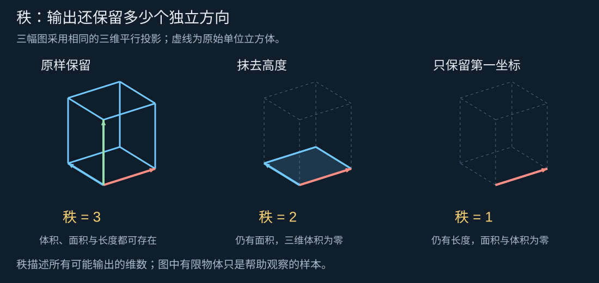
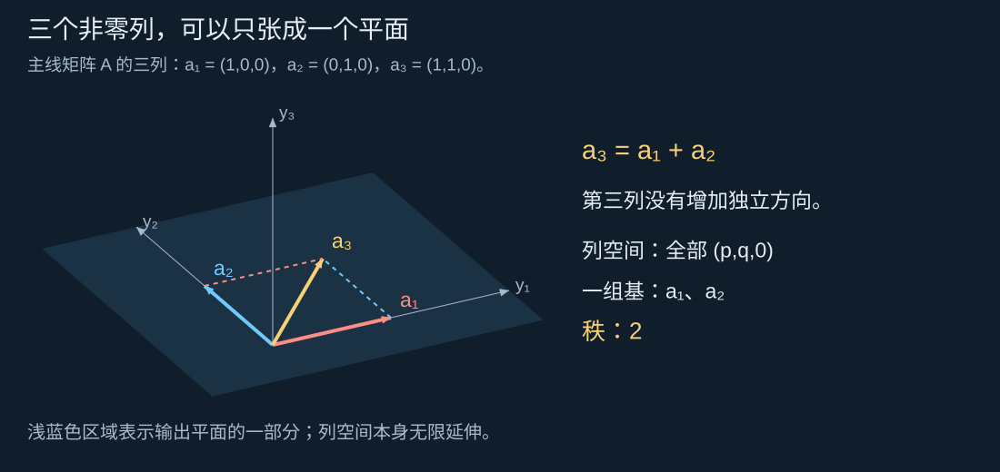
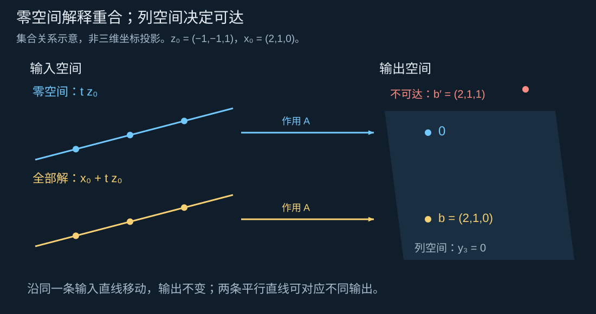
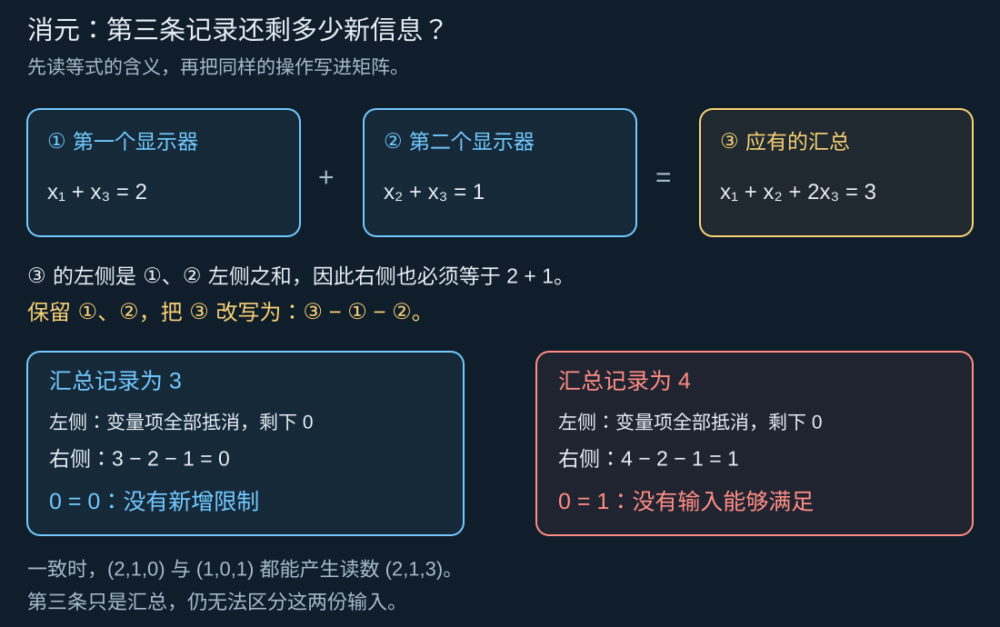
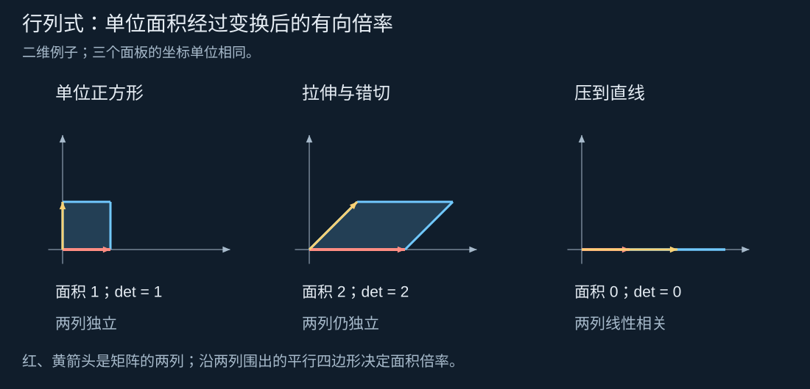

# DAY 2：压扁空间究竟丢掉了什么？｜秩、列空间、零空间、线性方程组、可逆性与行列式

[六天路线](../README.md) · [上一课：空间与线性变换](./01空间与线性变换.md)

第一课把矩阵看成一张“基本动作去向表”：每一列记录一支输入基向量的像，输入坐标决定各取几份。第二课继续沿用这个视角，但把注意力从“某个点去了哪里”转向 **哪些输出能够到达，以及哪些不同输入会变得无法区分** 。

这两个问题分别通向列空间和零空间。把它们连起来，秩、方程解的数量和可逆性就会成为同一幅空间图景的不同侧面。

建议用约 45 分钟理解前四节，50 分钟学习方程与消元，35 分钟理解可逆性和行列式，最后用 30～40 分钟做实验与思考题。秩–零化度定理的证明可在第二遍阅读时补齐。本文统一使用实数、列向量；$A\in\mathbb R^{m\times n}$ 表示 $m$ 行 $n$ 列的矩阵。

## 阅读导航

1. [从立方体变成一张薄片](#从立方体变成一张薄片)
2. [列空间与秩：能到达多少个独立方向](#列空间与秩能到达多少个独立方向)
3. [零空间：输出看不见的输入差别](#零空间输出看不见的输入差别)
4. [秩与零空间如何分配输入维数](#秩与零空间如何分配输入维数)
5. [线性方程组：从目标输出寻找输入](#线性方程组从目标输出寻找输入)
6. [消元是在揭示独立约束](#消元是在揭示独立约束)
7. [可逆性：能否唯一倒放这个变换](#可逆性能否唯一倒放这个变换)
8. [行列式：有向面积与体积的倍率](#行列式有向面积与体积的倍率)
9. [数值实验与接近压扁的空间](#数值实验与接近压扁的空间)
10. [留给你的思考题](#留给你的思考题)
11. [思考题参考答案](#思考题参考答案)

## 从立方体变成一张薄片

把一个三维模型的高度全部设为零，规则是

$$P\begin{pmatrix}x_1\\x_2\\x_3\end{pmatrix}
=\begin{pmatrix}x_1\\x_2\\0\end{pmatrix},\qquad
P=\begin{pmatrix}1&0&0\\0&1&0\\0&0&0\end{pmatrix}.$$

这里 $x_1,x_2,x_3$ 分别是输入点沿三根坐标轴的位置。变换保留前两个坐标、抹去第三个坐标。一个单位立方体变成单位正方形；原本在同一条竖直线上、只是高度不同的点，现在重合了。



图中左侧仍有三个独立方向，中间只剩两个，右侧只剩一个。右图采用 $L(x_1,x_2,x_3)=(x_1,0,0)$，又抹掉了第二个坐标。三幅图都用二维平行投影展示三维结构；屏幕上的斜角不代表实际空间夹角。

图里画的是有限大小的物体，但我们要研究的是 **所有可能输入的去向** 。对 $P$，允许输入任意实数坐标后，输出会铺满整个 $x_1x_2$ 平面，而不只是单位正方形。这个“所有输出的集合”是接下来定义列空间的起点。

## 列空间与秩：能到达多少个独立方向

取一个稍丰富的例子作为本课主线：

$$A=\begin{pmatrix}1&0&1\\0&1&1\\0&0&0\end{pmatrix},\qquad
Ax=\begin{pmatrix}x_1+x_3\\x_2+x_3\\0\end{pmatrix}.$$

与直接抹去高度的 $P$ 不同，这个变换先让第三个输入同时影响前两个输出，再把第三个输出固定为零。把输出记作 $y=Ax$，便有 $y_1=x_1+x_3$、$y_2=x_2+x_3$、$y_3=0$。

它的三列是

$$a_1=\begin{pmatrix}1\\0\\0\end{pmatrix},\quad
a_2=\begin{pmatrix}0\\1\\0\end{pmatrix},\quad
a_3=\begin{pmatrix}1\\1\\0\end{pmatrix}=a_1+a_2.$$

第三列虽然不是零，也不与前两列中的任何一列平行，但它可以由前两列组合出来，所以没有增加新的独立方向。这正是 **线性相关** ：存在一组不全为零的系数，使列向量组合成零。本例为

$$a_1+a_2-a_3=0.$$

系数 $1,1,-1$ 不全为零。一般地，判断多个向量是否独立，必须看其中是否存在这种组合关系；只检查“两两是否平行”不足以判断三个及更多向量。

第一课的列组合公式给出

$$Ax=x_1a_1+x_2a_2+x_3a_3.$$

当各个输入坐标自由变化时，右边会遍历三列的全部线性组合。这个集合叫 **列空间** ，记作

$$\operatorname{Col}(A)=\{Ax:x\in\mathbb R^3\}
=\operatorname{span}\{a_1,a_2,a_3\}.$$

$\operatorname{Col}$ 是 column space 的缩写；花括号表示一个集合；$\operatorname{span}$ 表示“所有线性组合组成的集合”。本例第三列可以由前两列得到，因此

$$\operatorname{Col}(A)=\left\{\begin{pmatrix}p\\q\\0\end{pmatrix}:p,q\in\mathbb R\right\}.$$

这里不仅是说输出位于这个平面：对平面上任意 $(p,q,0)^\top$，选输入 $(p,q,0)^\top$ 就能到达它。因此列空间恰好等于这个平面。

**矩阵的秩，就是列空间的维数。** 记号为

$$\operatorname{rank}(A)=\dim\operatorname{Col}(A).$$

$\dim$ 表示维数，即一组基包含多少个向量。本例 $a_1,a_2$ 独立且张成整个列空间，故秩为 2。直观上，秩数的是输出中仍能独立变化的方向，而不是矩阵中的数字个数、非零列数或箭头长度。



对一般的 $m\times n$ 矩阵，列向量只有 $n$ 个，且每列都在 $m$ 维输出空间中，所以

$$0\leq\operatorname{rank}(A)\leq\min(m,n).$$

秩为 0 时所有列都是零，所有输入都被送到原点。秩为 1 时非零输出只在某条过原点的直线上，但这条直线可以斜着穿过空间，并不一定是一根坐标轴。

## 零空间：输出看不见的输入差别

主线矩阵给出

$$A\begin{pmatrix}2\\1\\0\end{pmatrix}
=A\begin{pmatrix}1\\0\\1\end{pmatrix}
=\begin{pmatrix}2\\1\\0\end{pmatrix}.$$

两份输入不同，输出却相同。第二份输入相对第一份的变化量为 $(-1,-1,1)^\top$：前两个输入各减一份，第三个输入加一份。第三个输入增加的作用，恰好抵消了前两项的减少。

把这个差别送进矩阵，可以看到

$$A\begin{pmatrix}-1\\-1\\1\end{pmatrix}=0.$$

所有被送到零向量的输入构成 **零空间** ，记作

$$\operatorname{Null}(A)=\{z\in\mathbb R^n:Az=0\}.$$

这里的 $z$ 是一整个输入向量的名称，不是三维图中的第三个坐标。零空间位于输入空间 $\mathbb R^n$；列空间位于输出空间 $\mathbb R^m$。即使输入、输出维数相同，也要把这两个角色分开。

求本例的零空间，就是解

$$\begin{cases}z_1+z_3=0,\\z_2+z_3=0.\end{cases}$$

令 $z_3=t$，其中 $t$ 可取任意实数，则 $z_1=-t,z_2=-t$，得到

$$\operatorname{Null}(A)=\left\{t\begin{pmatrix}-1\\-1\\1\end{pmatrix}:t\in\mathbb R\right\}.$$

它是一条过原点的直线，维数为 1。零空间并不是“只有零向量的地方”；名称指的是其中的向量 **经过变换后** 都变为零。本例零空间里有无穷多个非零向量。

更重要的是，零空间描述的不仅是“哪些输入本身消失”，还包括“哪些输入差别无法被察觉”。由线性性，

$$Au=Av\quad\Longleftrightarrow\quad A(u-v)=0
\quad\Longleftrightarrow\quad u-v\in\operatorname{Null}(A).$$

这里 $\Longleftrightarrow$ 表示两边互相推出。两个输入得到相同输出，恰好等价于它们的差落在零空间中。因此从任意输入 $x$ 出发，沿任意零空间方向 $z$ 移动，都有

$$A(x+z)=Ax+Az=Ax.$$

对于前面的简单压扁矩阵 $P$，看不见的是竖直方向；对于现在的 $A$，看不见的是斜方向 $(-1,-1,1)^\top$。 **输出被限制在同一个平面，不代表它们丢掉了相同的输入方向。**

## 秩与零空间如何分配输入维数

本例有 3 个输入坐标，输出保留 2 个独立方向，另有 1 个独立方向的输入变化不可见。它们满足

$$\operatorname{rank}(A)+\dim\operatorname{Null}(A)=3.$$

这个关系可以推广到任意实矩阵 $A\in\mathbb R^{m\times n}$：

$$\boxed{\operatorname{rank}(A)+\dim\operatorname{Null}(A)=n.}$$

这叫 **秩–零化度定理** 。零化度就是零空间的维数；右侧的 $n$ 是输入维数，也就是列数，不是输出维数。

一种直观读法是：输入中的独立变化，一部分能够在输出中被区分，另一部分会落入零空间而消失。这里的“信息”指线性映射能否区分输入差别，不是文件大小或比特数。这个等式也不是把两个集合相加：两个维数可以相加，列空间与零空间本身通常位于不同的空间。

### 从一组输入基看出这个关系（第二遍选读）

前面的例子里，3 个输入方向中有 1 个方向被压成零，输出的秩恰好是 2。要证明这不是巧合，需要说明： **如果零空间占了 $k$ 个独立方向，为什么输出恰好剩下 $n-k$ 个独立方向，而不会再少？**

秩数的是列空间中一组基的向量个数。因此，这段证明的任务是找到一组输出向量，并确认两件事：它们能组合出所有输出；它们之间没有多余、重复的方向。我们会先在输入空间挑选合适的基，再跟踪这些基向量的去向。

#### 先把会消失的方向放进输入基

沿用本课的矩阵

$$A=\begin{pmatrix}1&0&1\\0&1&1\\0&0&0\end{pmatrix}.$$

已经知道，零空间是一条沿 $z=(-1,-1,1)^\top$ 的直线。也就是说，所有会被送到零的输入都能写成 $tz$。为了把这种“消失”看得清楚，可以直接把 $z$ 选作输入基中的一支向量，再补上

$$v_1=\begin{pmatrix}1\\0\\0\end{pmatrix},\qquad
v_2=\begin{pmatrix}0\\1\\0\end{pmatrix}.$$

这三支箭头能表示任意输入，而且表示方式唯一。具体地，对任意 $x=(x_1,x_2,x_3)^\top$，都有

$$x=x_3z+(x_1+x_3)v_1+(x_2+x_3)v_2.$$

可以逐坐标核对：第三个坐标先确定 $z$ 的份数必须是 $x_3$，再由前两个坐标分别确定 $v_1,v_2$ 的份数。因此 $z,v_1,v_2$ 确实构成一组输入基。

这样选基没有改变变换 $A$，只是把描述输入的方式调整为“沿消失方向取几份，再沿另外两个方向各取几份”。这比直接盯着三个标准坐标，更容易看见哪些部分会在变换后消失。

#### 跟踪这组基，就能找到输出基的候选

把上面的输入表达式送进 $A$，利用线性性：

$$Ax=x_3Az+(x_1+x_3)Av_1+(x_2+x_3)Av_2.$$

其中 $Az=0$，于是

$$Ax=(x_1+x_3)Av_1+(x_2+x_3)Av_2.$$

这说明 **所有输出都能由 $Av_1,Av_2$ 组合出来** 。沿 $z$ 的那份输入已经消失，不需要用它来描述输出。

在这个具体例子中，$Av_1=(1,0,0)^\top$、$Av_2=(0,1,0)^\top$，显然是输出平面的一组基，所以秩为 2。不过，要把这个思路推广到任意矩阵，还需要弄清一个关键环节：补入的输入方向经过变换后，为何不会再次彼此抵消？

仅仅说“$v_1,v_2$ 在输入中独立”还不够。一般的线性变换可能把独立箭头压到同一方向；这里真正有用的是： **输入基已经包含了零空间的全部独立方向** 。

#### 用坐标唯一性排除输出中的冗余

为了检查 $Av_1,Av_2$ 是否独立，尝试用系数 $c_1,c_2$ 把它们组合成零：

$$c_1Av_1+c_2Av_2=0.$$

我们要证明，只有 $c_1=c_2=0$ 才能做到。把线性性反向使用，上式变成

$$A(c_1v_1+c_2v_2)=0.$$

把括号里的整个输入向量暂记作 $w=c_1v_1+c_2v_2$。现在知道 $Aw=0$，所以 $w$ 属于零空间。零空间由 $z$ 张成，因此存在一个系数 $d$，使 $w=dz$。

同一个 $w$ 于是有了两种写法：

$$w=0z+c_1v_1+c_2v_2=dz+0v_1+0v_2.$$

在同一组输入基 $z,v_1,v_2$ 下，这两种写法的坐标分别为

$$(0,c_1,c_2)^\top\quad\text{与}\quad(d,0,0)^\top.$$

**一组基下的坐标必须唯一** ，所以逐项比较得到 $d=0,c_1=0,c_2=0$。这就排除了输出向量之间的非零抵消关系，证明了 $Av_1,Av_2$ 线性无关。

几何上，本例中 $v_1,v_2$ 张成水平面，零空间是斜着穿过原点的直线，两者只有原点重合。刚才的 $w$ 既由 $v_1,v_2$ 组合得到，又属于零空间，因此只能是零向量。坐标唯一性的推理，把这个图像表达成了可以推广的证明。

#### 从三维例子推广到 $n$ 维

现在保留同样的步骤，只把方向的数量换成一般符号。输入空间有 $n$ 维，零空间有 $k$ 维，因此可以用 $k$ 支基向量 $z_1,\ldots,z_k$ 描述所有会消失的输入。

先保留这 $k$ 支向量，再逐个补入不在已有张成空间里的向量，直到构成整个输入空间的一组基。完整基需要 $n$ 支，所以恰好要补入 $n-k$ 支，记为 $v_1,\ldots,v_{n-k}$：

$$\underbrace{z_1,\ldots,z_k}_{\text{零空间的基}},\qquad
\underbrace{v_1,\ldots,v_{n-k}}_{\text{补入的输入方向}}.$$

这里用到的是有限维空间的基扩充性质：一组线性无关的向量可以继续补充，直到成为整个空间的基。

接下来仍检查输出基需要的两件事。

**第一，能够组合出所有输出。** 任意输入都能由这组完整基表示；经过 $A$ 后，每个 $Az_i$ 都为零。因此所有输出都能由 $Av_1,\ldots,Av_{n-k}$ 组合出来。

**第二，这些输出向量之间没有冗余。** 假如某组系数满足

$$c_1Av_1+\cdots+c_{n-k}Av_{n-k}=0,$$

就把对应的输入组合记作

$$w=c_1v_1+\cdots+c_{n-k}v_{n-k}.$$

线性性给出 $Aw=0$，所以 $w$ 属于零空间，必能写成

$$w=d_1z_1+\cdots+d_kz_k.$$

在完整输入基下，第一种写法的 $z_i$ 系数全为零，第二种写法的 $v_j$ 系数全为零。同一向量的坐标唯一，迫使所有 $c_j,d_i$ 都为零。因此 $Av_1,\ldots,Av_{n-k}$ 线性无关。

这 $n-k$ 支输出向量既能张成列空间，又线性无关，便构成列空间的一组基。按秩的定义，

$$\operatorname{rank}(A)=n-k
=n-\dim\operatorname{Null}(A).$$

至此，前面的“输入维数分成保留与消失两部分”有了完整理由：先把所有消失方向纳入输入基，剩余基向量的像就恰好组成输出基。这种补法不唯一，也不要求补入的方向与零空间垂直；证明依靠的是完整基的独立性与坐标唯一性。

## 线性方程组：从目标输出寻找输入

前面给输入算输出；方程 $Ax=b$ 则反过来给定目标 $b$，寻找能到达它的输入 $x$。$A$ 和 $b$ 已知，$x$ 未知。

先用主线矩阵尝试目标 $b=(2,1,0)^\top$：

$$\begin{pmatrix}1&0&1\\0&1&1\\0&0&0\end{pmatrix}
\begin{pmatrix}x_1\\x_2\\x_3\end{pmatrix}
=\begin{pmatrix}2\\1\\0\end{pmatrix}.$$

逐行展开是 $x_1+x_3=2$、$x_2+x_3=1$，以及恒成立的 $0=0$。选 $x_3=t$ 后，全部解为

$$x=\begin{pmatrix}2-t\\1-t\\t\end{pmatrix}
=\underbrace{\begin{pmatrix}2\\1\\0\end{pmatrix}}_{\text{一个特解 }x_0}
+t\underbrace{\begin{pmatrix}-1\\-1\\1\end{pmatrix}}_{\text{零空间方向}}.$$

“特解”只表示其中一个确定的解，不表示它比其他解更好。这个目标对应的全部输入是一条过 $x_0$ 的直线；它与零空间直线平行，却不经过原点。



对任意矩阵，这个结构都成立。若 $x_0$ 已经满足 $Ax_0=b$：

- 任取 $z\in\operatorname{Null}(A)$，就有 $A(x_0+z)=b$，所以“特解加零空间向量”都是解。
- 任取另一个解 $x$，就有 $A(x-x_0)=0$，所以它与特解的差一定属于零空间。

两步合起来，全部解恰好是

$$\{x:Ax=b\}=x_0+\operatorname{Null}(A).$$

右边表示把零空间这个集合整体平移到 $x_0$。当 $b\ne0$ 时，它不是线性子空间，因为不含零向量；它是一个仿射集合，与第一课“线性部分加平移”的想法相接。

再把目标改成 $b=(2,1,1)^\top$，第三行就要求 $0=1$，无解。几何上，目标离开了列空间所在的平面，任何输入都不可能到达。

因此判断解的结构只需要两个问题：

| 条件 | 对 $Ax=b$ 的结论 | 空间解释 |
| --- | --- | --- |
| $b\notin\operatorname{Col}(A)$ | 无解 | 目标不在可达集合中 |
| $b\in\operatorname{Col}(A)$ 且 $\operatorname{Null}(A)=\{0\}$ | 唯一解 | 可达，且不同输入不会重合 |
| $b\in\operatorname{Col}(A)$ 且零空间维数大于 0 | 无穷多解 | 有解后，可沿不可见方向任意移动 |

在实数域上的线性方程组不会恰好有两个解：若 $u\ne v$ 都是解，那么 $u+t(v-u)$ 对任意实数 $t$ 都是解。注意 **非零零空间只说明“有解时不唯一”，并不保证每个目标都有解** 。

## 消元是在揭示独立约束

前面用列空间判断目标能否到达，用零空间描述同一输出背后的不同输入。实际解方程时，我们还需要一种计算方法，把这些关系从一堆数字里找出来。 **消元的目的，就是把方程改写成更容易读懂、但答案完全相同的形式。**

这一节从三个读数开始：先辨认哪些读数重复，再找出还能自由调整的输入，最后把这个过程写成矩阵运算。

### 三条记录不一定提供三份独立信息

想象有三个可调节的校准量 $x_1,x_2,x_3$，它们使用相同单位，允许取正值、零和负值。两个显示器分别报告 $x_1+x_3$ 和 $x_2+x_3$，另有一张汇总表，把这两个显示值相加。现在记录到：

$$\begin{aligned}
\text{①}\quad x_1+x_3&=2,\\
\text{②}\quad x_2+x_3&=1,\\
\text{③}\quad x_1+x_2+2x_3&=3.
\end{aligned}$$

每条方程都是一条 **约束** ：它排除不符合读数的输入。例如①要求 $x_1$ 与 $x_3$ 的和为 2，排除了两者之和为 5 的输入。

但③的左边恰好是①、②左边的和，右边也恰好是 $2+1=3$。因此，一旦满足①和②，③就自动成立。第三条没有进一步缩小候选输入的范围；它是一条 **冗余约束** 。



此时三个输入还不能唯一确定。例如 $(2,1,0)^\top$、$(1,0,1)^\top$ 都满足全部三条记录。更一般地，让第三个输入取任意值 $x_3=t$，前两个显示值便要求

$$x_1=2-t,\qquad x_2=1-t.$$

因此全部可行输入为 $(2-t,1-t,t)^\top$。增加 $x_3$ 时，同时减少 $x_1,x_2$，两个显示值都不变，汇总值自然也不变。

这与前面看到的解直线一致：第一条非平凡方程在三维输入空间中留下一个平面，第二条把候选集合进一步限制到一条直线，而本例的第三条平面包含整条解直线，未能继续缩小它。这里“独立约束”的含义就是：它带来了不能从已有方程推出的新限制。

### 从第三条中减去已经知道的信息

把③中的①和②减掉，能直接显示第三条还剩什么内容。这个操作必须在等号两边同时进行：

$$\begin{aligned}
&(x_1+x_2+2x_3)-(x_1+x_3)-(x_2+x_3)\\
&\qquad=3-2-1,
\end{aligned}$$

化简后得到 $0=0$。它不是要求“所有未知量都等于零”，而是对所有输入都成立，已经不再限制任何未知量。

所以原来的三条方程可以改写为

$$\begin{cases}
x_1+x_3=2,\\
x_2+x_3=1,\\
0=0.
\end{cases}$$

这个改写没有丢掉求解所需的信息。我们保留了①、②，只把③换成“③减①减②”；若把①、②重新加回新第三条，就能恢复原来的③。 **操作能够撤销，因此改写前后允许的输入完全相同。**

如果汇总记录写成了 4，而前两个显示值仍为 2 和 1，同一个操作就会给出

$$0=4-2-1=1.$$

这次留下的是 $0=1$，任何输入都不可能满足。它说明三条记录互相矛盾，并不表示应该把某个未知量设为 1。消元于是区分了两种情况：$0=0$ 暴露重复信息，$0=1$ 暴露不一致信息。

### 增广矩阵只是方程的紧凑记录表

上面的计算已经完成了消元的核心动作。为了在更大的方程组中方便操作，可以暂时不重复写 $x_1,x_2,x_3$，只按固定顺序记录它们的系数和等号右边的数：

| 方程 | $x_1$ 的系数 | $x_2$ 的系数 | $x_3$ 的系数 | 等号右边 |
| --- | --- | --- | --- | --- |
| ① | 1 | 0 | 1 | 2 |
| ② | 0 | 1 | 1 | 1 |
| ③ | 1 | 1 | 2 | 3 |

前三列组成系数矩阵 $B$，最后一列组成目标向量 $b$：

$$B=\begin{pmatrix}1&0&1\\0&1&1\\1&1&2\end{pmatrix},\qquad
b=\begin{pmatrix}2\\1\\3\end{pmatrix}.$$

将它们并排放在一起，便是 **增广矩阵** $[B\mid b]$。竖线把“未知量的系数”和“已知目标”隔开；右边这列不是第四个未知量。

刚才的“③减①减②”，现在可以逐格计算：

$$[1,1,2\mid3]-[1,0,1\mid2]-[0,1,1\mid1]=[0,0,0\mid0].$$

整个记录表随之变为

$$\left[\begin{array}{ccc|c}1&0&1&2\\0&1&1&1\\1&1&2&3\end{array}\right]
\longrightarrow
\left[\begin{array}{ccc|c}1&0&1&2\\0&1&1&1\\0&0&0&0\end{array}\right].$$

这就是一次 **行变换** ：每一行代表一条等式，对整行操作就相当于对等式两边一起操作。如果只减左边三个系数、不动右端，就会把原来的③错写成 $0=3$，制造一个原本不存在的矛盾。

常用行变换有三种，每一种都有明确的反向操作：

| 操作 | 对方程的含义 | 如何撤销 |
| --- | --- | --- |
| 交换两行 | 调换两条方程的顺序 | 再交换一次 |
| 一行乘非零数 $c$ | 等号两边同时乘 $c$ | 再除以 $c$ |
| 一行加上另一行的 $c$ 倍 | 用已知等式改写这条等式 | 再减去同样的 $c$ 倍 |

乘数不能为零：把一条方程整体乘零，会把它变成 $0=0$，原来的约束就无法恢复。消元只使用可撤销的操作，并始终连同右端一起处理。

### 主元与自由变量：从改写后的方程读出分工

消元后的前两行已经很容易求解：第一行给出 $x_1=2-x_3$，第二行给出 $x_2=1-x_3$，最后一行不再提出要求。因此可以先任意选择 $x_3$，再算出 $x_1,x_2$。

在这种求解方式中，$x_3$ 叫 **自由变量** ；$x_1,x_2$ 则由它和右端确定。自由并不表示改变 $x_3$ 时可以把另外两个输入固定住，而是说选定 $x_3$ 后，其他变量可以相应调整，使方程继续成立。

为了在一般方程组中读出同样的分工，消元会把系数整理成 **阶梯形** ：非零行放在零行上方，每行最左侧的非零位置比上一行更靠右。这个领先的非零数称为 **主元** ，所在列称为主元列。本例的系数部分为

$$\begin{pmatrix}
\boxed{1}&0&1\\
0&\boxed{1}&1\\
0&0&0
\end{pmatrix}.$$

两个主元分别在第 1、2 列，对应优先求出的 $x_1,x_2$。第 3 列没有主元，所以 $x_3$ 可以作为自由变量。它的系数并不全为零；“自由”指的是没有额外一行把它也独立确定下来。

同一条解直线也可以改用其他参数描述。这里选 $x_3$，是因为当前消元形式下它最方便；真正不随写法改变的是 **自由度的数量** 。

在一般的阶梯形方程组中，可以从最后一个非零行向上回代：每个主元变量都能由自由变量和右端算出。若有 $n$ 个未知量、$p$ 个主元，并且方程一致，就剩 $n-p$ 个自由变量。

这也解释了 **主元数为什么等于秩** 。把右端取为零来求零空间，每个自由变量都可以独立选择，而主元变量由它们确定，将自由变量依次取为“一个为 1、其余为 0”，就得到零空间的一组基，共 $n-p$ 支，因此零空间维数为 $n-p$。代入前面已经证明的秩–零化度定理：

$$\operatorname{rank}(B)=n-\dim\operatorname{Null}(B)=n-(n-p)=p.$$

本例 $n=3,p=2$，所以秩为 2。原矩阵虽然有三行非零行，但第三行是重复约束，不能直接据此把秩数成 3；要在整理成阶梯形以后，数主元或非零行。

### 把一致性判断接回列空间

现在可以把“重复”和“矛盾”与前面的空间图景连起来。系数矩阵 $B$ 的所有输出都满足 $y_3=y_1+y_2$，所以列空间是三维输出空间中的这个斜平面。

目标 $b=(2,1,3)^\top$ 在平面上，因此可达。把它作为新的一列附到 $B$ 后，它已经能由原列组合出来，不会增加独立方向，故

$$\operatorname{rank}([B\mid b])=\operatorname{rank}(B)=2.$$

目标 $\widetilde b=(2,1,4)^\top$ 不在这个平面上，附加这一列就增加一个独立方向。因此

$$\operatorname{rank}([B\mid\widetilde b])=3>\operatorname{rank}(B)=2.$$

计算中出现的 $[0\;0\;0\mid1]$，正是这份不一致性的代数表现。它在增广矩阵中形成一个新主元，却落在右端列，而不是未知量的系数列。

推广到任意 $A$ 与目标 $b$，便得到

$$Ax=b\text{ 有解}\quad\Longleftrightarrow\quad
\operatorname{rank}([A\mid b])=\operatorname{rank}(A).$$

这条判据是在数： **目标这一列有没有超出原来的可达空间** 。先确认有解，再看系数部分的主元数是否等于未知量个数，才能继续判断唯一解或无穷多解。

### 行变换保留解，却不一定保留列空间的朝向（进一步阅读）

本例行变换以后，系数矩阵恰好变成前文的 $A$：

$$B=\begin{pmatrix}1&0&1\\0&1&1\\1&1&2\end{pmatrix}
\longrightarrow
A=\begin{pmatrix}1&0&1\\0&1&1\\0&0&0\end{pmatrix}.$$

这一步也可以理解为重新组织输出记录。原来第三个输出是汇总值 $y_3$；现在把它改记成“汇总值减去两个显示值”，即 $y_3-y_1-y_2$。前两个记录保留，因此仍能恢复原汇总值。

在原记录方式下，可达输出满足 $y_3=y_1+y_2$；在新记录方式下，第三个输出恒为零。两个输出平面朝向不同，但都只有两个独立方向。对应的右端也从 $(2,1,3)^\top$ 变为 $(2,1,0)^\top$，原未知输入的解集合保持不变。

用矩阵表达，这种输出重组是左乘一个可逆矩阵 $E$，所以新矩阵为 $EB$。若原列之间存在关系 $\sum_j c_jb_j=0$，重组后的列也满足 $\sum_jc_jEb_j=0$；反过来可以乘 $E^{-1}$ 恢复。因此列之间的独立或依赖关系、以及秩都不改变，但各列的具体坐标可能改变。

所以若要借助消元找 **原矩阵列空间的一组基** ，应记住主元所在的列号，再回原矩阵取相应列。本例列号是 1、2，取的是 $B$ 的 $(1,0,1)^\top,(0,1,1)^\top$，而不是消元后 $A$ 的 $(1,0,0)^\top,(0,1,0)^\top$。后两支箭头描述的是重组记录后的另一个输出平面。

回到两个显示器与汇总表：重复记录不会额外确定输入，不一致记录则会让精确求解失败。第三课将在这个基础上讨论带噪声的读数，寻找与这些记录最接近的可达输出。

## 可逆性：能否唯一倒放这个变换

矩阵可逆意味着存在一个矩阵，能够把整个变换完整撤销。对 $n\times n$ 方阵 $A$，逆矩阵 $A^{-1}$ 满足

$$A^{-1}A=AA^{-1}=I.$$

它同时需要两件事：输出空间中的每个目标都可达；不同输入不会被混成同一个输出。前者对应列空间覆盖整个输出空间，后者对应零空间只有零向量。

对方阵，这两件事由同一个条件保证：$\operatorname{rank}(A)=n$。于是

$$A\text{ 可逆}\ \Longleftrightarrow\ \operatorname{rank}(A)=n
\ \Longleftrightarrow\ \operatorname{Null}(A)=\{0\}.$$

此时每个 $b\in\mathbb R^n$ 都恰好有一个解 $x=A^{-1}b$。例如 $S=\operatorname{diag}(2,1,1)$ 表示沿第一轴拉长两倍，其逆矩阵为 $\operatorname{diag}(1/2,1,1)$，把长度缩回去。$\operatorname{diag}$ 表示把括号中的数放在对角线上，其余元素为零。

压扁矩阵 $P$ 则无法倒放。它把 $(0,0,0)^\top$ 与 $(0,0,1)^\top$ 都送到零；仅从输出零，无法知道该恢复哪个输入。即使人为补一个高度，也只是选了一个可能输入，不能称为恢复了原输入。

### 非方阵要分开看“可达”与“唯一”

若 $A$ 有 $m$ 行 $n$ 列：

- **满列秩** 指秩为 $n$，列向量全部独立。零空间为 $\{0\}$，所以对每个可达目标，解唯一；但未必每个 $m$ 维目标都可达。
- **满行秩** 指秩为 $m$，输出空间全部可达。若 $n>m$，零空间维数为 $n-m>0$，所以每个目标都有无穷多解。

第一课的 $M=\begin{pmatrix}1&0\\0&1\\1&1\end{pmatrix}$ 是满列秩的 $3\times2$ 矩阵。它把 $(a,b)^\top$ 送到 $(a,b,a+b)^\top$，没有混淆任何两个输入，但只能到达 $y_3=y_1+y_2$ 的平面。

相反，$N=\begin{pmatrix}1&0&0\\0&1&0\end{pmatrix}$ 是满行秩的 $2\times3$ 矩阵。任意二维目标都能到达，但第三个输入随意变化都不影响输出。

因此“输入输出维数不同”并不自动意味着信息丢失；要看输入差别是否进入零空间。非方阵没有这里所说的两侧逆矩阵，左逆、右逆及伪逆的用途留到后续展开。

## 行列式：有向面积与体积的倍率

秩告诉我们输出有多少个独立方向，但不告诉我们物体被放大了多少。对方阵，行列式补充了这一尺度信息。

在二维中，单位正方形的两条边是 $e_1,e_2$。经过矩阵 $C$ 后，两条边成为它的两列，正方形变成平行四边形。若

$$C=\begin{pmatrix}a&b\\c&d\end{pmatrix},$$

新边是 $(a,c)^\top$ 与 $(b,d)^\top$，它们围成的 **有向面积** 为 $ad-bc$；这个数就是 $\det(C)$。绝对值表示面积倍率，符号表示是否翻转了有序基的朝向。三维中，相应的是有向体积倍率。



例如第一课的矩阵 $C=\begin{pmatrix}2&1\\0&1\end{pmatrix}$，两列为 $(2,0)^\top,(1,1)^\top$。平行四边形的底是 2、高是 1，所以面积是 2；公式也给出 $\det(C)=2\cdot1-1\cdot0=2$。

若两列落到同一条直线上，平行四边形被压扁，面积为零。例如 $D=\begin{pmatrix}1&2\\0&0\end{pmatrix}$ 的秩为 1，行列式为 0。三维中，立方体被压成平面或直线时，三维体积同样为零；平面仍可能有非零面积，但已不保留三维体积。

对 $n\times n$ 方阵，一般结论是

$$\det(A)\ne0\ \Longleftrightarrow\ \operatorname{rank}(A)=n
\ \Longleftrightarrow\ A\text{ 可逆}.$$

本课用二维面积、三维体积建立直觉；一般维度的行列式理论不在这里完整展开。要特别区分：

| 信息 | 能说明什么 | 不能说明什么 |
| --- | --- | --- |
| $\det(A)=0$ | 方阵未满秩，不可逆 | 不能据此得出秩一定是 0，或分清压到平面还是直线 |
| $\det(A)<0$ | 有向体积的朝向翻转 | 不代表“负体积”，也不代表不可逆 |
| $\lvert\det(A)\rvert=1$ | 总体积保持 | 不保证每个方向长度不变，例如 $\operatorname{diag}(2,1/2)$ |

普通行列式只对方阵定义。面对 $3\times2$ 这样的矩阵，仍可以讨论秩、列空间、零空间，不需要硬套一个行列式。

## 数值实验与接近压扁的空间

数学上，“压得很薄”与“完全压扁”不同。考虑

$$A_\varepsilon=\begin{pmatrix}1&0&0\\0&1&0\\0&0&\varepsilon\end{pmatrix},\qquad\varepsilon\geq0.$$

参数 $\varepsilon$ 是第三个方向的缩放倍数。$\varepsilon=0$ 时高度彻底丢失，秩为 2；只要 $\varepsilon>0$，再薄也保留三个独立方向，精确秩仍为 3。

但从输出倒推高度，需要 $x_3=y_3/\varepsilon$。当 $\varepsilon=10^{-6}$ 时，输出第三坐标中 $10^{-6}$ 的误差，会被放大成输入高度中 1 的误差。因而可逆并不自动意味着容易准确恢复。

工程计算会根据精度和数据噪声判断某些方向是否“太小而无法可靠区分”，这涉及 **数值秩** 。它依赖容差和尺度，不能和精确秩混为一谈；第四课的奇异值分解会提供更合适的判断工具。也不能仅凭行列式很小就判定病态：例如 $\varepsilon I$ 各方向同比缩小，其相对误差表现不同于只压缩一个方向。

打开 [第二课实验脚本](../codes/02_rank_experiment.py)，在专题根目录运行：

```sh
python3 codes/02_rank_experiment.py
```

脚本仅使用 Python 标准库，以有理数消元核对精确秩，展示：主线矩阵的秩为 2；沿零空间方向移动保持输出不变；读数一致和不一致时增广矩阵秩不同；$\varepsilon=0$ 与 $\varepsilon=1/1000000$ 的精确秩分别为 2、3。它不使用容差判断数值秩，也不代替前面的证明。

## 留给你的思考题

先写出空间判断，再算公式；回答中尽量说明“输入空间里的方向”和“输出空间里的方向”各指什么。参考答案附在[本章末尾](#思考题参考答案)，可先在下面作答，再对照理解与推导。

### 1．三列都非零，为什么不一定是秩 3

设 $C=\begin{pmatrix}1&0&1\\0&1&1\\1&1&2\end{pmatrix}$。找出三列之间的关系，给出列空间的一组基及它所在平面的方程。求零空间，检查秩–零化度定理。只看三列两两不平行，为什么仍不足以判断独立？

我的回答：

### 2．同样被压到平面，丢掉的方向相同吗

比较正文的 $P=\operatorname{diag}(1,1,0)$ 与主线矩阵 $A$。分别找一个非零零空间向量，并解释两者列空间相同、零空间不同的含义。输入 $(0,0,1)^\top$ 在两种变换下分别去了哪里？

我的回答：

### 3．目标能不能到达，到达以后有几个来源

对正文主线矩阵 $A$，分别讨论 $b_1=(3,-1,0)^\top$、$b_2=(3,-1,2)^\top$、$b_3=0$。有解的写出全部解；无解的同时给出代数理由和几何理由。哪些解集合经过原点？

我的回答：

### 4．第三个传感器是否增加了独立信息

理想读数为 $y_1=x_1+x_3$、$y_2=x_2+x_3$、$y_3=y_1+y_2$。先用秩解释第三条记录的冗余。若把第三条改成直接测量 $y_3=x_3$，写出新的矩阵，判断能否唯一恢复三个输入，并推导恢复公式。只讨论理想模型，不假设实际测量无噪声。

我的回答：

### 5．行列式为零，究竟知道了多少

分别求 $\operatorname{diag}(1,1,0)$、$\operatorname{diag}(1,0,0)$、零矩阵的秩与行列式，描述单位立方体的像。再考察 $\operatorname{diag}(-1,1,1)$：负行列式意味着什么，能否恢复输入？

我的回答：

### 6．二维到三维，真的创造了第三份自由信息吗

对 $M=\begin{pmatrix}1&0\\0&1\\1&1\end{pmatrix}$，判断 $(2,3,5)^\top$ 与 $(2,3,6)^\top$ 是否可达。有解时是否唯一？分别求秩和零空间维数，说明“输出有三个坐标”与“输出有三个独立方向”的区别。

我的回答：

### 7．一百万分之一与零之间

设输出来自 $A_\varepsilon$，第三坐标存在绝对误差 $10^{-6}$。比较 $\varepsilon=1$、$10^{-3}$、$10^{-6}$、$0$ 时的精确秩，以及恢复输入第三坐标的误差或不可恢复性。为什么“可逆”还不足以结束工程判断？

我的回答：

### 用自己的话串起来

试着用三句话解释：秩数什么；零空间藏着什么；它们怎样共同决定 $Ax=b$ 的解。再指出本课哪个例子最能帮助你区分“多一个数”与“多一个独立方向”。

我的复述：

## 思考题参考答案

以下解答与题目逐一对应：先说明要判断的空间关系，再用计算把判断落实。原来的“我的回答”保留，便于记录自己的理解与尚未想通的地方。各题沿用题目中的矩阵名称；向量均使用标准坐标。

### 第 1 题：第三列有三个数，却没有增加独立方向

先看每个输入方向会被送到哪里。本题矩阵的三列为

$$c_1=\begin{pmatrix}1\\0\\1\end{pmatrix},\qquad
c_2=\begin{pmatrix}0\\1\\1\end{pmatrix},\qquad
c_3=\begin{pmatrix}1\\1\\2\end{pmatrix}.$$

第三支箭头恰好是前两支首尾相接的结果：$c_3=c_1+c_2$。因此，沿第三个输入轴走一步所产生的输出，也可以靠沿前两个输入轴各走一步得到。它没有提供前两列组合不出来的新方向。

要确认秩恰好为 2，还要检查前两列确实独立。若

$$\alpha c_1+\beta c_2
=\begin{pmatrix}\alpha\\\beta\\\alpha+\beta\end{pmatrix}=0,$$

第一、第二坐标分别要求 $\alpha=0$、$\beta=0$。所以 $c_1,c_2$ 线性无关，又能组合出全部三列，便是列空间的一组基：

$$\operatorname{Col}(C)=\operatorname{span}\{c_1,c_2\},\qquad
\operatorname{rank}(C)=2.$$

把任意输出写成 $y=\alpha c_1+\beta c_2=(\alpha,\beta,\alpha+\beta)^\top$，可以读出它所在平面的方程：

$$y_3=y_1+y_2.$$

反过来，平面上任意一点 $(p,q,p+q)^\top$ 都等于 $pc_1+qc_2$。所以列空间铺满这个平面，而不只是落在它里面的一部分。

接下来找输入中哪些变化会消失，也就是解 $Cz=0$：

$$\begin{cases}
z_1+z_3=0,\\
z_2+z_3=0,\\
z_1+z_2+2z_3=0.
\end{cases}$$

第三式是前两式之和，没有增加限制。先任意选择 $z_3=t$，前两式就确定 $z_1=-t,z_2=-t$，于是

$$\operatorname{Null}(C)
=\left\{t\begin{pmatrix}-1\\-1\\1\end{pmatrix}:t\in\mathbb R\right\}.$$

这里三个坐标不能各自随便选：选定一个 $t$，三个数就全部确定。所有向量只沿同一条直线伸缩；非零向量 $(-1,-1,1)^\top$ 单独就构成一组基。因此零空间维数为 1，秩–零化度关系为 $2+1=3$。

三列两两都不平行，只能排除“某一列是另一列的倍数”。 **三支箭头是否独立，还必须检查一支是否能由另外两支共同组合出来。** 本题的 $c_3=c_1+c_2$ 正是这种情况。相关关系也可写成 $c_1+c_2-c_3=0$；这里相加的是加权后的向量，不是把三个系数单独相加。

### 第 2 题：相同的输出平面，可以隐藏不同的输入差别

先把两个规则并排写出来：

$$Px=\begin{pmatrix}x_1\\x_2\\0\end{pmatrix},\qquad
Ax=\begin{pmatrix}x_1+x_3\\x_2+x_3\\0\end{pmatrix}.$$

它们的第三个输出坐标都为零，而且对任意 $(p,q,0)^\top$，输入 $(p,q,0)^\top$ 在两种规则下都能到达。因此两者列空间相同，都是整个 $y_3=0$ 平面，秩也同为 2。

区别出现在输入空间。对于 $P$，要求输出为零，只需要 $x_1=x_2=0$，第三个坐标任意，所以

$$\operatorname{Null}(P)
=\left\{t\begin{pmatrix}0\\0\\1\end{pmatrix}:t\in\mathbb R\right\}.$$

对于 $A$，要求 $x_1+x_3=x_2+x_3=0$，所以

$$\operatorname{Null}(A)
=\left\{t\begin{pmatrix}-1\\-1\\1\end{pmatrix}:t\in\mathbb R\right\}.$$

这两条直线各自只有一个独立方向，但方向不同。$P$ 看不见的是单独改变高度；$A$ 看不见的是第三个输入增加时，前两个输入同步减少的组合变化。

题目给出的输入 $e_3=(0,0,1)^\top$ 正好能显示差别：

$$Pe_3=0,\qquad Ae_3=\begin{pmatrix}1\\1\\0\end{pmatrix}.$$

在 $A$ 中，第三个输入并没有被简单删除，它先影响了前两个输出。必须再用 $(-1,-1,0)^\top$ 的输入变化抵消这份影响，才会得到不可见方向 $(-1,-1,1)^\top$。

因此， **列空间回答“能到哪些地方”，零空间回答“哪些输入差别看不出来”** 。同一个可达平面，并不能告诉我们究竟把哪些输入混在了一起。

### 第 3 题：先检查目标所在的位置，再找全部来源

本题的输出规则是

$$Ax=\begin{pmatrix}x_1+x_3\\x_2+x_3\\0\end{pmatrix}.$$

因此可达目标必须满足第三坐标为零。对于可达目标，再用前两行确定输入之间的关系。

对于 $b_1=(3,-1,0)^\top$，方程为

$$x_1+x_3=3,\qquad x_2+x_3=-1.$$

第三个输入可以自由取值。令 $x_3=t$，便得到全部解：

$$x=\begin{pmatrix}3-t\\-1-t\\t\end{pmatrix}
=\begin{pmatrix}3\\-1\\0\end{pmatrix}
+t\begin{pmatrix}-1\\-1\\1\end{pmatrix},\qquad t\in\mathbb R.$$

代入可以核对：第一坐标输出为 $(3-t)+t=3$，第二坐标输出为 $(-1-t)+t=-1$。反过来，任何解都有某个第三坐标 $t$，其余两个坐标必须按上式取值，所以这个表达式没有漏掉解。

几何上，这是一条经过 $(3,-1,0)^\top$、平行于零空间的输入直线。整条线都被送到同一个输出 $b_1$。它不经过输入原点，因为 $A0=0\ne b_1$。

对于 $b_2=(3,-1,2)^\top$，第三行要求 $0=2$，因此无解。几何上，$b_2$ 位于可达平面 $y_3=0$ 之外，任何输入都无法到达它；前两个坐标能匹配，也不能弥补第三个坐标的矛盾。

对于 $b_3=0$，前两行要求 $x_1=-x_3,x_2=-x_3$，全部解就是

$$x=t\begin{pmatrix}-1\\-1\\1\end{pmatrix},\qquad t\in\mathbb R.$$

这条解直线是零空间本身，取 $t=0$ 时经过原点。同样是输出零，来源仍有无穷多个；输出为零不意味着输入只能为零。

三个目标中，只有 $b_3$ 的解集合经过原点；$b_1$ 的解集合是一条平移后的直线，$b_2$ 的解集合为空。两条有解的直线位于 **输入空间** ，它们各自对应的目标点位于 **输出空间** 。

### 第 4 题：增加一个读数，怎样才会增加独立信息

原来的三条读数对应矩阵

$$B=\begin{pmatrix}1&0&1\\0&1&1\\1&1&2\end{pmatrix}.$$

第三行是前两行之和，因而知道 $y_1,y_2$ 后，$y_3$ 已经确定。这个矩阵与第 1 题的 $C$ 相同，秩为 2，输出始终满足 $y_3=y_1+y_2$。

从恢复输入的角度看，增加 $x_3$ 并同步减少 $x_1,x_2$，三个读数都不变。因此原模型仍无法分辨沿 $(-1,-1,1)^\top$ 的输入变化。

现在让第三个传感器直接报告 $x_3$，新规则变为

$$y=Dx,\qquad
D=\begin{pmatrix}1&0&1\\0&1&1\\0&0&1\end{pmatrix}.$$

恢复过程从第三条读数开始：它直接给出 $x_3=y_3$。再从前两个读数中扣除已知的第三个输入，就有

$$\boxed{x_1=y_1-y_3,\qquad x_2=y_2-y_3,\qquad x_3=y_3.}$$

任何给定的三个理想读数都能这样求出一份输入，并且没有剩余的自由选择。代回后分别得到 $(y_1-y_3)+y_3=y_1$、$(y_2-y_3)+y_3=y_2$、$x_3=y_3$，所以恢复规则确实有效。

写成矩阵就是

$$x=D^{-1}y,\qquad
D^{-1}=\begin{pmatrix}1&0&-1\\0&1&-1\\0&0&1\end{pmatrix}.$$

还可以通过零空间检查唯一性：若 $Dx=0$，第三行先迫使 $x_3=0$，前两行再给出 $x_1=x_2=0$。所以零空间只有零向量，维数为 0，秩–零化度定理给出 $\operatorname{rank}(D)=3$。

直观上，新第三条读数能看见旧模型看不见的调整：沿 $(-1,-1,1)^\top$ 移动时，前两个读数虽然不变，第三个读数却会增加 1。它由此消除了原来的歧义。

这里的结论是理想线性模型中可以唯一恢复。实际读数若带误差，上面的相减也会把误差带进结果；“唯一”本身不等于“没有误差”。

### 第 5 题：体积变成零，仍可能保留平面或直线

对角矩阵分别缩放各根坐标轴。取单位立方体为 $0\leq x_1,x_2,x_3\leq1$，就可以直接跟踪三个坐标的去向。

| 矩阵 | 输出规则 | 秩 | 行列式 | 单位立方体的像 |
| --- | --- | --- | --- | --- |
| $\operatorname{diag}(1,1,0)$ | $(x_1,x_2,0)^\top$ | 2 | 0 | 第三坐标为零的单位正方形 |
| $\operatorname{diag}(1,0,0)$ | $(x_1,0,0)^\top$ | 1 | 0 | 第一坐标轴上从 0 到 1 的线段 |
| $0_{3\times3}$ | $(0,0,0)^\top$ | 0 | 0 | 原点 |
| $\operatorname{diag}(-1,1,1)$ | $(-x_1,x_2,x_3)^\top$ | 3 | $-1$ | 关于平面 $x_1=0$ 镜像后的单位立方体 |

这里 $0_{3\times3}$ 表示每个元素都是零的三阶方阵。秩可以从各矩阵的非零列读出：这些非零列分别沿不同坐标轴，因此独立。对角矩阵的行列式是三个对角元素的乘积，前三个都有零因子，最后一个则为 $(-1)\cdot1\cdot1=-1$。

注意表中描述的是有限立方体的像。若允许输入取任意实数，前三个矩阵的列空间分别是整个坐标平面、整条坐标轴和仅含原点的集合。这与正文的[立方体压扁图](../images/02-rank-collapse.svg)对应。

正方形有面积，线段有长度，但两者的 **三维体积** 都为零，点也一样。因此仅知道三维行列式为零，分不清还保留两个方向、一个方向，还是一个也没保留；这些区别由秩描述。

最后一个矩阵记为 $R=\operatorname{diag}(-1,1,1)$。它把第一轴方向反转，另外两轴保持，形成镜像，改变了有序三轴的朝向。行列式为 $-1$ 中的负号记录这次朝向翻转，绝对值 1 表示普通体积保持为 1。

镜像并没有把不同点压到一起。再做一次相同镜像，就有

$$R(Rx)=\begin{pmatrix}-(-x_1)\\x_2\\x_3\end{pmatrix}=x.$$

所以 $R^{-1}=R$，可以完整恢复输入。 **负行列式表示朝向翻转；非零行列式仍然保证方阵可逆。**

### 第 6 题：三个输出坐标，也可以只承载两份自由选择

本题的规则为

$$Mx=\begin{pmatrix}x_1\\x_2\\x_1+x_2\end{pmatrix},\qquad
M=\begin{pmatrix}1&0\\0&1\\1&1\end{pmatrix}.$$

前两个输出已经确定后，第三个输出必须等于它们的和，因此所有可达输出都落在 $y_3=y_1+y_2$ 平面内。

对于 $(2,3,5)^\top$，前两个输出要求 $x_1=2,x_2=3$，第三个输出恰好为 $2+3=5$。因此有解，而且唯一：

$$x=\begin{pmatrix}2\\3\end{pmatrix}.$$

唯一性不只是因为找到了这一份输入，而是因为任何其他解也必须通过前两行满足 $x_1=2,x_2=3$，没有改变任何输入坐标的余地。

对于 $(2,3,6)^\top$，前两行仍要求 $x_1=2,x_2=3$，第三行却要求 $2+3=6$，产生矛盾。几何上，这个点不在可达平面上，所以无解。

两列 $(1,0,1)^\top$ 与 $(0,1,1)^\top$ 独立：若它们的加权和为零，第一、第二坐标分别迫使两个权重为零。因此

$$\operatorname{rank}(M)=2.$$

求零空间时，$Mx=0$ 的前两行就给出 $x_1=x_2=0$，于是

$$\operatorname{Null}(M)=\left\{\begin{pmatrix}0\\0\end{pmatrix}\right\},\qquad
\dim\operatorname{Null}(M)=0.$$

零空间只含零向量时，没有任何非零方向需要用基来描述，所以维数为 0，而不是因为集合有一个元素就说维数为 1。秩–零化度关系在这里是 $2+0=2$，右端取输入维数 2。

可以把输出想成写有三格的记录表：前两格可以自由填写，第三格只能填写前两格之和。多写一格没有增加一份独立选择。因此输出虽然用三维坐标记录，却只铺出二维平面。

第 1 题的矩阵也输出这个平面，但它有三个输入，其中一个方向不可见；这里的 $M$ 只有两个输入，而且一个也没有丢失。 **相同的输出平面，既可能来自有信息丢失的三维输入，也可能来自没有信息丢失的二维输入。**

### 第 7 题：非零的微小厚度，恢复时需要放大多少

先区分真实输出与带误差的读数。真实第三坐标是 $y_3=\varepsilon x_3$；把读数记为 $\widetilde y_3$，把读数误差记为 $\delta$，则

$$\widetilde y_3=y_3+\delta=\varepsilon x_3+\delta.$$

题目给定的绝对误差为 $\lvert\delta\rvert=10^{-6}$。当 $\varepsilon>0$ 时，用读数除以缩放倍数得到恢复值 $\widehat x_3$：

$$\widehat x_3=\frac{\widetilde y_3}{\varepsilon}
=x_3+\frac{\delta}{\varepsilon}.$$

这里的波浪号表示“带误差的读数”，帽子表示“据此恢复的估计值”。因此恢复误差为

$$\lvert\widehat x_3-x_3\rvert
=\frac{\lvert\delta\rvert}{\varepsilon}
=\frac{10^{-6}}{\varepsilon}.$$

| $\varepsilon$ | 精确秩 | 恢复第三坐标的操作 | 第三坐标的绝对恢复误差 |
| --- | --- | --- | --- |
| $1$ | 3 | 读数除以 1 | $10^{-6}$ |
| $10^{-3}$ | 3 | 读数乘以 $10^3$ | $10^{-3}$ |
| $10^{-6}$ | 3 | 读数乘以 $10^6$ | $1$ |
| $0$ | 2 | 无法通过除法恢复 | 输入高度无法由这些读数确定 |

如果题目中的 $10^{-6}$ 表示误差上限而非恰好大小，那么前三行的误差值也相应读作上限，推导不变。

前三种情况下，三列分别沿三根坐标轴，且都不是零向量，因此精确秩仍为 3。第三根箭头可以非常短，但只要长度不为零，它就仍提供独立于前两根轴的方向。

以 $\varepsilon=10^{-6}$ 为例，真实输入高度 $x_3=1$ 对应真实输出 $y_3=10^{-6}$。若读数偏大 $10^{-6}$，读到 $2\times10^{-6}$，恢复结果就是 2，输入误差达到 1。缩小空间的同时，也把不同高度之间的输出差别压到了与读数误差相当的尺度。

而当 $\varepsilon=0$ 时，情况发生了根本变化：真实输出恒有 $y_3=0$，无论输入高度是 1、100 还是其他实数。即使测量完全准确，也不能从这个零值恢复高度。此时零空间为 $\operatorname{span}\{(0,0,1)^\top\}$，缺少的是一整个输入方向的信息。

若 $\varepsilon=0$ 时实际读到非零的 $\widetilde y_3$，把它当作精确目标会得到矛盾 $0=\widetilde y_3$。这份非零读数来自误差，并没有让已经消失的高度信息重新出现。因此这一行不能套用除法公式，也不应把结果简单写成某个“无限大的误差”。

**可逆性回答精确输出能否唯一确定输入；误差分析还要回答，读数的小变化会让恢复结果变化多少。** 工程中需要把这种放大倍数与测量精度、输入尺度和允许误差一起看。本题前三种情况都可逆，但在同样的绝对读数误差下，恢复高度的可靠程度差别很大。

### 用自己的话串起来：参考表达

> 秩数的是所有可达输出中，有多少个能独立变化的方向；它等于列空间的维数。
>
> 零空间收集会被送到零的输入变化；两个输入若相差其中一个向量，就会产生同样的输出。
>
> 解 $Ax=b$ 时，先用列空间判断目标是否可达；可达时，从一个解出发加上零空间里的所有向量，就得到全部解，因此零空间只有零向量时解唯一，有非零方向时解有无穷多个。

区分“多一个数”和“多一个独立方向”，可以对照第 4 题的两种第三读数。记录 $y_1+y_2$，只是把已经知道的结果再写成一个数；直接测量 $x_3$，则能区分原先无法分辨的输入。在这个例子中，判断新信息的关键是它能否排除原来仍然可能的输入。


## 延伸阅读

- [3Blue1Brown：Inverse matrices, column space, and null space](https://www.3blue1brown.com/lessons/inverse-matrices/)：从空间变换观察可达输出与不可见方向。
- [MIT 18.06SC：Column Space and Nullspace](https://www.ocw.mit.edu/courses/18-06sc-linear-algebra-fall-2011/pages/ax-b-and-the-four-subspaces/column-space-and-nullspace/)：用列组合、方程和消元建立系统联系。

参考入口核对于 2026-11-07。正文为本课程重新组织的解释，算例、示意图与实验均为教学构造；图形不是测量数据。下一课将从“目标不在列空间中”继续出发，学习正交投影与最小二乘。
