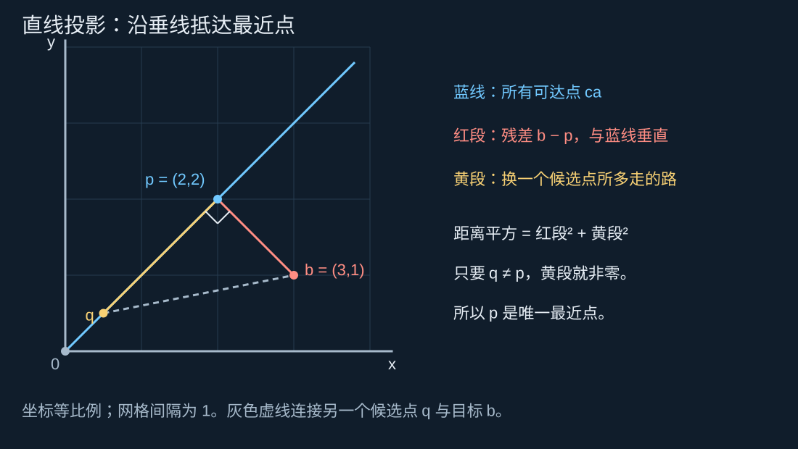
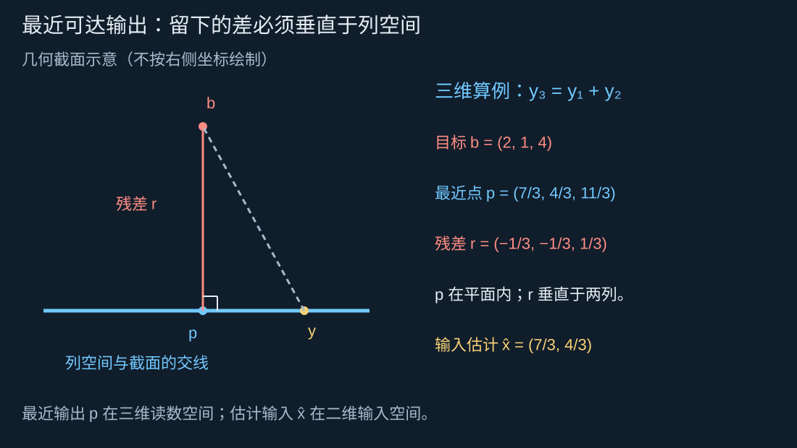
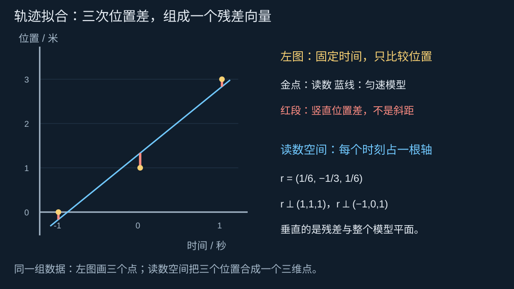
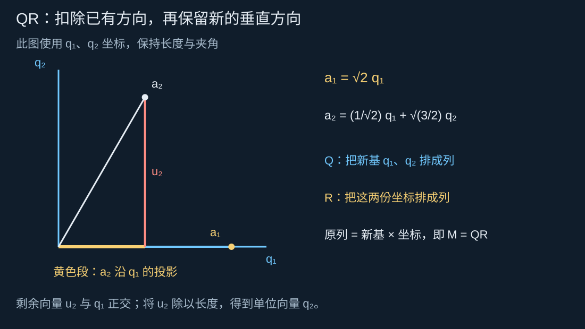
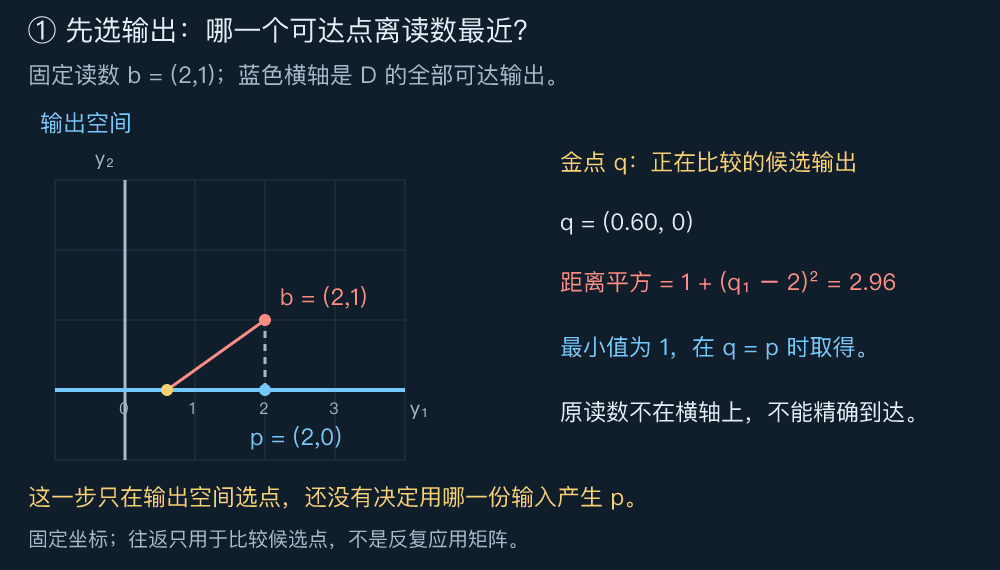
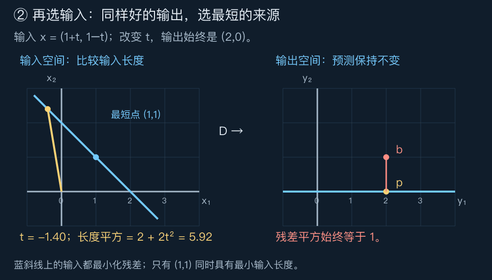
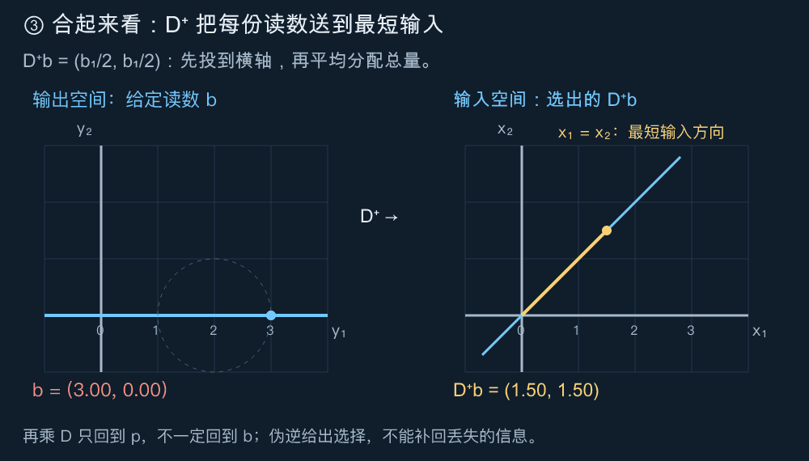

# DAY 3：测量互相矛盾时，怎样找到最接近的解？｜内积、正交投影、最小二乘、QR 与伪逆

[六天路线](../README.md) · [上一课：秩与线性方程组](./02秩与线性方程组.md)

第二课把求解 $Ax=b$ 拆成两件事：目标是否在列空间中；到达同一个目标的输入是否唯一。今天从第一件事失败的地方继续：读数带有误差，目标落在可达空间之外，精确方程无解，但我们仍希望给出一个有依据的估计。

本课的主线是 **先在输出空间找到离目标最近的可达点，再回到输入空间寻找产生它的输入** 。内积帮我们描述垂直，投影找到最近点，最小二乘把它写成求解问题，QR 让计算更方便；若输入不唯一，伪逆再给出一种明确的选择。

建议先用 45 分钟读懂投影，再用 50 分钟完成最小二乘与轨迹例子，用 40 分钟理解 QR 和伪逆，最后实验并作答。本文使用实数、标准坐标和欧氏距离；测量示例均为教学构造。QR 的一般式和伪逆的完整理论可以第二遍再读。

## 阅读导航

1. [从一份不可能的读数开始](#从一份不可能的读数开始)
2. [内积把垂直变成可计算的条件](#内积把垂直变成可计算的条件)
3. [先把一个点投到一条直线上](#先把一个点投到一条直线上)
4. [从直线到平面：最近点的残差垂直于整个空间](#从直线到平面最近点的残差垂直于整个空间)
5. [最小二乘：用正规方程找到最近的可达输出](#最小二乘用正规方程找到最近的可达输出)
6. [拟合机器人运动：两张图里的垂直不是一回事](#拟合机器人运动两张图里的垂直不是一回事)
7. [QR：先换成互相垂直的尺子](#qr先换成互相垂直的尺子)
8. [伪逆：输出确定以后怎样选输入](#伪逆输出确定以后怎样选输入)
9. [亲手实验](#亲手实验)
10. [留给你的思考题](#留给你的思考题)
11. [思考题参考答案](#思考题参考答案)

## 从一份不可能的读数开始

沿用第二课的二维到三维映射：

$$M=\begin{pmatrix}1&0\\0&1\\1&1\end{pmatrix},\qquad
Mx=\begin{pmatrix}x_1\\x_2\\x_1+x_2\end{pmatrix}.$$

把 $x_1,x_2$ 想成两个使用相同单位的校准量。三个显示器分别报告第一项、第二项、两项之和。理想输出一定满足 $y_3=y_1+y_2$，所以可达输出构成三维空间中的一个平面。

现在读到

$$b=\begin{pmatrix}2\\1\\4\end{pmatrix}.$$

前两个读数要求输入为 $(2,1)^\top$，但它对应的第三个输出是 3，并不是 4。第二课告诉我们，这个精确方程无解。

如果三个显示器都可能出错，就没有理由直接认定前两个正确、只修改第三个。我们可以把三个误差放在一起比较。对候选输入 $x$，预测输出为 $Mx$，把“读数减预测”记作

$$r=b-Mx.$$

$r$ 称为 **残差向量** ，每个分量对应一个显示器的差值。它是能从数据与模型算出的偏差，不等于我们已经知道了真实测量误差。

例如选择 $x=(2,1)^\top$，残差为 $(0,0,1)^\top$；选择 $x=(7/3,4/3)^\top$，残差为 $(-1/3,-1/3,1/3)^\top$。后一种选择让三个读数都稍作调整，平方和从 $1$ 降为 $1/3$。它是否已经最好，需要一个能覆盖所有候选输入的理由。

接下来先在二维图里理解“最近”，再把同一逻辑带回这个三维平面。此时不用记住 $7/3$ 从哪里来；第五节会逐步算出它。

## 内积把垂直变成可计算的条件

### 长度与距离：把几项坐标合成一个数

二维向量 $u=(u_1,u_2)^\top$ 的长度由勾股定理给出：$\sqrt{u_1^2+u_2^2}$。推广到 $m$ 个坐标，定义欧氏范数

$$\lVert u\rVert_2=\sqrt{\sum_{i=1}^{m}u_i^2}.$$

双竖线是“求向量长度”的记号，下标 2 标明这里使用平方和开根号。两个点 $b,p$ 之间的距离是差向量的长度 $\lVert b-p\rVert_2$。比较距离时也可以比较距离平方，因为非负数开平方不会改变大小顺序。

在显示器例子中，这相当于把三个坐标轴看作同等尺度：每个显示器偏差 1 单位，都贡献同样的 1。若单位或可信程度不同，需要重新选择尺度或权重，后文会说明边界。

### 内积：检验两个方向是否互相垂直

对同维向量 $u,v\in\mathbb R^m$，定义标准内积

$$u^\top v=\sum_{i=1}^{m}u_iv_i.$$

上标 $\top$ 表示转置：把列向量 $u$ 横过来成为一行，再与列向量 $v$ 相乘，得到一个数。例如 $(1,2)^\top$ 与 $(2,-1)^\top$ 的内积为 $1\cdot2+2\cdot(-1)=0$。

对于非零向量，它也等于

$$u^\top v=\lVert u\rVert_2\lVert v\rVert_2\cos\theta,$$

其中 $\theta$ 是两支箭头的夹角。因此内积为零意味着夹角为直角，称为 **正交** 。正内积表示锐角，负内积表示钝角。零向量按内积定义与所有向量正交，但它没有可用来谈夹角的方向。

内积并不要求每一项乘积都为零。例如刚才的 $2+(-2)=0$，是在两个坐标的贡献抵消后，确认整体箭头垂直。

它与长度还满足 $u^\top u=\lVert u\rVert_2^2$。展开两支箭头相加后的长度：

$$\lVert u+v\rVert_2^2
=\lVert u\rVert_2^2+2u^\top v+\lVert v\rVert_2^2.$$

当 $u\perp v$ 时，中间项为零，便是勾股定理。这个关系将成为“最近点”的证明工具。

## 先把一个点投到一条直线上

我们想在过原点的直线 $L=\{ca:c\in\mathbb R\}$ 上寻找离 $b$ 最近的点。这里 $a\ne0$ 是直线的方向，$c$ 表示沿这支方向取几份。

先用一个能直接画出的例子：$a=(1,1)^\top$，$b=(3,1)^\top$。直线是 $y=x$，候选点形如 $(c,c)^\top$。



图中 $p=(2,2)^\top$ 是垂足，红色差向量 $b-p=(1,-1)^\top$ 与直线方向 $(1,1)^\top$ 内积为零。另选直线上任意一点 $q$，从 $q$ 到 $b$ 都可以分成沿直线的 $p-q$ 和垂直直线的 $b-p$ 两段，因此

$$\lVert b-q\rVert_2^2
=\lVert b-p\rVert_2^2+\lVert p-q\rVert_2^2.$$

右边第二项非负，只在 $q=p$ 时为零。所以垂足是唯一最近点。这里的图只是帮助想象；等式对直线上任意 $q$ 都成立，才说明没有更好的遗漏候选。

### 从垂直条件算出垂足

为了不依赖画图读数，把垂足写成 $p=ca$。我们要找的系数满足“剩下的差与直线垂直”：

$$a^\top(b-ca)=0.$$

展开为 $a^\top b-c(a^\top a)=0$。因为 $a\ne0$，分母 $a^\top a$ 是正的，于是

$$c=\frac{a^\top b}{a^\top a},\qquad
p=a\frac{a^\top b}{a^\top a}.$$

本例 $a^\top b=4$、$a^\top a=2$，所以 $c=2$，得到 $p=(2,2)^\top$。分母是在校正方向箭头本身的长度；只有当 $a$ 长度为 1 时，才可省去它。

把方向改成 $2a$，直线没有变：算出的系数会减半，最终 $p$ 仍不变。投影由目标直线决定，而不由我们画多长的方向箭头决定。

还要区分两个数：$c$ 是“取几份 $a$”，而沿直线的有符号投影长度是 $c\lVert a\rVert_2$。本例分别为 $2$ 与 $2\sqrt2$。

### 把这项操作记录成矩阵

固定 $a$，让目标 $b$ 变化，上面的规则是线性映射：

$$p=Pb,\qquad P=\frac{aa^\top}{a^\top a}.$$

$a$ 是列，$a^\top$ 是行，$aa^\top$ 是一个方阵；它与标量 $a^\top a$ 不同。本例

$$P=\frac12\begin{pmatrix}1&1\\1&1\end{pmatrix}.$$

已经落在直线上的点，再投影一次位置不变，所以 $P^2=P$。本例还有 $P^\top=P$，即矩阵关于主对角线对称。对于实矩阵，正交投影同时满足这两个性质；仅有 $P^2=P$ 还可能是斜投影，并不保证最近。

第二课主线的三阶矩阵把 $(0,0,1)^\top$ 送到 $(1,1,0)^\top$，它虽然把空间压到平面且满足平方等于自身，却不是对该平面的正交投影。压扁到某处与沿垂线寻找最近点，需要区分。

## 从直线到平面：最近点的残差垂直于整个空间

现在回到开篇的可达平面 $S=\operatorname{Col}(M)$。直线上只有一个方向要检查，平面上则有两个独立方向。

假如已找到平面内一点 $p$，使残差 $r=b-p$ 垂直于平面中的所有方向，那么对平面内任意候选点 $y$，向量 $p-y$ 仍在平面内。因此

$$\lVert b-y\rVert_2^2
=\lVert r+(p-y)\rVert_2^2
=\lVert r\rVert_2^2+\lVert p-y\rVert_2^2.$$

只要离开 $p$，第二项就大于零，距离必定增大。这证明 $p$ 是唯一最近的可达输出。

为什么最近点一定要满足这个垂直条件？若残差在平面某个方向 $d$ 上还有分量，也就是 $r^\top d\ne0$，就能沿这个方向稍微移动来缩短距离。具体地，对任意实数 $t$，

$$\lVert b-(p+td)\rVert_2^2
=\lVert r\rVert_2^2-2t\,r^\top d+t^2\lVert d\rVert_2^2.$$

取 $t=(r^\top d)/\lVert d\rVert_2^2$，距离平方就减少 $(r^\top d)^2/\lVert d\rVert_2^2>0$，与已经最近矛盾。这里 $d$ 非零；$p+td$ 仍然是平面内可达点。

所以垂直不是一个凑巧好用的猜测，而是最近点必须满足、也足以保证最近的条件。这套论证同样适用于更高维的线性子空间，不需要真的画出高维图。



图左是包含残差方向的一张截面示意：蓝线表示输出平面在截面里的交线，并不是说列空间变成了一维。右侧列出本例的真实三维坐标。图示只表达垂直与距离分解，具体坐标由下一节计算。

## 最小二乘：用正规方程找到最近的可达输出

### 用每一列检查残差

对一般的 $A\in\mathbb R^{m\times n}$，寻找最近可达输出就是

$$\min_{x\in\mathbb R^n}\lVert b-Ax\rVert_2^2
=\min_x\sum_{i=1}^m\bigl(b_i-(Ax)_i\bigr)^2.$$

这里 $m$ 是读数个数，$n$ 是未知参数个数；$(Ax)_i$ 是第 $i$ 个预测值。这叫 **最小二乘** ：“二乘”指残差的平方，“最小”指这些平方相加后尽可能小。

把每项平方能避免正负偏差互相抵消，也与欧氏距离的平方一致。它是一种明确的误差衡量方式，并不意味着所有工程问题都必须用它。

把一个最优输入记作 $\widehat x$，对应预测为 $p=A\widehat x$。我们已经知道，残差必须垂直于列空间。矩阵的列 $a_1,\ldots,a_n$ 能组合出全部可达方向，所以只需要求

$$a_j^\top(b-A\widehat x)=0\quad(j=1,\ldots,n).$$

反过来，如果残差与每一列都正交，它与任何列组合也正交，因为内积对组合满足分配律。

$A^\top$ 的每一行恰好是一列转置。把这些检查叠起来，就是

$$A^\top(b-A\widehat x)=0
\quad\Longleftrightarrow\quad
\boxed{A^\top A\widehat x=A^\top b.}$$

这叫 **正规方程** 。它不是在坚持原来无解的 $Ax=b$，而是在要求预测后剩下的差，不能再通过调整输入而沿可达方向消除。两端都是 $n$ 维向量；$A^\top A$ 是 $n\times n$ 方阵。

### 算完开篇的三个读数

本例使用 $A=M$，直接乘得

$$M^\top M=\begin{pmatrix}2&1\\1&2\end{pmatrix},\qquad
M^\top b=\begin{pmatrix}6\\5\end{pmatrix}.$$

所以要解

$$2\widehat x_1+\widehat x_2=6,\qquad
\widehat x_1+2\widehat x_2=5.$$

第二式乘 2 再减第一式，得到 $3\widehat x_2=4$；代回得 $\widehat x_1=7/3$。于是

$$\widehat x=\begin{pmatrix}7/3\\4/3\end{pmatrix},\qquad
p=M\widehat x=\begin{pmatrix}7/3\\4/3\\11/3\end{pmatrix},\qquad
r=b-p=\begin{pmatrix}-1/3\\-1/3\\1/3\end{pmatrix}.$$

$p$ 满足 $p_3=p_1+p_2$，确实可达。残差与两列的内积分别为 $-1/3+1/3=0$ 和 $-1/3+1/3=0$，因此它垂直于整个列空间。上一节的勾股论证保证这就是全局最小值，而不仅是比开篇某一个候选更好。

### 何时可以写逆矩阵公式

若 $A$ 的列线性无关，$A^\top A$ 可逆，此时唯一解为

$$\widehat x=(A^\top A)^{-1}A^\top b.$$

可逆性的原因可以沿第二课的零空间思路核对：对任意非零输入变化 $h$，满列秩意味着 $Ah\ne0$，所以

$$h^\top A^\top Ah=\lVert Ah\rVert_2^2>0.$$

若 $A^\top A$ 有非零零空间向量，上式左侧就会为零，矛盾。因此它的零空间只有零向量，作为方阵便可逆。第五课会把这种严格为正的性质称为正定性。

相应的输出投影矩阵为

$$P=A(A^\top A)^{-1}A^\top,\qquad p=Pb.$$

它是 $m\times m$ 矩阵，作用在 **读数空间** ；$\widehat x$ 则位于 $n$ 维输入空间。别把投影后的读数 $p$ 和估计输入 $\widehat x$ 当成同一个对象。

列不独立时，正规方程仍刻画所有最小二乘解，但不能套用这个逆矩阵公式。最近的输出仍唯一，产生它的输入却可能不唯一；第八节会把这件事接回零空间。

## 拟合机器人运动：两张图里的垂直不是一回事

假设机器人沿一条直轨道匀速运动。我们只估计沿轨道的一维位置，用时间相对中间一次测量计时：$t=-1,0,1$ 秒，读数分别为 $0,1,3$ 米。

理想模型为

$$s(t)=\alpha+vt.$$

$\alpha$ 是 $t=0$ 时的位置，$v$ 是速度。前两次读数看起来每秒增加 1 米，后两次却增加 2 米，因此没有一条匀速模型能精确穿过三个点。这里假设测量时间准确，误差主要在位置读数中。

把未知参数排成 $\theta=(\alpha,v)^\top$，三次预测写成

$$X\theta=\begin{pmatrix}1&-1\\1&0\\1&1\end{pmatrix}
\begin{pmatrix}\alpha\\v\end{pmatrix},\qquad
b=\begin{pmatrix}0\\1\\3\end{pmatrix}.$$

$X$ 叫设计矩阵：每一行对应一次测量，每一列记录一个参数如何影响全部读数。第一列让三次位置一起平移；第二列让前后时刻的预测一减一增。

这个模型对时间是带截距的直线，但从参数 $\theta$ 到整组预测 $X\theta$ 的映射是线性的，因为截距 $\alpha$ 本身也是输入参数。

本例两列互相正交，因此

$$X^\top X=\begin{pmatrix}3&0\\0&2\end{pmatrix},\qquad
X^\top b=\begin{pmatrix}4\\3\end{pmatrix}.$$

正规方程分别给出 $3\widehat\alpha=4$ 和 $2\widehat v=3$，于是拟合轨迹为

$$\widehat s(t)=\frac43+\frac32t.$$

三次预测及残差为

$$p=\begin{pmatrix}-1/6\\4/3\\17/6\end{pmatrix},\qquad
r=b-p=\begin{pmatrix}1/6\\-1/3\\1/6\end{pmatrix},\qquad
\lVert r\rVert_2^2=\frac16.$$



左图横轴是时间，纵轴是位置。时间固定，所以每项误差是同一时刻的 **竖直位置差** ，不是散点到拟合直线的最短斜距离。

右边讨论的是另一个空间：把三个时刻的读数分别放在三根坐标轴上，整组数据成为一个三维向量。所有匀速预测铺出二维列空间，残差向量与这个平面正交。时间位置图上的三个点，与读数空间中的一个点，是同一组数据的两种组织方式。

还可以直接看正规方程留下的两项检查：

$$r_1+r_2+r_3=0,\qquad -r_1+r_3=0.$$

第一项表示残差已不能通过整体提高或降低轨迹改善；第二项表示已不能通过调整速度改善。它们对应设计矩阵的两列，而不是要求每项残差单独为零。

### 距离的选择也是模型的一部分

本例把三个位置读数等同对待。若某个读数更不可靠，可以改用正权重 $w_i$ 最小化 $\sum_i w_i r_i^2$；它相当于把第 $i$ 行方程与读数一起乘以 $\sqrt{w_i}$ 后，再做普通最小二乘。权重不能只乘预测而不乘观测。

如果时间本身也有明显误差，单纯比较竖直位置差就未必合适。又如少量异常读数，平方会特别放大它们的影响。最小二乘保证的是 **在所选模型与距离下最优** ，不自动保证轨迹符合全部真实运动规律。本课不把带噪数据当成真实测量记录，也不展开其他估计方法。

## QR：先换成互相垂直的尺子

### 从两支斜着的基向量里剥离重复方向

正规方程已经能解题。接下来换一个计算角度：若列空间的基互相垂直且长度都是 1，那么每个投影系数只需做一次内积，像读取正交坐标轴上的坐标一样方便。

这样的基叫 **标准正交基** 。我们不改变可达空间，只换一套描述它的基。仍用主线矩阵 $M$ 的两列

$$a_1=\begin{pmatrix}1\\0\\1\end{pmatrix},\qquad
 a_2=\begin{pmatrix}0\\1\\1\end{pmatrix}.$$

第一步，把第一列除以长度，得到单位向量

$$q_1=\frac{a_1}{\lVert a_1\rVert_2}
=\frac1{\sqrt2}\begin{pmatrix}1\\0\\1\end{pmatrix}.$$

第二步，第二列含有一部分沿 $q_1$ 的分量。为了找一个新方向，先减去这部分投影：

$$u_2=a_2-q_1(q_1^\top a_2)
=\begin{pmatrix}0\\1\\1\end{pmatrix}-\frac12\begin{pmatrix}1\\0\\1\end{pmatrix}
=\begin{pmatrix}-1/2\\1\\1/2\end{pmatrix}.$$

剩下的 $u_2$ 垂直于 $q_1$。再除以长度 $\sqrt{3/2}$，得到

$$q_2=\frac1{\sqrt6}\begin{pmatrix}-1\\2\\1\end{pmatrix}.$$

可以逐项核对 $q_1^\top q_2=0$，且 $q_1^\top q_1=q_2^\top q_2=1$。这就是 Gram–Schmidt 正交化的两列版本：保留第一支方向，从后续箭头中扣除已经拥有的方向，再把剩下的箭头变成单位长度。



图在列空间内部使用 $q_1,q_2$ 坐标绘制，而不是沿原三维坐标轴拍摄。减法没有把列空间转走：$q_1,q_2$ 都由原列组合而来，反过来原列也能由它们恢复。

### Q 保存新基，R 保存原列在新基中的坐标

把两支单位向量排成 $Q=(q_1\ q_2)$，原列可写成

$$a_1=\sqrt2q_1,\qquad
 a_2=\frac1{\sqrt2}q_1+\sqrt{\frac32}q_2.$$

将这两份坐标按列排好，得到

$$M=QR,\qquad
R=\begin{pmatrix}\sqrt2&1/\sqrt2\\0&\sqrt{3/2}\end{pmatrix}.$$

这叫 **QR 分解** 。$Q$ 是 $3\times2$ 的新基表，$R$ 是 $2\times2$ 的坐标表。$R$ 左下角为零，因为第一列还不需要第二个新方向；一般构造中，第 $j$ 列只使用前 $j$ 支新基，因此 $R$ 是上三角矩阵。

对满列秩的 $m\times n$ 矩阵（$m\geq n$），这种精简 QR 有 $Q\in\mathbb R^{m\times n}$、$R\in\mathbb R^{n\times n}$，满足 $Q^\top Q=I_n$。当 $m>n$，$QQ^\top$ 是投到列空间的矩阵，并不是整个输出空间的恒等矩阵。长方形的 $Q$ 不能直接当成有普通逆矩阵的方阵。

### 先读取投影坐标，再解一个三角方程

对于单位正交基，$q_i^\top b$ 就是投影沿 $q_i$ 的坐标。因此

$$p=Q(Q^\top b).$$

另一方面，$M\widehat x=Q(R\widehat x)$。在同一套基 $Q$ 下比较坐标，只需解

$$R\widehat x=Q^\top b.$$

对开篇的 $b=(2,1,4)^\top$，右端为 $(6/\sqrt2,4/\sqrt6)^\top$。从最后一行开始：

$$\sqrt{3/2}\,\widehat x_2=4/\sqrt6
\quad\Rightarrow\quad \widehat x_2=4/3.$$

第一行乘 $\sqrt2$ 后变成 $2\widehat x_1+\widehat x_2=6$，得到 $\widehat x_1=7/3$，与前面一致。这里先做投影，再通过上三角系统回代，不必显式构造逆矩阵。

正规方程便于推导，但浮点计算中直接形成 $A^\top A$ 可能加重数值敏感性。实际数值软件常使用 Householder QR 或 SVD 等方法；本课用 Gram–Schmidt 展示几何思路，配套脚本只用于小例子，并非通用稳定求解器。若列相关，某一步剩余向量为零，不能继续除以长度；识别秩与更一般的分解留到下一课。计算背景可对照 [Moler 的最小二乘章节](https://es.mathworks.com/content/dam/mathworks/mathworks-dot-com/moler/leastsquares.pdf)。

## 伪逆：输出确定以后怎样选输入

### 同一个最近点，可以有一整条输入直线

到目前为止的 $M$ 满列秩，所以最近输出的输入唯一。为了看清另一种情况，换成

$$D=\begin{pmatrix}1&1\\0&0\end{pmatrix},\qquad
b=\begin{pmatrix}2\\1\end{pmatrix}.$$

先只看输出空间。$D$ 的第二个输出永远为零，因此全部可达点都在横轴上；读数 $b=(2,1)^\top$ 却在横轴上方。沿蓝色横轴移动候选点，观察连接候选点与 $b$ 的红线：它在垂足处最短。



这段动画中，金点是不断更换的候选输出 $q$，蓝点 $p=(2,0)^\top$ 是固定的垂足，红点是固定读数 $b$。当金点经过蓝点时，红线最短，残差为 $(0,1)^\top$，平方和为 1。 **先在输出空间选好这个唯一最近点，才开始寻找它的输入来源。**

输入与输出虽然都是两个坐标，这里仍是两个角色不同的空间。任何满足 $x_1+x_2=2$ 的输入都能产生这个 $p$，因此全部最小二乘解为

$$x=\begin{pmatrix}1+t\\1-t\end{pmatrix},\qquad t\in\mathbb R.$$

沿 $(1,-1)^\top$ 改变输入，输出不变；这正是第二课的零空间。最小二乘已经把残差降到最低，无法仅凭残差进一步区分这些输入。

若希望选其中长度最小的一份，就比较

$$\lVert x\rVert_2^2=(1+t)^2+(1-t)^2=2+2t^2.$$

当且仅当 $t=0$ 最小，所以选择 $x_*=(1,1)^\top$。它垂直于零空间方向 $(1,-1)^\top$。直观上，沿不可见方向添加的成分不会改善输出，却会让这份输入更长。



这次看左图：蓝色斜线是全部最小二乘输入，金点随 $t$ 往返，黄色线段从输入原点连到金点，表示输入的长度。右图的预测与残差保持不动，提醒我们：左图上每个候选的拟合效果完全相同。动画在 $t=0$ 附近停留，此时输入长度最小，但残差并没有变得更小。

可以顺着两张图复述： **第一张比较输出误差，第二张在误差已经同样小的输入之间比较长度。** 两次比较发生在不同空间，也解决不同的歧义。

### 用一个统一规则处理无解与多解

对任意实矩阵 $A$，Moore–Penrose 伪逆记作 $A^+$，尺寸是 $n\times m$。上标 $+$ 表示伪逆，它本身也是一个矩阵；对本节选定的具体矩阵 $D$，便写成 $D^+$。本课先用它的求解意义认识这个符号：

$$x_*=A^+b$$

给出所有最小二乘解中欧氏范数最小的那一个。顺序是 **先让残差最小，再在这些同样好的解中让输入长度最小** ，并不是把两种平方加成一个新的目标。这个求解含义也可对照 [Moore–Penrose 伪逆文档](https://www.mathworks.com/help/matlab/ref/pinv.html)。

最近输出唯一；它的全部输入来源相差零空间向量。把任意一个来源沿零空间的分量扣掉，留下垂直于零空间的 $x_*$。对任意 $z\in\operatorname{Null}(A)$，勾股关系给出

$$\lVert x_*+z\rVert_2^2=\lVert x_*\rVert_2^2+\lVert z\rVert_2^2,$$

因此最短的选择也唯一。这里用到有限维子空间的正交分解；下一课用 SVD 构造一般的 $A^+$，本课不展开它的全部代数刻画。

本例可直接写出

$$D^+=\begin{pmatrix}1/2&0\\1/2&0\end{pmatrix},\qquad
D^+b=\begin{pmatrix}1\\1\end{pmatrix}.$$

现在让读数也动起来，看看 $D^+$ 是怎样作用于不同输入数据的。对于任意读数 $(b_1,b_2)^\top$，投到横轴后得到 $(b_1,0)^\top$；要产生这个预测，两项输入的和必须为 $b_1$，最短的一份则是平均分配：

$$D^+\begin{pmatrix}b_1\\b_2\end{pmatrix}
=\begin{pmatrix}b_1/2\\b_1/2\end{pmatrix}.$$

这里的平均分配来自本例两个输入的系数相同、使用标准欧氏范数；并不是所有矩阵的伪逆都能用“平均分”计算。



左图红点是当前读数 $b$，蓝点是它的最近可达输出；右图金点是 $D^+b$，始终位于 $x_1=x_2$ 的蓝色对角线上。左图圆周上下两个具有相同第一坐标的点，会得到同一个右侧输入：它们的区别沿着不可达的输出方向，不能由调整输入消除。

三张图都固定坐标轴，每帧重新计算当前候选或读数对应的结果；循环只是为了反复观察，没有不断把上一次输出再送进矩阵。第三张图左侧的运动是人为选取的一组读数，并不模拟机器人运动。

把右图选出的输入再乘 $D$，只会回到左图蓝点 $p$。具体地，

$$DD^+b=\begin{pmatrix}b_1\\0\end{pmatrix},\qquad
DD^+=\begin{pmatrix}1&0\\0&0\end{pmatrix}.$$

所以 $DD^+$ 是输出投影，并不是恒等矩阵。只在 $b_2=0$、原读数本来可达时，才有 $DD^+b=b$。这也解释了符号的区别：$D^{-1}$ 要完整撤销变换，而这里的 $D^+$ 先丢掉不可达的读数分量，再选择最短输入。

| 矩阵情况 | 伪逆给出的输入 | 与以前的关系 |
| --- | --- | --- |
| 方阵且可逆 | 唯一精确解 | $A^+=A^{-1}$ |
| 满列秩 | 唯一最小二乘解 | $A^+=(A^\top A)^{-1}A^\top$ |
| 列相关 | 最小范数的最小二乘解 | 不能套用上述逆矩阵公式 |

一般地，$AA^+b$ 是列空间中的最近输出；所有最小二乘解为 $A^+b+z$，其中 $z$ 遍历零空间。伪逆没有恢复已丢失的真实信息，它只是按指定范数作出唯一选择。如果真实输入是 $(2,0)^\top$，仅凭上述读数仍无法证明它比 $(1,1)^\top$ 更真实。

“最短”也依赖参数尺度。位置与速度等不同单位的参数混在一起时，直接比较参数长度需要先解释尺度约定。最小范数不是不依赖模型的真理。

## 亲手实验

在专题目录运行：

```sh
python3 codes/03_projection_experiment.py
```

[实验脚本](../codes/03_projection_experiment.py)仅使用 Python 标准库，核对直线投影、三维读数投影、轨迹拟合、两列 QR 和最小范数例子。主线的有理数计算使用 `Fraction`，含平方根的 QR 使用浮点数并以容差核对。

先预测再修改：将第三个读数从 4 改成 3，残差应变为零；将轨迹读数同时增加 2，拟合截距应增加 2，速度和残差不变；将最小范数例子的 $t$ 改成不同数，输出保持不变，输入长度却改变。

脚本的断言核对本课算例，不能用来代替关于所有矩阵的证明，也不处理大型、秩亏或接近秩亏问题的一般求解。

## 留给你的思考题

每题先写清“正在看输入空间还是输出空间”，再计算。这里保留作答位置；遇到不懂的步骤可以先画箭头与残差。[参考答案](#思考题参考答案)附在后面，可先作答再对照。

### 1．方向箭头变长，投影点会移动吗

取 $a=(1,2)^\top$、$b=(4,1)^\top$，求投影系数、投影点及残差，核对正交。再把 $a$ 换成 $3a$，分别判断系数、投影点、有符号投影长度怎样变化。

我的回答：

### 2．压到同一条直线，为什么距离不同

比较 $P=\begin{pmatrix}1&0\\0&0\end{pmatrix}$ 与 $H=\begin{pmatrix}1&1\\0&0\end{pmatrix}$。核对二者平方等于自身，对 $b=(0,1)^\top$ 求输出与残差。哪个是正交投影？为什么只有“重复投影不变”不够？

我的回答：

### 3．三条读数怎样共同调整

使用本课的 $M$，把读数改成 $b=(2,1,5)^\top$。求最小二乘输入、预测和残差，检查预测是否在平面中、残差是否垂直于两列。与只改第三读数的方案比较残差平方和。

我的回答：

### 4．机器人速度与整体位置偏移

在正文的三个时刻，把位置读数从 $(0,1,3)^\top$ 改成 $(2,3,5)^\top$。先预测截距、速度、残差哪些会改变，再计算核对。为什么时间位置图中的竖直残差，与读数空间的正交关系不矛盾？

我的回答：

### 5．Q 的转置究竟读取什么

用本课 $M=QR$ 的 $q_1,q_2$，核对 $Q^\top Q=I_2$。取 $n=(-1,-1,1)^\top$，计算 $Q^\top n$ 与 $QQ^\top n$；据此解释为什么 $QQ^\top\ne I_3$。这里的 $n$ 是输出空间中的方向，不是输入参数。

我的回答：

### 6．最好的输出是不是只有一个来源

对 $D=\begin{pmatrix}1&1\\0&0\end{pmatrix}$ 和 $b=(4,3)^\top$，找出最近可达输出、全部最小二乘输入和最小范数输入。将真实输入假设为 $(4,0)^\top$ 时，伪逆能否证明它是真实来源？说明理由。

我的回答：

### 7．同一个读数偏差，不同的可信程度

只估计一个位置 $x$，两个显示器读数分别为 0 和 2。先最小化 $x^2+(2-x)^2$，再最小化 $9x^2+(2-x)^2$。可用配方求解。结果分别更靠近哪个读数？权重 9 在这个模型中代表怎样的偏好？

我的回答：

### 用自己的话串起来

用三句话说明：投影在输出空间做什么；QR 为什么能帮助计算；伪逆在输入不唯一时补充了什么选择。再解释“最近输出唯一”和“输入唯一”之间的区别。

我的复述：

## 思考题参考答案

以下解答先解释正在比较什么，再给出计算与核对。保留上面的个人作答位置，便于对照理解。这里的向量都采用标准坐标，长度均指欧氏范数。

### 第 1 题：改的是方向箭头的刻度，不是目标直线

我们要找的是输出平面中，直线 $\operatorname{span}\{a\}$ 上离 $b$ 最近的点。把 $a$ 拉长三倍，并没有改变这条直线，所以可以先预测：投影点不动，表达它所需的“份数”会减少。

先算原来的投影系数：

$$a^\top b=1\cdot4+2\cdot1=6,\qquad
 a^\top a=1^2+2^2=5,\qquad c=\frac65.$$

投影点与残差分别为

$$p=ca=\begin{pmatrix}6/5\\12/5\end{pmatrix},\qquad
r=b-p=\begin{pmatrix}14/5\\-7/5\end{pmatrix}.$$

核对垂直条件：

$$a^\top r=1\cdot\frac{14}{5}+2\cdot\left(-\frac75\right)=0.$$

残差垂直于直线，因而这就是最近点。对直线上任意其他点 $q$，都有 $\lVert b-q\rVert_2^2=\lVert r\rVert_2^2+\lVert p-q\rVert_2^2$；只要 $q\ne p$，距离便更大。

现在把方向箭头换成 $a'=3a=(3,6)^\top$。新的系数是

$$c'=\frac{(3a)^\top b}{(3a)^\top(3a)}
=\frac{3\cdot6}{9\cdot5}=\frac25=\frac c3.$$

所以 $c'a'=(2/5)(3a)=(6/5)a=p$，残差也保持不变。

沿 $a$ 正方向的有符号投影长度，等于“系数乘方向箭头长度”：

$$c\lVert a\rVert_2=\frac65\sqrt5=\frac6{\sqrt5}.$$

换成 $a'$ 后，方向没翻转，长度变成原来的三倍，系数却变为三分之一，因此 $c'\lVert a'\rVert_2$ 仍为 $6/\sqrt5$。

**投影系数是在数取几份箭头；投影长度是在量沿这条直线实际走了多远。** 本题改变箭头刻度，前者改变，后者与投影点都不变。

### 第 2 题：重复一次不再移动，只说明已经落到了目标线上

两个矩阵对任意 $(u,v)^\top$ 的作用为

$$P\begin{pmatrix}u\\v\end{pmatrix}=\begin{pmatrix}u\\0\end{pmatrix},\qquad
H\begin{pmatrix}u\\v\end{pmatrix}=\begin{pmatrix}u+v\\0\end{pmatrix}.$$

它们都把点送到横轴。横轴上的点形如 $(w,0)^\top$，再经过任一矩阵都保持原样。因此对所有输入都有 $P(Px)=Px$、$H(Hx)=Hx$，也就是 $P^2=P$、$H^2=H$。

但对于本题 $b=(0,1)^\top$，两者选择的横轴位置不同：

$$Pb=\begin{pmatrix}0\\0\end{pmatrix},\qquad
r_P=b-Pb=\begin{pmatrix}0\\1\end{pmatrix},\qquad
\lVert r_P\rVert_2^2=1,$$

$$Hb=\begin{pmatrix}1\\0\end{pmatrix},\qquad
r_H=b-Hb=\begin{pmatrix}-1\\1\end{pmatrix},\qquad
\lVert r_H\rVert_2^2=2.$$

从图形上想，$P$ 让点竖直落到横轴；$H$ 让它一边向下、一边向右。后者走的是斜线，所以更长。

横轴方向是 $e_1=(1,0)^\top$。$e_1^\top r_P=0$，而 $e_1^\top r_H=-1\ne0$。因此 $P$ 是正交投影，$H$ 是斜投影。对一般输入，$b-Pb=(0,v)^\top$ 也总垂直于横轴，说明 $P$ 的结论不限于本题这个点。

$H$ 已把点送到了横轴，所以重复应用不再移动；但第一次选中的横轴点未必最近。 **$H^2=H$ 表示落点固定，不能代替残差垂直这一最短距离条件。**

### 第 3 题：三个显示器一起让步，比指定一个承担全部差值更近

本题仍使用

$$M=\begin{pmatrix}1&0\\0&1\\1&1\end{pmatrix},\qquad
b=\begin{pmatrix}2\\1\\5\end{pmatrix}.$$

预测输出只能位于 $y_3=y_1+y_2$ 的平面，而目标满足 $5\ne2+1$，因此精确无解。我们寻找的是平面上的最近输出，以及产生它的输入。

正规方程为

$$\begin{pmatrix}2&1\\1&2\end{pmatrix}
\begin{pmatrix}\widehat x_1\\\widehat x_2\end{pmatrix}
=\begin{pmatrix}7\\6\end{pmatrix}.$$

这里右端第一项是 $2+5$，第二项是 $1+5$，分别来自两列与读数的内积。两条方程是 $2\widehat x_1+\widehat x_2=7$、$\widehat x_1+2\widehat x_2=6$。第二式乘 2 再减第一式，得到 $3\widehat x_2=5$；代回得 $\widehat x_1=8/3$。

于是

$$\widehat x=\begin{pmatrix}8/3\\5/3\end{pmatrix},\qquad
p=M\widehat x=\begin{pmatrix}8/3\\5/3\\13/3\end{pmatrix},\qquad
r=b-p=\begin{pmatrix}-2/3\\-2/3\\2/3\end{pmatrix}.$$

先检查位置：$13/3=8/3+5/3$，所以 $p$ 确实在可达平面内。再检查残差：

$$\begin{pmatrix}1&0&1\end{pmatrix}r=-2/3+2/3=0,\qquad
\begin{pmatrix}0&1&1\end{pmatrix}r=-2/3+2/3=0.$$

残差垂直于两列，因此垂直于它们张成的整个平面。结合勾股论证，它就是全局最近点。本例 $M$ 满列秩，所以产生这个点的输入也唯一。

最优残差平方和为

$$\lVert r\rVert_2^2=3\cdot\frac49=\frac43.$$

如果保留前两个读数，只把第三个改成相容的 3，就选择了输入 $(2,1)^\top$、预测 $(2,1,3)^\top$。它相对于原读数的残差是 $(0,0,2)^\top$，平方和为 4，大于 $4/3$。

最小二乘在本题中把前两个预测各提高 $2/3$，把第三个预测降低 $2/3$。它让三份同等对待的误差共同分担矛盾；若改变权重，调整比例也会改变。

### 第 4 题：整体平移位置，不会改变匀速模型中的速度

三个新读数都比原来多了 2 米。可以先预测：把整条轨迹向上平移 2 米，原来的各项残差就保持原样；相邻时刻的位置变化量没变，因此速度也不变。

设计矩阵仍为

$$X=\begin{pmatrix}1&-1\\1&0\\1&1\end{pmatrix}.$$

新目标 $b'=(2,3,5)^\top$ 给出

$$X^\top b'=\begin{pmatrix}2+3+5\\-2+5\end{pmatrix}
=\begin{pmatrix}10\\3\end{pmatrix},\qquad
X^\top X=\begin{pmatrix}3&0\\0&2\end{pmatrix}.$$

所以 $3\widehat\alpha=10$、$2\widehat v=3$，新轨迹为

$$\widehat s(t)=\frac{10}{3}+\frac32t.$$

截距从 $4/3$ 增加到 $10/3$，恰好多 2；速度仍是 $3/2$ 米每秒。三个时刻的预测及残差分别为

$$p'=\begin{pmatrix}11/6\\10/3\\29/6\end{pmatrix},\qquad
r'=b'-p'=\begin{pmatrix}1/6\\-1/3\\1/6\end{pmatrix}.$$

每项残差都与原来相同，平方和仍为 $1/6$。

这个结果也能直接由模型解释：第一列 $(1,1,1)^\top$ 控制整体位置平移，把截距增加 2，正好给每一个预测都加上 2。因此旧候选轨迹与新候选轨迹之间有一一对应，且对应残差完全一样；旧最优轨迹平移后也一定是新最优轨迹。

在[轨迹示意图](../images/03-trajectory-fit.svg)的时间位置图里，每段残差都沿竖直位置轴，因为比较的是同一时刻的读数与预测。在三维读数空间中，则把这三段差合成一支向量 $r'$。它满足

$$r'_1+r'_2+r'_3=0,\qquad -r'_1+r'_3=0,$$

也就是与 $X$ 的两列都正交。两张图使用的坐标轴与对象不同，因而“竖直的位置差”和“垂直于列空间”并不冲突。

### 第 5 题：读取平面内的坐标，不会记录垂直于平面的成分

两支单位向量为

$$q_1=\frac1{\sqrt2}\begin{pmatrix}1\\0\\1\end{pmatrix},\qquad
q_2=\frac1{\sqrt6}\begin{pmatrix}-1\\2\\1\end{pmatrix}.$$

矩阵 $Q^\top Q$ 的每个元素，都是一支列向量与另一支列向量的内积：

$$Q^\top Q=
\begin{pmatrix}q_1^\top q_1&q_1^\top q_2\\q_2^\top q_1&q_2^\top q_2\end{pmatrix}.$$

分别计算可得

$$q_1^\top q_1=\frac{1+0+1}{2}=1,\quad
q_2^\top q_2=\frac{1+4+1}{6}=1,\quad
q_1^\top q_2=\frac{-1+0+1}{\sqrt{12}}=0.$$

因此 $Q^\top Q=I_2$。这意味着先用 $Q$ 把两项坐标组合成平面内的向量，再用 $Q^\top$ 读取坐标，就能完整还原那两项坐标。

但本题给出的 $n=(-1,-1,1)^\top$ 垂直于这个平面：

$$q_1^\top n=\frac{-1+1}{\sqrt2}=0,\qquad
q_2^\top n=\frac{1-2+1}{\sqrt6}=0.$$

于是

$$Q^\top n=\begin{pmatrix}0\\0\end{pmatrix},\qquad
QQ^\top n=Q\begin{pmatrix}0\\0\end{pmatrix}
=\begin{pmatrix}0\\0\\0\end{pmatrix}.$$

而 $I_3n=n\ne0$，所以 $QQ^\top\ne I_3$。一个明确反例已经足够否定矩阵相等。

几何上，$Q^\top$ 只读取沿 $q_1,q_2$ 的两个分量，垂直于平面的方向没有投影分量；再乘 $Q$ 也无法把没有记录的成分补回来。对于任意 $b$，$QQ^\top b$ 得到的是其平面投影。 **在平面内，读取与重建可以还原；在整个三维空间中，它只能保留平面内的部分。**

这里的 $n$ 位于三维输出空间，也属于 $Q^\top$ 的零空间；它不是原映射 $M$ 的输入零空间向量。$M$ 的输入只有二维，且其零空间仅含二维零向量。

### 第 6 题：伪逆选出唯一代表，不等于识别真实来源

$D$ 把 $(x_1,x_2)^\top$ 送到 $(x_1+x_2,0)^\top$，所以可达输出是横轴。目标 $b=(4,3)^\top$ 到横轴的垂足为

$$p=\begin{pmatrix}4\\0\end{pmatrix},\qquad
r=b-p=\begin{pmatrix}0\\3\end{pmatrix}.$$

残差平方和最小为 9。产生该预测的条件只有 $x_1+x_2=4$，所以全部最小二乘输入为

$$x=\begin{pmatrix}2+t\\2-t\end{pmatrix},\qquad t\in\mathbb R.$$

它们在输入空间构成一条直线，沿着零空间方向 $(1,-1)^\top$ 延伸。无论选哪个 $t$，预测与残差都相同，可以对应着[最短输入动图](../images/03-pinv-minimum.gif)理解，只是本题直线改为 $x_1+x_2=4$。

要在这些解中选最短的一份，比较

$$\lVert x\rVert_2^2=(2+t)^2+(2-t)^2=8+2t^2.$$

最小值 8 在 $t=0$ 时取得，所以

$$x_*=D^+b=\begin{pmatrix}2\\2\end{pmatrix}.$$

真实输入若假设为 $(4,0)^\top$，对应 $t=2$，也是一份最小二乘输入，但长度平方为 16，大于 8。它与 $(2,2)^\top$ 的差为 $(2,-2)^\top$，属于零空间；模型完全看不见这份差别。

还要注意，精确模型的第二输出恒为零。观测到第二坐标 3，意味着这份读数包含模型外的偏差；无论真实输入是哪一份，都不能用改变输入来产生这个 3。

因此伪逆不能证明 $(4,0)^\top$ 是真实来源，也不能仅因 $(2,2)^\top$ 更短就证明它更真实。它实现的是 **先最小化残差，再按标准欧氏范数选出最短代表** 。若要识别真实来源，还需要额外观测或关于输入的可靠约束。

### 第 7 题：权重改变的是我们怎样比较误差

两个读数都在估计同一个位置 $x$。当两项误差同等对待时，目标函数可以配方为

$$x^2+(2-x)^2=2x^2-4x+4=2(x-1)^2+2.$$

平方项总非负，只在 $x=1$ 时为零，所以最优估计为 1，最小目标值为 2。它位于两个读数正中间，与 0、2 的距离都为 1。

现在把第一项的权重改为 9：

$$9x^2+(2-x)^2
=10x^2-4x+4
=10\left(x-\frac15\right)^2+\frac{18}{5}.$$

因此最优估计为 $x=1/5$，最小加权目标值为 $18/5$。它距离第一个读数 0 只有 $1/5$，距离第二个读数 2 则为 $9/5$，明显更靠近第一个读数。

这不表示第一项残差必须为零。若强行取 $x=0$，目标值为 4，反而大于 $18/5$；让第一个读数也承担一点偏差，仍能进一步降低总目标。

权重 9 的意思是：相同大小的残差，在第一项中造成的平方代价是第二项的 9 倍。也可以理解为先把第一项残差放大 3 倍，再求普通平方和，因为 $(3x)^2=9x^2$。

若用权重表达测量可信程度，它体现了更信任第一个读数的建模偏好；这个偏好是否合理，需要测量依据。不能仅从数字 9 推出某个读数正确的概率。

两次得到的最小目标值 2 与 $18/5$ 使用了不同的度量，不能直接据此说第二次估计“质量更差”。在各自规定的度量下，两者分别最优。

### 用自己的话串起来：参考表达

> 投影在输出空间中寻找离观测最近的可达点，剩下的残差垂直于整个列空间。
>
> QR 用一套单位正交基描述同一个可达空间，使投影坐标可以用内积读取，再通过三角方程恢复输入参数。
>
> 若多个输入对应同一个最佳预测，伪逆在所有最小二乘输入中选择长度最小的一个，但它不会重新获得被零空间隐藏的真实信息。

“最近输出唯一”是说可达空间里只有一个最佳预测点；“输入唯一”还要求这个点不能有多个来源。满列秩时零空间只有零向量，所以最佳输入唯一；列相关时，可以沿非零零空间方向移动而不改变最佳预测，因此最佳输入有无穷多个，伪逆从中选出一个代表。


## 延伸阅读

- [MIT 18.06SC：Projection Matrices and Least Squares](https://ocw.mit.edu/courses/18-06sc-linear-algebra-fall-2011/pages/least-squares-determinants-and-eigenvalues/projection-matrices-and-least-squares/)：对照列空间投影、正规方程与拟合的联系。
- [MIT 18.06SC：Orthogonal Matrices and Gram–Schmidt](https://ocw.mit.edu/courses/18-06sc-linear-algebra-fall-2011/pages/least-squares-determinants-and-eigenvalues/orthogonal-matrices-and-gram-schmidt/)：继续理解正交基与 QR。
- [MathWorks：Moore–Penrose pseudoinverse](https://www.mathworks.com/help/matlab/ref/pinv.html)：核对最小范数最小二乘的含义及数值容差；本课实验不依赖 MATLAB。
- [Cleve Moler：Least Squares](https://es.mathworks.com/content/dam/mathworks/mathworks-dot-com/moler/leastsquares.pdf)：进一步阅读 QR 与数值最小二乘的计算背景。

参考入口核对日期：2026-11-09。正文解释、算例与配图为本课程重新组织的教学内容。下一课将用 SVD 观察矩阵沿不同方向怎样伸缩，并理解伪逆为何会放大某些方向上的误差。
