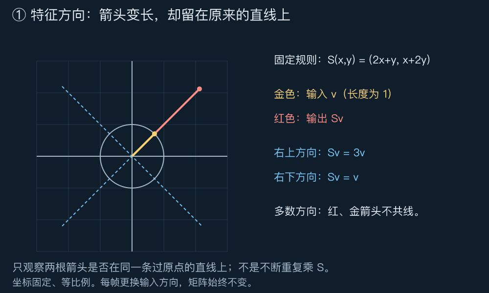
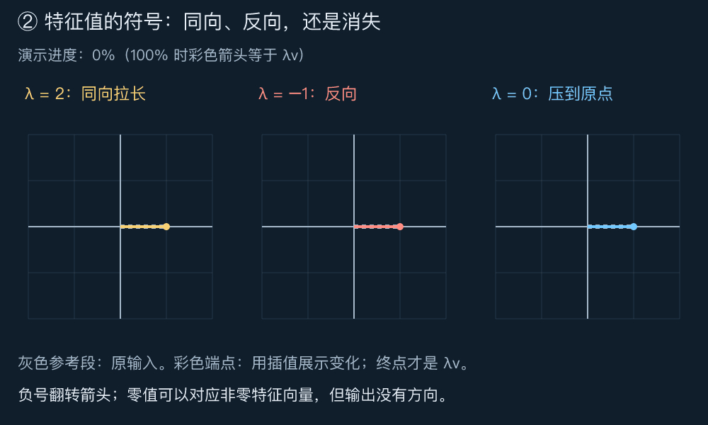
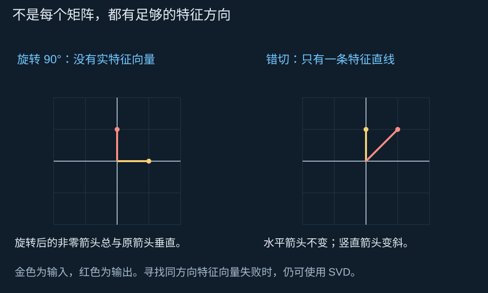
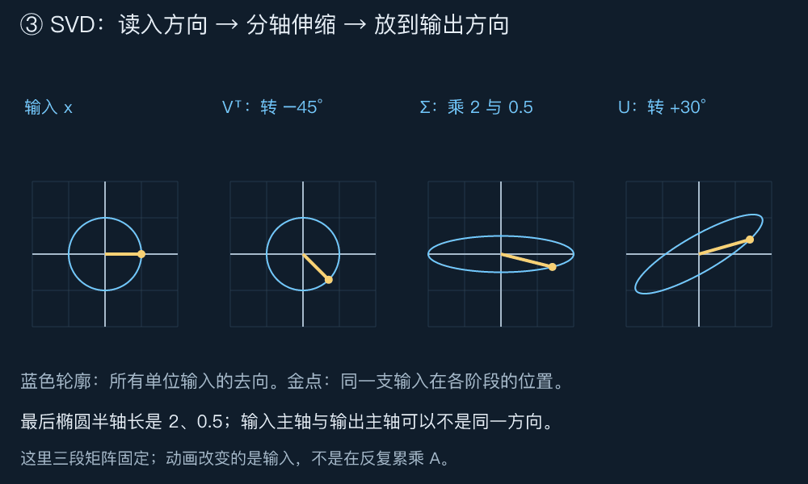
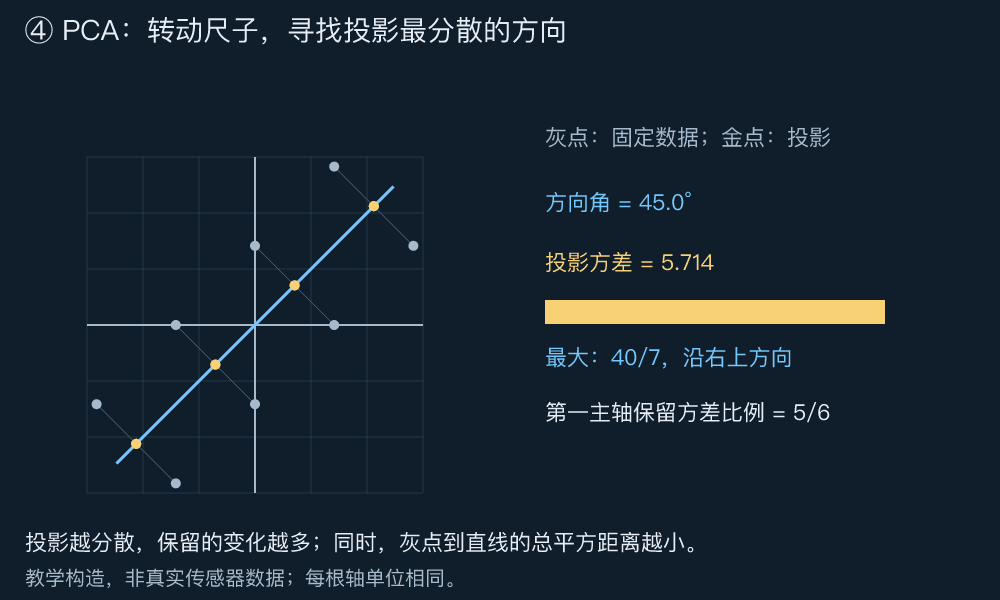
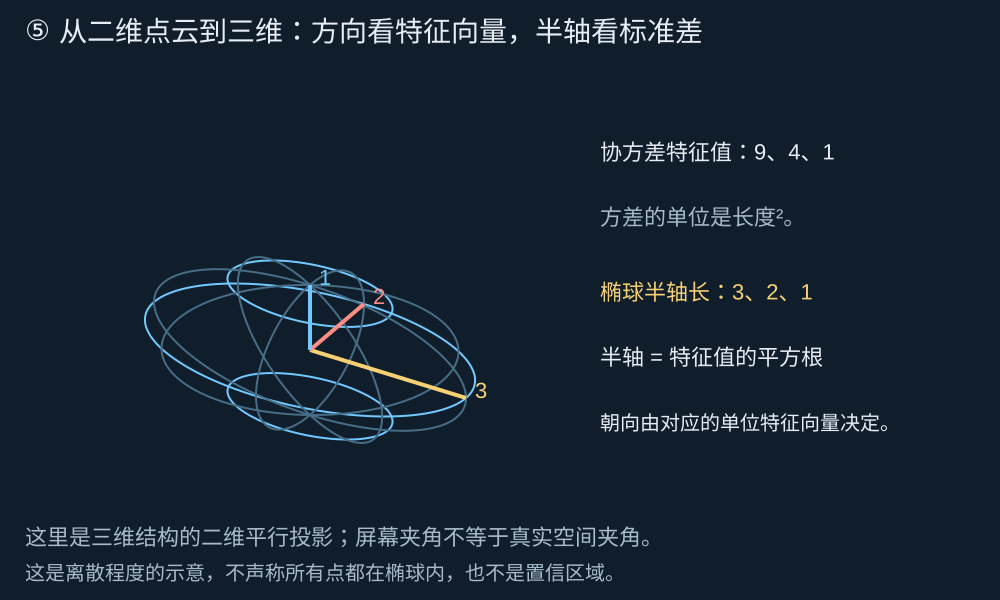

# DAY 4：哪些方向最特殊？｜特征值、特征向量、对角化、SVD、协方差与 PCA

[六天路线](../README.md) · [上一课：投影与最小二乘](./03投影与最小二乘.md)

前两课关心矩阵把空间送到哪里、丢掉哪些方向；第三课用投影寻找最近的可达输出。今天继续问： **不同方向被放大得一样多吗？如果一团点像一个斜着的椭球，我们该沿哪根轴去理解它？**

本课可以先看图，再读公式。四段动图和两张静态图构成一条阅读路线；每张图下的“先看”提示只要求观察一个关系。推导放在后面，用来解释观察为什么成立。本文使用实矩阵、标准欧氏长度；特征值先讨论实数情形，遇到例外时会明确说明。

建议第一遍用 40 分钟看图、预测并口述；第二遍用 70 分钟读推导，最后用 40～60 分钟做实验与思考题。图中的点云均为教学构造，不是实际测量。

## 阅读导航

1. [特征方向：哪支箭头只沿原直线伸缩](#特征方向哪支箭头只沿原直线伸缩)
2. [特征值的正负与零分别表示什么](#特征值的正负与零分别表示什么)
3. [对角化：把特殊方向当作坐标轴](#对角化把特殊方向当作坐标轴)
4. [SVD：输入方向与输出方向可以各用一套基](#svd输入方向与输出方向可以各用一套基)
5. [从 SVD 重新理解秩与伪逆](#从-svd-重新理解秩与伪逆)
6. [协方差：把点云各方向的分散程度写进矩阵](#协方差把点云各方向的分散程度写进矩阵)
7. [PCA：选一根最值得保留的轴](#pca选一根最值得保留的轴)
8. [从平面扩展到三维误差椭球](#从平面扩展到三维误差椭球)
9. [亲手实验](#亲手实验)
10. [留给你的思考题](#留给你的思考题)
11. [思考题参考答案](#思考题参考答案)

## 特征方向：哪支箭头只沿原直线伸缩

第一课中，矩阵的列记录标准坐标轴的去向。但标准轴不一定最适合描述一个变换：沿斜方向观察，有时规则反而更简单。

先固定一个矩阵，让不同方向的单位箭头依次进入它：

$$S=\begin{pmatrix}2&1\\1&2\end{pmatrix},\qquad
S\begin{pmatrix}x\\y\end{pmatrix}=\begin{pmatrix}2x+y\\x+2y\end{pmatrix}.$$



**先看：金色与红色箭头什么时候落在同一条直线上？** 金色表示当前输入 $v$，红色表示 $Sv$；它们同时从原点出发。蓝色虚线是两条特殊方向。两支箭头完全重合时，红色可能被金色覆盖。矩阵始终固定，每帧只是选一支新的单位输入；不是把上一帧的输出再乘一次 $S$。

沿右上方向取 $v_1=(1,1)^\top$，沿右下方向取 $v_2=(1,-1)^\top$，直接计算：

$$Sv_1=\begin{pmatrix}3\\3\end{pmatrix}=3v_1,\qquad
Sv_2=\begin{pmatrix}1\\-1\end{pmatrix}=v_2.$$

第一支变长为三倍，第二支保持原样。相比之下，横向输入 $(1,0)^\top$ 会变成 $(2,1)^\top$，离开原来的横轴。

这引出定义：对方阵 $A$，如果存在非零向量 $v$ 和数 $\lambda$，使

$$Av=\lambda v,$$

则 $v$ 是一个 **特征向量** ，$\lambda$ 是对应的 **特征值** 。非零条件很重要：零向量满足任意倍数的等式，却无法指明方向。

不那么形式化地说，特征向量指出“沿哪条直线看，变换只剩一个乘法”。方向上的任何非零倍数都仍是特征向量：$A(cv)=cAv=\lambda(cv)$。所以图里标出的是整条特征直线，而不只是某个长度的箭头。

### 从猜出方向到完整算出方向

图能帮助猜测，但还需要确认有没有漏掉其他特征值。将等式移到一边：

$$(A-\lambda I)v=0.$$

$I$ 是同阶单位矩阵。这相当于寻找一个矩阵的非零零空间向量。根据第二课，方阵出现非零零空间，当且仅当它不可逆，也就是行列式为零。因此本例满足

$$\det(S-\lambda I)=(2-\lambda)^2-1
=(\lambda-3)(\lambda-1)=0.$$

候选值只有 3 与 1。代回：$\lambda=3$ 要求 $y=x$，$\lambda=1$ 要求 $y=-x$。这便把图中的两条直线完整找了出来。

这个多项式叫特征多项式。计算它的目的，是寻找哪些 $\lambda$ 会让 $A-\lambda I$ 出现不可见方向；不是另记一个与空间无关的口诀。

## 特征值的正负与零分别表示什么



**先看：同向变长、反向、消失，是三种不同结果。** 灰色段是原输入。动画让彩色端点在原输入与最终输出之间往返；进度达到 100% 时才显示完整的 $\lambda v$。中间帧只是展示用的插值，不表示固定矩阵的重复作用。

这三幅是三种不同变换的示例，不是前面 $S$ 又多出了三个特征值。每幅可分别用 $\operatorname{diag}(\lambda,1)$ 作用于 $v=(1,0)^\top$ 实现。

| 特征值 | 对应非零特征向量发生什么 |
| --- | --- |
| $\lambda>1$ | 同向拉长 |
| $0<\lambda<1$ | 同向缩短 |
| $\lambda=1$ | 保持原样 |
| $\lambda<0$ | 箭头反向，长度乘以 $\lvert\lambda\rvert$ |
| $\lambda=0$ | 输入被压为零；输出不再有方向 |

“方向不变”容易让人误以为不能反向。更准确的说法是 **不离开原来的过原点直线** 。零输出也在这条直线上。

特别地，零特征值意味着存在非零 $v$ 使 $Av=0$，因此方阵不满秩、不可逆。但这不意味着整个矩阵的秩为零：$\operatorname{diag}(2,0)$ 仍保留一个方向。

## 对角化：把特殊方向当作坐标轴

本例两支特征向量独立，可以当作输入空间的一组基。沿它们分解任意输入，变换就只需要把两份系数分别乘以 3、1。

把它们按列组成

$$B=\begin{pmatrix}1&1\\1&-1\end{pmatrix},\qquad
\Lambda=\begin{pmatrix}3&0\\0&1\end{pmatrix}.$$

任意 $x$ 在这组基下的坐标是 $c=B^{-1}x$。先读出系数、分别缩放、再还原到标准坐标，就得到

$$x\xrightarrow{B^{-1}}c\xrightarrow{\Lambda}\Lambda c
\xrightarrow{B}Sx,
\qquad S=B\Lambda B^{-1}.$$

例如 $x=(2,0)^\top=v_1+v_2$，新坐标为 $(1,1)^\top$；缩放后为 $(3,1)^\top$；还原得到 $3v_1+v_2=(4,2)^\top$，正好等于 $Sx$。

这叫 **对角化** ：在特征向量组成的基中，矩阵成为对角阵。对一般 $n\times n$ 方阵，需要凑齐 $n$ 支线性无关的特征向量。仅仅算出特征值不够，还要看对应方向能否组成基。

### 有些矩阵找不到这样的基



**先看：特征方向不一定存在，也不一定够用。**

旋转 $90^\circ$ 的矩阵为 $R=\begin{pmatrix}0&-1\\1&0\end{pmatrix}$。每支非零实箭头都转了直角，不可能与原箭头共线，所以没有实特征向量。它在复数域有特征值 $\pm i$，但本课不把复特征向量解释成平面上的实箭头。

错切矩阵 $H=\begin{pmatrix}1&1\\0&1\end{pmatrix}$ 的特征多项式为 $(1-\lambda)^2$。虽然 1 是二重根，$(H-I)v=0$ 却要求第二坐标为零，只剩水平线上的特征向量。再挑两支也总平行，无法组成二维基，因此不可对角化。

### 实对称矩阵为什么特别方便

若 $A=A^\top$，称为实对称矩阵。实对称谱定理保证：它的特征值都是实数，而且总能选到一组单位正交特征向量。于是

$$A=Q\Lambda Q^\top,\qquad Q^\top Q=I.$$

因为这次 $Q$ 是方阵，$Q^{-1}=Q^\top$。对本例，取 $q_1=(1,1)^\top/\sqrt2$、$q_2=(1,-1)^\top/\sqrt2$ 即可。

不同特征值对应的向量为什么垂直，可以用内积看见：若 $Au=\lambda u$、$Av=\mu v$，对称性给出

$$\lambda u^\top v=(Au)^\top v=u^\top Av=\mu u^\top v.$$

因此当 $\lambda\ne\mu$ 时，必须 $u^\top v=0$。这解释了不同特征方向的正交性；完整谱定理还保证基的存在，重复特征值的空间内也可选正交基，这部分不在此完整证明。

“可选正交基”不代表基唯一。例如单位矩阵对任何向量都保持原样，任何单位正交基都可用。

## SVD：输入方向与输出方向可以各用一套基

对角化要求同一套特征方向在变换前后对应自身。有些变换做不到；非方阵的输入、输出甚至维数不同，不能直接要求 $Av$ 与 $v$ 相等到一个倍数。

我们可以放宽目标： **选择一组输入方向，再单独选择一组输出方向，让每对方向之间只差一个非负伸缩倍数。** 这就是奇异值分解，简称 SVD。



**先看：四幅图的金点，是同一个输入在不同阶段的去向。** 蓝线是所有单位输入形成的轮廓。每帧选一个新的单位输入，依次应用固定的三个矩阵；没有移动坐标轴，也没有不断重复乘最终矩阵。

图中专门选择

$$A=R_{30^\circ}\begin{pmatrix}2&0\\0&1/2\end{pmatrix}R_{-45^\circ},\qquad
R_\theta=\begin{pmatrix}\cos\theta&-\sin\theta\\\sin\theta&\cos\theta\end{pmatrix}.$$

$R_\theta$ 表示绕原点旋转 $\theta$。先转 $-45^\circ$，再沿横轴放大 2 倍、纵轴缩小为一半，最后转 $30^\circ$。这三个操作合起来就是一个固定线性映射。

最后的椭圆长半轴为 2、短半轴为 $1/2$，朝向分别为 $30^\circ$、$120^\circ$。对应的输入主轴却在 $45^\circ$、$135^\circ$。它们并不要求前后共线。

### 将图写成公式

对任意实矩阵 $A\in\mathbb R^{m\times n}$，完整 SVD 写成

$$A=U\Sigma V^\top.$$

这里 $V$ 是 $n\times n$ 的正交矩阵，列向量给出输入空间的一组单位正交基；$U$ 是 $m\times m$ 的正交矩阵，列向量给出输出空间的一组单位正交基。$\Sigma$ 是 $m\times n$ 的矩形对角阵，对角线上是非负的 **奇异值** ，通常从大到小排列。

这三个字母的作用依次是：

$$x\xrightarrow{V^\top}\text{读取输入基坐标}
\xrightarrow{\Sigma}\text{各坐标分别伸缩}
\xrightarrow{U}\text{组合成输出向量}.$$

正交矩阵保持长度，可能包含旋转或镜像；图中恰好只需要旋转。对于非方阵，中间一步还要处理维数变化与零方向，不能把所有 SVD 都理解为同一平面里的三个操作。

对于正奇异值 $\sigma_i$，对应列向量满足

$$Av_i=\sigma_i u_i.$$

这与 $Av=\lambda v$ 的关键差别是：右边可以使用另一支单位向量 $u_i$。特征值可以为负；奇异值总非负，方向翻转由基向量承担。

### 奇异值怎样算出来

我们想找“哪些单位输入被拉长得最多”。平方长度可以写成

$$\lVert Ax\rVert_2^2=x^\top A^\top Ax.$$

$A^\top A$ 是对称矩阵，且这个平方永不为负。把它的单位正交特征向量取作 $v_i$，对应特征值为 $\sigma_i^2$，便得到

$$A^\top A v_i=\sigma_i^2v_i.$$

当 $\sigma_i>0$，令 $u_i=Av_i/\sigma_i$，它是单位向量。不同的这些方向彼此正交，因为

$$u_i^\top u_j=\frac{v_i^\top A^\top A v_j}{\sigma_i\sigma_j}.$$

对 $i\ne j$，分子为 $\sigma_j^2v_i^\top v_j=0$。零方向则补齐正交基；由此可构造一般 SVD。完整维数处理可参阅 [MIT 的 SVD 课程](https://ocw.mit.edu/courses/18-06sc-linear-algebra-fall-2011/pages/positive-definite-matrices-and-applications/singular-value-decomposition/)。

几何上，单位圆经过二维满秩矩阵后形成椭圆，半轴长是奇异值。实对称矩阵的奇异值是特征值的绝对值；本课 $S$ 的两者都是 3、1，但这不是一般矩阵都满足的关系。

## 从 SVD 重新理解秩与伪逆

将输入写成 $x=\sum_i c_iv_i$，则输出中每个可见方向的系数变成 $\sigma_i c_i$。这把第二课与第三课的结论放到了同一张方向表里。

| 奇异值 | 这个输入方向发生什么 | 尝试恢复时发生什么 |
| --- | --- | --- |
| $\sigma_i>0$ | 留下独立的输出方向 | 对应输出系数除以 $\sigma_i$ |
| $\sigma_i$ 很小但非零 | 输出差异被压得很小 | 读数误差可能被明显放大 |
| $\sigma_i=0$ | 这个方向完全不可见 | 无法恢复；最小范数解把该输入分量取为零 |

秩等于正奇异值的个数。完整输入基中，余下的 $n-r$ 支向量张成零空间；当矩阵列比行多时，矩形 $\Sigma$ 没有对角位置的额外输入方向也在其中。

若只列正奇异值对应的方向，矩阵和伪逆分别可写成

$$A=\sum_{i=1}^r\sigma_i u_i v_i^\top,\qquad
A^+=\sum_{i=1}^r\frac1{\sigma_i}v_i u_i^\top.$$

这里 $u_iv_i^\top$ 是一个矩阵：先用 $v_i^\top x$ 读取输入分量，再沿 $u_i$ 放到输出中。于是

$$A^+b=\sum_{i=1}^r\frac{u_i^\top b}{\sigma_i}v_i.$$

先读取观测在可达输出方向上的分量，除以相应伸缩倍数，再还原输入方向。观测垂直于列空间的部分不进入这份和式；输入零空间里的分量也不添加。这正对应第三课的“最近输出，再选最短输入”。

例如 $A_\varepsilon=\operatorname{diag}(1,\varepsilon)$，$\varepsilon>0$ 时，第二项读数误差 $\delta$ 会被恢复成 $\delta/\varepsilon$。$\varepsilon=10^{-6}$ 时，$10^{-6}$ 的绝对读数误差变成 1；$\varepsilon=0$ 时，不是继续除以零，而是将对应伪逆系数取为零。

实际计算常按容差舍弃很小的奇异值，这叫截断等做法；它减少误差放大，也会舍弃部分信号，相当于改变恢复规则，不能声称精确恢复了原问题。正奇异值的大小也依赖单位与尺度。

## 协方差：把点云各方向的分散程度写进矩阵

现在换一个问题：机器人停在同一位置，反复定位却得到一团散开的点。我们不先问矩阵怎样移动点，而是问这些点自身在哪个方向最分散。

先计算均值 $\mu$，再将每个点减去它。原测量点为 $p_i\in\mathbb R^d$，中心化后的点为 $z_i=p_i-\mu$，因此 $\sum_i z_i=0$。 **中心化是在看相对中心的偏差，而不把机器人离坐标原点多远混进离散程度。**

将 $N$ 个中心化点按行写入矩阵 $X\in\mathbb R^{N\times d}$。本课采用样本协方差约定

$$C=\frac1{N-1}X^\top X=\frac1{N-1}\sum_{i=1}^N z_i z_i^\top,\qquad N>1.$$

每个 $z_i$ 本身仍是列向量，放进 $X$ 的一行时使用 $z_i^\top$。二维时

$$C=\begin{pmatrix}
\frac{\sum z_{i1}^2}{N-1}&\frac{\sum z_{i1}z_{i2}}{N-1}\\
\frac{\sum z_{i1}z_{i2}}{N-1}&\frac{\sum z_{i2}^2}{N-1}
\end{pmatrix}.$$

对角项记录各轴的方差；非对角项记录两个坐标是否倾向一起偏正或一起偏负。协方差为正不表示每个点都同号，更不自动说明因果。

有些教材使用 $1/N$。统一采用哪一种即可；它们整体只差一个正倍数，因此特征方向不变，但方差数值需要对应同一约定。

### 一根斜尺子的读数有多分散

选择一个单位方向 $q$，每个点投影到这根尺子上的有符号坐标为 $z_i^\top q$。将这些坐标的平方相加并除以 $N-1$，便得到沿该方向的样本方差：

$$\frac1{N-1}\sum_i(z_i^\top q)^2=q^\top Cq.$$

这说明协方差矩阵是一张可以询问“沿任意方向，分散程度是多少”的记录表。它是对称矩阵，并且对任何 $q$ 都有 $q^\top Cq\geq0$，因为左边是一串平方之和。第五课会正式称这类性质为半正定性。

## PCA：选一根最值得保留的轴

假设只允许用一个数记录每个中心化二维点，我们需要挑一根轴。沿哪根轴投影，能保留最多的变化？



**先看：灰点不动，转动的是蓝色投影直线；金点是灰点的垂足。** 当直线顺着点云的长方向，金点拉得最开，右侧方差条最长。与第三课相接，灰点到直线的连线也整体最短。不是把灰点旋转成了另一团数据。

图中八个点由下式明确构造：

$$z=aq_1+bq_2,\qquad
q_1=\frac1{\sqrt2}\begin{pmatrix}1\\1\end{pmatrix},\quad
q_2=\frac1{\sqrt2}\begin{pmatrix}-1\\1\end{pmatrix},$$

其中 $a$ 依次取 $-3,-1,1,3$，每个 $a$ 都分别配 $b=-1,1$。这些点均值为零。在 $q_1,q_2$ 坐标中，平方和分别为 40 与 8，交叉乘积之和为零。因此

$$C=\frac17\begin{pmatrix}24&16\\16&24\end{pmatrix},\qquad
Cq_1=\frac{40}{7}q_1,\quad Cq_2=\frac87q_2.$$

这里的两个特征值是沿两根主轴的方差，单位为坐标单位的平方。

### 最大特征值为什么给出最分散方向

我们已经有一套单位正交特征基。任意单位方向可写成 $q=c_1q_1+c_2q_2$，并满足 $c_1^2+c_2^2=1$。于是

$$q^\top Cq=\frac{40}{7}c_1^2+\frac87c_2^2\leq\frac{40}{7}.$$

这就是在两个特征值之间做非负加权平均；不可能超过较大的那个。只在 $c_2=0$ 时达到最大，也就是沿 $q_1$ 或其反向。

这个方向叫第一主成分方向。对更高维对称协方差矩阵，同样的推理说明最大特征值对应方向最分散；后续主成分在与已有方向正交的条件下继续保留最多方差。这就是 **主成分分析 PCA** 的核心。

### 保留方差最多，也等价于重建平方误差最小

用一根单位轴 $q$ 表示点 $z_i$，存下一个数 $s_i=q^\top z_i$，再重建为 $\widehat z_i=s_iq$。根据正交投影的勾股关系，

$$\lVert z_i-\widehat z_i\rVert_2^2
=\lVert z_i\rVert_2^2-(q^\top z_i)^2.$$

对全部点相加，第一项是固定的。所以投影平方和越大，重建误差平方和越小。这将 PCA 与第三课的最小二乘连起来：寻找最佳的过中心直线，而不是给定直线后只求某一个点的投影。

本例总平方长度为 $40+8=48$。保留 $q_1$ 后保留 40，舍弃 8，解释方差比例为 $40/48=5/6$。这不表示每个点都准确了 $5/6$，也不是预测准确率；它只描述这份数据按当前尺度统计的方差份额。恢复原坐标时还要把均值加回去：$\widehat p_i=\mu+s_iq_1$。

### PCA 与 SVD 是同一组方向的两种算法视角

若中心化数据矩阵 $X=U\Sigma V^\top$，则

$$C=\frac1{N-1}X^\top X
=V\frac{\Sigma^\top\Sigma}{N-1}V^\top.$$

所以 $V$ 的列是特征空间里的主轴方向；协方差特征值为 $\sigma_i^2/(N-1)$。这里的 $U$ 描述样本侧的结构，不要把 $U$ 的列误当成空间里的坐标方向。PCA 的中心化、方向与得分关系可对照 [CMU 课程](https://www.stat.cmu.edu/~cshalizi/dst/20/lectures/06/lecture-06.html)。

坐标单位改变会改变协方差与 PCA；不同物理量混合时，应明确是否标准化。标准化不是免费的修饰，它改变了要优化的距离。若最大特征值重复，最优方向可能不唯一；即使不重复，$q$ 与 $-q$ 也代表同一根轴，分数符号翻转不改变重建点。

## 从平面扩展到三维误差椭球



**先看：方差是 9、4、1，画出来的半轴却是 3、2、1。** 椭球轴长用的是标准差，也就是方差的平方根。

若三维协方差有正特征值 $\lambda_i$ 与单位正交方向 $q_i$，可用

$$z=\sqrt{\lambda_1}c_1q_1+\sqrt{\lambda_2}c_2q_2+\sqrt{\lambda_3}c_3q_3,
\qquad c_1^2+c_2^2+c_3^2=1$$

描述一个离散尺度椭球的表面。图中使用 $C=\operatorname{diag}(9,4,1)$，因此三个方向恰好是坐标轴；一般情况下椭球会倾斜，倾斜方向由特征向量决定。

不要把两种椭圆混为一谈： **单位球经过矩阵 $A$ 的像，半轴是 $A$ 的奇异值；由协方差 $C$ 描述的离散尺度椭球，半轴是 $C$ 的特征值的平方根。** 如果直接用 $C$ 变换单位球，得到的半轴会是 $\lambda_i$，不是上图的标准差尺度。

该椭球是分散尺度示意，不保证全部点在其中，也不能不加分布与置信水平假设就当作置信区域。零特征值会让它压到平面或直线；这对应某个方向没有变化。下一课将进一步研究这些平方形式为何决定曲面的形状与凸性。

## 亲手实验

在专题目录运行：

```sh
python3 codes/04_experiment.py
```

[实验脚本](../codes/04_experiment.py)使用标准库，核对特征对、对角化、固定 SVD、秩亏方向、八点协方差、PCA 的方差与重建误差。它验证本课明确构造的例子，不实现通用特征分解或 SVD 求解器。

先预测再修改：把 $S$ 改成 $S+I$，特征方向是否改变？把点云中短轴系数 $b$ 从 $\pm1$ 改成 $\pm3$，第一主轴会不会换方向？把 SVD 例子的 $1/2$ 改成 0，单位圆的像会变成什么？

## 留给你的思考题

先用一句话描述图形，再算公式。每题都可以画一支输入箭头与它的输出，不需要一开始就写特征多项式。[参考答案](#思考题参考答案)附在后面，可先尝试再对照。

### 1．两条斜方向为什么足够

对 $S=\begin{pmatrix}2&1\\1&2\end{pmatrix}$，将 $x=(3,1)^\top$ 分解到 $(1,1)^\top$、$(1,-1)^\top$，分别缩放后还原 $Sx$。与直接矩阵乘法核对。把 $S$ 改成 $S+I$ 后，哪些方向与倍数发生变化？

我的回答：

### 2．负特征值是否意味着不可逆

对 $D=\operatorname{diag}(-2,0,3)$，指出三根坐标轴的变化，求秩与零空间。若把中间的 0 改成 1，能否恢复输入？真正妨碍恢复的是负号还是零？

我的回答：

### 3．同样的特征值，为什么变换不同

单位矩阵 $I_2$ 与错切 $H=\begin{pmatrix}1&1\\0&1\end{pmatrix}$ 都只有特征值 1。分别求特征向量集合，解释为什么一个可以对角化、另一个不可以。特征值列表是否足以描述矩阵？

我的回答：

### 4．SVD 中一支方向的完整旅程

对正文 $A=R_{30^\circ}\operatorname{diag}(2,1/2)R_{-45^\circ}$，选 $v_1=(1,1)^\top/\sqrt2$，逐步计算 $V^\top v_1$、$\Sigma V^\top v_1$、$Av_1$。它是特征向量吗？输出长度与哪个奇异值对应？

我的回答：

### 5．小奇异值与零奇异值

比较 $\operatorname{diag}(1,10^{-4})$ 和 $\operatorname{diag}(1,0)$。对读数 $b=(2,10^{-4})^\top$ 分别求伪逆结果，并解释为什么两者截然不同。如果第二读数另有 $10^{-4}$ 的误差，非零情形的恢复误差多大？

我的回答：

### 6．点云的长轴究竟保留了什么

用本课八点数据，分别沿 $q_1$ 和 $q_2$ 保留一维坐标。计算保留方差比例及总重建平方误差。将所有原始点平移 $(10,5)^\top$ 后，正确中心化得到的主轴会改变吗？

我的回答：

### 7．方差、标准差与椭球半轴

若三维协方差为 $\operatorname{diag}(16,4,1)$，离散尺度椭球半轴是多少？保留前两根主轴的解释方差比例是多少？若直接用这个协方差矩阵变换单位球，半轴又是多少？

我的回答：

### 用自己的话串起来

解释特征向量与奇异向量的区别；说明 PCA 为什么选择协方差的最大特征值方向；再用第三课的语言解释 SVD 如何构造最小范数最小二乘解。

我的复述：

## 思考题参考答案

每题先说明图形或空间关系，再展开计算。上面的个人作答位置保留，便于对照自己的理解。本节的具体数值用于核对；涉及一般结论时，另给出不依赖这些数值的理由。

### 第 1 题：沿特征方向拆开，再分别缩放

两支斜向量 $v_1=(1,1)^\top$、$v_2=(1,-1)^\top$ 不平行，能组成二维空间的一组基。因此可以把输入写成 $x=c_1v_1+c_2v_2$。我们先找两份系数：

$$\begin{pmatrix}3\\1\end{pmatrix}
=c_1\begin{pmatrix}1\\1\end{pmatrix}
+c_2\begin{pmatrix}1\\-1\end{pmatrix}
\quad\Longrightarrow\quad
\begin{cases}c_1+c_2=3,\\c_1-c_2=1.\end{cases}$$

两式相加得 $2c_1=4$，所以 $c_1=2,c_2=1$。也就是沿右上方向取两份，再沿右下方向取一份。

已知 $Sv_1=3v_1$、$Sv_2=v_2$，线性性保留组合的系数，因此

$$Sx=S(2v_1+v_2)=2Sv_1+Sv_2=6v_1+v_2
=\begin{pmatrix}7\\5\end{pmatrix}.$$

直接相乘得到 $Sx=(2\cdot3+1,\ 3+2\cdot1)^\top=(7,5)^\top$，与上面一致。这里是把整个输入拆到特殊方向上后再处理；并不是输入 $x$ 自身也是特征向量。

把 $S$ 改成 $S+I$，对于任意满足 $Sv=\lambda v$ 的特征向量，有

$$(S+I)v=Sv+v=(\lambda+1)v.$$

所以两条特征方向都不变，倍数从 3、1 变为 4、2。反过来，如果 $(S+I)v=\mu v$，移去 $v$ 就得到 $Sv=(\mu-1)v$，因此不会额外出现新的特征方向。

本题输入的新输出为

$$(S+I)x=2\cdot4v_1+1\cdot2v_2
=\begin{pmatrix}10\\6\end{pmatrix}=Sx+x.$$

**加单位矩阵，是给每个特征方向的倍数加 1；不是把每个坐标直接加 1。**

### 第 2 题：反向仍能倒放，压成零才失去区别

矩阵的作用可以逐坐标读出：

$$D\begin{pmatrix}x_1\\x_2\\x_3\end{pmatrix}
=\begin{pmatrix}-2x_1\\0\\3x_3\end{pmatrix}.$$

第一根轴反向并拉长两倍，第二根轴压到原点，第三根轴同向拉长三倍。它们对应的特征值分别为 $-2,0,3$。

第一、第三列非零且独立，第二列为零，所以秩为 2。求零空间，就是要求全部输出为零：$-2x_1=0$、$3x_3=0$，而 $x_2$ 任意。因此

$$\operatorname{Null}(D)=\left\{t\begin{pmatrix}0\\1\\0\end{pmatrix}:t\in\mathbb R\right\}.$$

这是一条输入空间中的直线，维数为 1，满足秩–零化度关系 $2+1=3$。沿第二根轴改变多少，输出都察觉不到。

把中间对角元素改成 1 后，新矩阵为 $\widetilde D=\operatorname{diag}(-2,1,3)$。对输出 $y$，可以逐项恢复：

$$x_1=-\frac{y_1}{2},\qquad x_2=y_2,\qquad x_3=\frac{y_3}{3}.$$

所以 $\widetilde D^{-1}=\operatorname{diag}(-1/2,1,1/3)$，秩为 3，零空间只有零向量。第一轴虽然翻转，但再翻转并缩短即可还原；第二轴原先所有数都变成零，才无法知道原来是哪一个数。

**负特征值记录方向翻转，零特征值记录某个非零输入方向的消失。** 对方阵，妨碍可逆性的正是后者。

### 第 3 题：倍数相同，不代表拥有同样多的独立方向

对于单位矩阵，任意非零向量都满足 $I_2v=v$，所以它的特征向量集合为 $\mathbb R^2\setminus\{0\}$，全部对应特征值 1。任选两支独立向量都能组成特征基，标准基当然也可以；$I_2$ 本身已经是对角阵。

对于错切矩阵，写出输入与输出：

$$H\begin{pmatrix}a\\b\end{pmatrix}=\begin{pmatrix}a+b\\b\end{pmatrix}.$$

它的特征多项式为 $(1-\lambda)^2$，所以唯一特征值为 1。要让 $Hv=v$，必须

$$a+b=a,\qquad b=b.$$

第一式迫使 $b=0$，而向量非零要求 $a\ne0$。因此全部特征向量为

$$\left\{\begin{pmatrix}a\\0\end{pmatrix}:a\in\mathbb R,\ a\ne0\right\}.$$

它们只沿水平线，挑再多支也无法给出第二个独立方向。两个特征值按重数计都是 1，却只有一个独立特征方向，所以 $H$ 不可对角化。

也可以从反面检查：如果 $H$ 能对角化，唯一可能的对角阵就是 $\operatorname{diag}(1,1)=I_2$，于是 $H=BI_2B^{-1}=I_2$，但实际 $H\ne I_2$，矛盾。

这两个矩阵对竖直箭头的作用已足以看出差异：$I_2(0,1)^\top=(0,1)^\top$，$H(0,1)^\top=(1,1)^\top$。特征值列表没有告诉我们特征方向的数量与位置，更不能单独重建一般矩阵。

### 第 4 题：奇异方向的前后两支箭头不必共线

输入 $v_1=(1,1)^\top/\sqrt2$ 是一支指向 $45^\circ$、长度为 1 的箭头。按[四阶段动图](../images/04-svd.gif)从左向右跟踪它。

第一步，$V^\top=R_{-45^\circ}$ 将它转到正横轴：

$$V^\top v_1
=\begin{pmatrix}1/\sqrt2&1/\sqrt2\\-1/\sqrt2&1/\sqrt2\end{pmatrix}
\begin{pmatrix}1/\sqrt2\\1/\sqrt2\end{pmatrix}
=\begin{pmatrix}1\\0\end{pmatrix}.$$

第二步，$\Sigma=\operatorname{diag}(2,1/2)$ 将横向分量放大两倍；纵向分量本来是零，因此仍为零：

$$\Sigma V^\top v_1=\begin{pmatrix}2\\0\end{pmatrix}.$$

第三步，$U=R_{30^\circ}$ 将这支长度为 2 的箭头转到 $30^\circ$：

$$Av_1=\begin{pmatrix}2\cos30^\circ\\2\sin30^\circ\end{pmatrix}
=\begin{pmatrix}\sqrt3\\1\end{pmatrix}.$$

输出长度为 $\sqrt{3+1}=2$，正好等于对应奇异值 $\sigma_1=2$。输出单位方向是 $u_1=(\sqrt3/2,1/2)^\top$，因此 $Av_1=2u_1$。

$v_1$ 不是这个 $A$ 的特征向量：输入方向为 $45^\circ$，输出方向为 $30^\circ$，不在同一条过原点直线上。代数上，任意 $\lambda v_1$ 的两个坐标都相等，而 $(\sqrt3,1)^\top$ 的两个坐标不等，所以找不到满足 $Av_1=\lambda v_1$ 的实数。

**特征关系使用同一方向 $Av=\lambda v$；奇异关系允许输入与输出分别使用 $v_i,u_i$，只规定 $Av_i=\sigma_i u_i$。** 这也是 SVD 能描述更一般矩阵的原因。

### 第 5 题：微小信号可以放大，完全消失的信号不能倒除

分别把两个矩阵记为 $A_\varepsilon=\operatorname{diag}(1,10^{-4})$ 与 $A_0=\operatorname{diag}(1,0)$。前者两根轴都保留，只是第二轴压得很短；后者把第二轴彻底抹掉。

对非零情形，矩阵可逆，所以伪逆等于普通逆：

$$A_\varepsilon^+=\operatorname{diag}(1,10^4),\qquad
A_\varepsilon^+\begin{pmatrix}2\\10^{-4}\end{pmatrix}
=\begin{pmatrix}2\\1\end{pmatrix}.$$

这里的第二坐标 1 确实能产生读数 $10^{-4}$。输入很正常，只是输出信号被压缩了。

对零情形，任意输入只能产生 $(x_1,0)^\top$，所以给定读数不可精确到达。其最近可达输出是 $(2,0)^\top$，残差为 $(0,10^{-4})^\top$。产生该预测的输入为 $(2,t)^\top$，长度平方为 $4+t^2$，因此最短输入取 $t=0$：

$$A_0^+=\operatorname{diag}(1,0),\qquad
A_0^+\begin{pmatrix}2\\10^{-4}\end{pmatrix}
=\begin{pmatrix}2\\0\end{pmatrix}.$$

这个零是最小范数规则选的值，不是证明真实输入的第二坐标为零。已经消失的方向不能通过“除以零”恢复。

如果非零情形的第二读数另有误差 $\delta$，恢复值变为

$$\widehat x_2=\frac{10^{-4}+\delta}{10^{-4}}
=1+\frac{\delta}{10^{-4}}.$$

所以当绝对误差 $\lvert\delta\rvert=10^{-4}$ 时，输入第二坐标的绝对恢复误差为 1；若读数偏大 $10^{-4}$，恢复结果为 2，而不是原来的 1。

本题比较的是精确伪逆。只要奇异值非零，就取倒数；一旦等于零，就不恢复该方向。因此当秩改变时，伪逆可能不连续。实际按容差把很小的奇异值当作零，是另一种有意舍弃信息的恢复规则，需要和这里的精确计算区分。

### 第 6 题：保留一根轴，就是留下一个坐标、舍去另一个坐标

八个中心化点都写成 $z=aq_1+bq_2$，其中 $q_1,q_2$ 单位且正交；$a$ 取 $-3,-1,1,3$，每个值分别配 $b=-1,1$。

因为正交，点的长度平方是 $a^2+b^2$。对全部八点求和：

$$\sum a^2=2(9+1+1+9)=40,\qquad
\sum b^2=8.$$

本课使用样本协方差，分母为 $N-1=7$，所以两根轴上的方差分别为 $40/7$、$8/7$，总方差为 $48/7$。

只保留 $q_1$ 时，投影分数是 $q_1^\top z=a$，重建为 $\widehat z=aq_1$。残差为 $bq_2$，每个点损失 $b^2$，所以总重建平方误差为 8。保留的方差比例为

$$\frac{40/7}{(40+8)/7}=\frac56.$$

只保留 $q_2$ 时，分数是 $b$，重建为 $bq_2$，残差为 $aq_1$，所以总重建平方误差为 40，保留方差比例为 $1/6$。

| 保留方向 | 每点保存的一个数 | 保留方差比例 | 总重建平方误差 |
| --- | --- | --- | --- |
| $q_1$ | $a$ | $5/6$ | 8 |
| $q_2$ | $b$ | $1/6$ | 40 |

这里“总重建平方误差”是八个误差长度平方直接相加，没有除以 7 或 8。协方差使用的分母与重建误差是否求平均，是两项不同约定，不能混用。

现在把所有原始点加上平移量 $h=(10,5)^\top$。原点云均值为零，新均值是 $h$，所以新中心化点为

$$z_i'=(z_i+h)-h=z_i.$$

中心化后的数据逐点不变，协方差及主轴也不变。重建原位置时，只需在重建的偏差向量上加回新均值：$\widehat p_i'=h+\widehat z_i$。

图形上，是把整团点及其最佳拟合直线一起搬到新位置，点云的形状和朝向没有改变。不中心化却直接使用相对于原点的平方乘积，则会把这份整体位移混进计算，那已不是这里的协方差 PCA。

### 第 7 题：同一组数，作为方差与作为伸缩倍数时含义不同

协方差矩阵 $C=\operatorname{diag}(16,4,1)$ 的特征方向是三根坐标轴，特征值分别为 16、4、1。这些数字是沿各轴的方差。

离散尺度椭球的半轴使用标准差，也就是特征值的平方根：

$$\sqrt{16}=4,\qquad\sqrt4=2,\qquad\sqrt1=1.$$

所以半轴长为 4、2、1。如果坐标单位是米，方差单位为平方米，半轴长度单位才是米。相应椭球可由 $z=(4c_1,2c_2,c_3)^\top$ 描述，其中 $c_1^2+c_2^2+c_3^2=1$。

保留前两根主轴，保留方差为 $16+4=20$，总方差为 21，因此解释方差比例为

$$\frac{16+4}{16+4+1}=\frac{20}{21}\approx95.24\%.$$

这里必须加方差，不能把半轴长度相加后算成 $(4+2)/(4+2+1)$。解释方差比例衡量的是平方变化量，不是长度份额。

若把数值矩阵 $C$ 直接用作线性变换来作用于单位球，则

$$C\begin{pmatrix}c_1\\c_2\\c_3\end{pmatrix}
=\begin{pmatrix}16c_1\\4c_2\\c_3\end{pmatrix}.$$

这次半轴长是 16、4、1，因为我们真的把各坐标乘以这些数。对于这个正对角矩阵，它们也恰好就是奇异值。

要把单位球变成前面的标准差尺度椭球，应使用 $C^{1/2}=\operatorname{diag}(4,2,1)$；这个符号表示矩阵平方根，此处将其与自身相乘正好得到 $C$。它与直接使用 $C$ 是两项不同操作。

最后，$95.24\%$ 是保留的方差份额，不是落在椭球内的点所占比例，也不是某个置信概率。

### 用自己的话串起来：参考表达

> 特征向量是一支经过方阵作用后，仍留在自己所在直线上的非零箭头；特征值记录沿这条直线的有符号倍数。SVD 则分别选择输入与输出的单位方向，用非负奇异值连接它们，因此前后方向不必相同。
>
> PCA 在中心化点云中寻找投影方差最大的单位方向。协方差在特征基中把各方向的方差分开，因此最大特征值对应的方向保留最多变化，也使一维重建的总平方误差最小。
>
> SVD 构造伪逆时，先读取观测在可达输出方向上的分量，再除以正奇异值、还原输入方向；不恢复零奇异值方向。这样既得到最近的可达输出，又在所有对应输入中选取长度最小的一份。

可以用本课第 4、5 题自查：能否分别说清“输出方向变了”与“输入信息丢了”的区别。旋转方向不妨碍恢复；零奇异值才会让某些输入差别完全不可见，而很小的正奇异值会让恢复对误差敏感。


## 延伸阅读

- [MIT：对称矩阵与正定性讲义](https://ocw.mit.edu/courses/18-06sc-linear-algebra-fall-2011/resources/mit18_06scf11_ses3-1sum/)：选读实对称矩阵与正交特征基。
- [MIT：Singular Value Decomposition](https://ocw.mit.edu/courses/18-06sc-linear-algebra-fall-2011/pages/positive-definite-matrices-and-applications/singular-value-decomposition/)：把输入、输出两组基与奇异值联系起来。
- [CMU：Principal Components Analysis II](https://www.stat.cmu.edu/~cshalizi/dst/20/lectures/06/lecture-06.html)：对照中心化、投影得分和协方差；其分母约定与本文可能不同。
- [Penn State：PCA](https://online.stat.psu.edu/stat505/Lesson11)：进一步区分使用协方差矩阵与使用标准化数据的情形。

参考入口核对日期：2026-11-10。正文、数值例子与图片为本课程组织的教学材料。动图生成报告与抽帧检查保留在临时工作目录，项目仅保存最终 GIF、正文静态 SVG 及可编辑源码。
