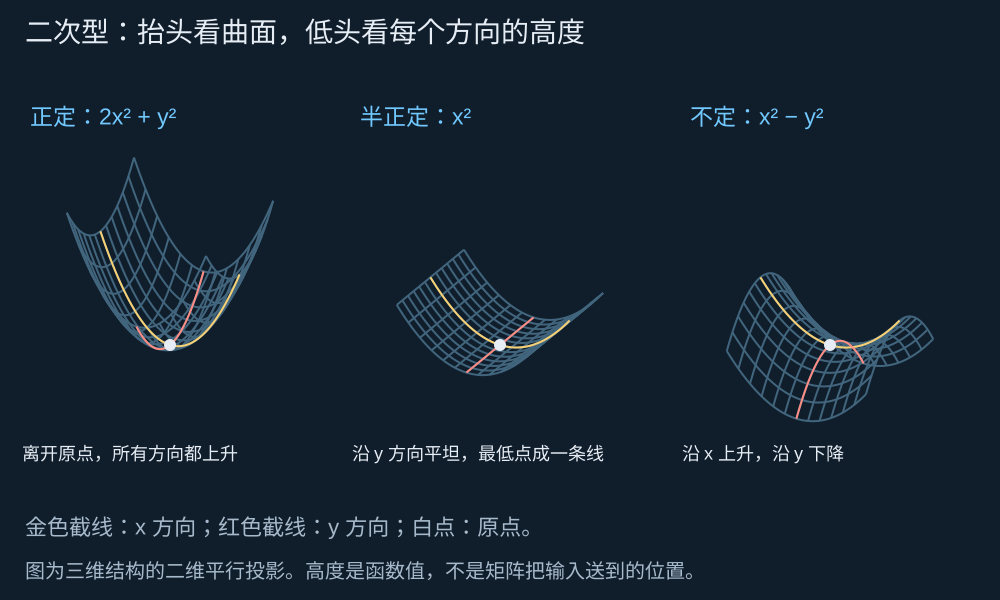
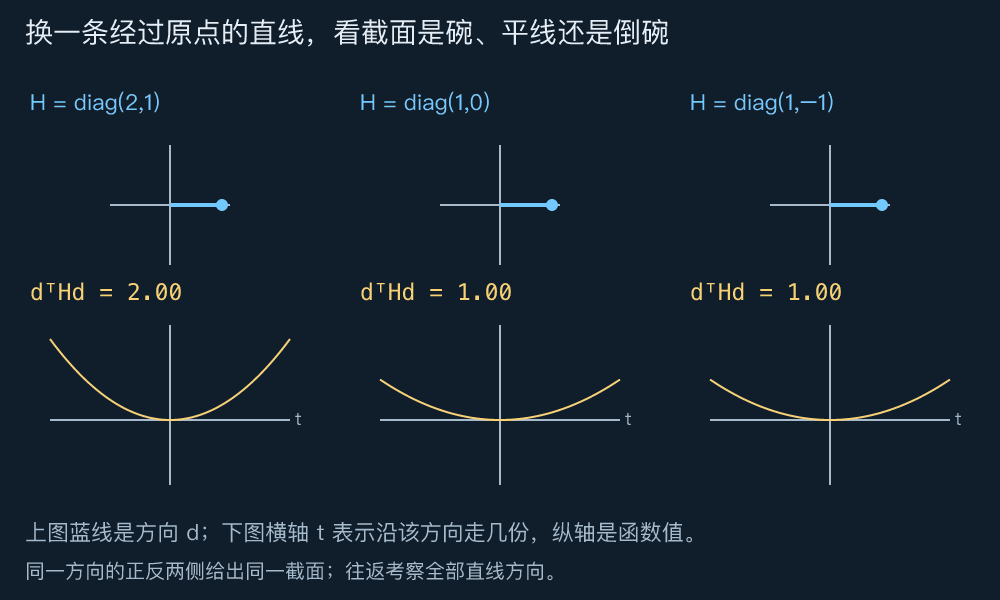
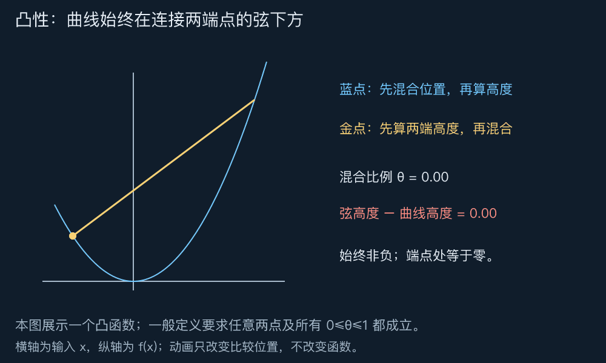
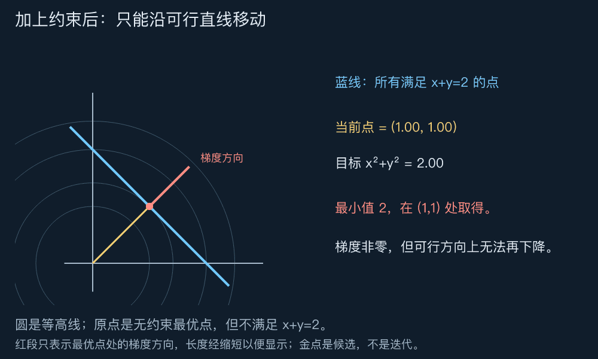
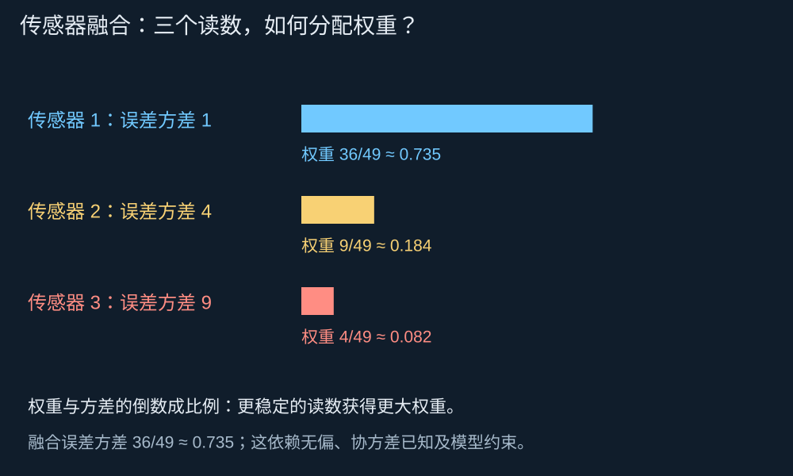

# DAY 5：为什么有些二次曲面是碗，有些是马鞍？｜二次型、正定与半正定、凸性、Hessian、KKT 与 QP

[六天路线](../README.md) · [上一课：特征值与矩阵分解](./04特征值与矩阵分解.md)

第四课把矩阵拆成不同方向上的作用，协方差的特征值告诉我们沿各主轴的方差。今天换一个观看方式：把输入点放在地面上，把一个二次表达式的数值当作高度。沿各方向向上弯、平坦或向下弯，决定了我们面对的是碗、槽还是马鞍。

本课从曲面走到优化：先理解 **为什么某些问题有可靠的全局最低点，再理解有约束时怎样找到它** 。贯穿案例是把多个无偏传感器的读数融合成一个估计，选择权重使误差方差尽量小。

先看图和每图的“先看”提示，再读推导。本文统一使用实数与列向量；讨论正定、半正定时，矩阵均假设实对称。建议图形与二次型约 45 分钟，凸性与导数约 45 分钟，约束和传感器例子约 60 分钟，实验与思考题约 30 分钟。KKT 的一般式可第二遍阅读。

## 阅读导航

1. [二次型：让每个输入点拥有一个高度](#二次型让每个输入点拥有一个高度)
2. [正定与半正定：检查所有方向](#正定与半正定检查所有方向)
3. [凸性：连线为什么能判断一个碗](#凸性连线为什么能判断一个碗)
4. [梯度与 Hessian：当前位置往哪走以及地面怎样弯](#梯度与-hessian当前位置往哪走以及地面怎样弯)
5. [有约束时最低点的梯度可以不为零](#有约束时最低点的梯度可以不为零)
6. [从边界引出 KKT 条件](#从边界引出-kkt-条件)
7. [用凸二次规划融合三个传感器](#用凸二次规划融合三个传感器)
8. [相关误差让最优点落到边界](#相关误差让最优点落到边界)
9. [从 QP 走向下一课的 SDP](#从-qp-走向下一课的-sdp)
10. [亲手实验](#亲手实验)
11. [留给你的思考题](#留给你的思考题)
12. [思考题参考答案](#思考题参考答案)

## 二次型：让每个输入点拥有一个高度

先看三个函数：$2x^2+y^2$、$x^2$、$x^2-y^2$。输入都是地面上的 $(x,y)$，但高度不同。



**先看：从白色原点出发，金色与红色截线分别向哪边弯？** 第一幅两条都向上；第二幅有一条平坦；第三幅一条向上、一条向下。图使用三维平行投影，屏幕夹角不是实际空间夹角。

这种“输入向量变成一个标量高度”的表达式，叫 **二次型** ：

$$q(x)=x^\top Hx,\qquad H\in\mathbb R^{n\times n},\quad H=H^\top.$$

这里 $x$ 是整个向量。二维展开时，为避免混淆，把坐标写成 $x_1,x_2$：

$$H=\begin{pmatrix}a&b\\b&c\end{pmatrix}
\quad\Longrightarrow\quad
q(x)=a x_1^2+2b x_1x_2+c x_2^2.$$

中间的 2 来自两项交叉乘积：第一行贡献 $b x_1x_2$，第二行再贡献 $b x_2x_1$。矩阵中的 $b$ 不是整个交叉项的系数。

例如 $H=\begin{pmatrix}2&1\\1&2\end{pmatrix}$ 给出 $2x_1^2+2x_1x_2+2x_2^2$。它看起来混合了两项输入，但第四课已经找到了正交特征方向。令 $H=Q\Lambda Q^\top$、$c=Q^\top x$，便得到

$$x^\top Hx=c^\top\Lambda c=\sum_i\lambda_i c_i^2.$$

$c_i$ 是输入在第 $i$ 根单位特征轴上的坐标。换到这些轴后，交叉项消失，只剩每根轴各自的平方高度。本例就是 $3c_1^2+c_2^2$：斜着看是一个两边陡峭程度不同的碗。

如果最初给出的矩阵不是对称的，二次型只取决于它的对称部分，因为

$$x^\top Ax=x^\top\frac{A+A^\top}{2}x.$$

所以本课从一开始就使用对称矩阵，避免把不影响高度的反对称部分混进讨论。

## 正定与半正定：检查所有方向

只检查横轴和纵轴还不够，斜方向可能藏着下降坡。我们让方向也转动起来。



**先看：下方截面能否变平，能否倒扣？** 上方蓝线是单位方向 $d$，沿它走 $t$ 份，输入就是 $td$。相应高度为

$$q(td)=t^2(d^\top Hd).$$

所以 $d^\top Hd$ 的正负决定截面朝上、平坦还是朝下。动画改变方向 $d$，每个矩阵固定不变；这不是求最优点的移动轨迹。

| 类型 | 对输入的要求 | 特征值条件 | 二次型图景 |
| --- | --- | --- | --- |
| 正定，$H\succ0$ | 所有非零 $x$ 都有 $x^\top Hx>0$ | 全部为正 | 沿任何方向离开原点都会升高 |
| 半正定，$H\succeq0$ | 所有 $x$ 都有 $x^\top Hx\geq0$ | 全部非负 | 无向下方向，但可能有平坦方向 |
| 不定 | 既有正值也有负值 | 既有正特征值也有负特征值 | 某些截面向上，另一些向下 |

半正定包含正定。“半”不是一半元素为正，也不是一半方向向上。若半正定但不正定，才一定存在非零平坦方向。

这些特征值判据来自上节的平方和：若所有 $\lambda_i\geq0$，每项 $\lambda_i c_i^2$ 都非负；反过来，若有负特征值，选它的单位特征向量就会得到负高度。这是针对所有方向的证明，而不是通过有限角度的动图抽样下结论。

例如 $\begin{pmatrix}1&2\\2&1\end{pmatrix}$ 每个元素都为正，但在 $(1,-1)^\top$ 处得到 $-2$，所以不是半正定。相反，$\begin{pmatrix}1&-1\\-1&1\end{pmatrix}$ 含负元素，却给出 $(x_1-x_2)^2\geq0$，确实半正定。

对半正定 $H$，$x^\top Hx=0$ 恰好表示 $x$ 只含零特征值方向的分量，也就是 $Hx=0$。因此平底槽的平坦方向，就是矩阵的零空间。

## 凸性：连线为什么能判断一个碗

我们不只想判断原点附近的高度，还想知道整个函数是否会出现“看起来最低，远处却还有更低位置”的陷阱。先从一条抛物线观察。



**先看：同一个横坐标下，蓝点是否总在金点下方？** 金点是两端高度的加权平均；蓝点是在同样的加权平均位置上重新计算函数值。动图只展示固定端点的一种比较；一般定义要求任意端点都满足。

先说可行范围：集合 $C$ 是 **凸集** ，指其中任意两点 $u,v$ 之间的整段线都仍在集合里，即

$$(1-\theta)u+\theta v\in C,\qquad 0\leq\theta\leq1.$$

$\theta$ 是混合比例，不是新的空间坐标。直线、实心圆盘、半空间都是凸集；只取圆周通常不是凸集，因为连接两点的线段可能穿过未包含的内部。

定义在凸集上的函数 $f$ 称为 **凸函数** ，若对任意 $u,v$ 和上述 $\theta$，有

$$f((1-\theta)u+\theta v)
\leq(1-\theta)f(u)+\theta f(v).$$

直观上，图像不高于两端的连线。它可以是圆滑的碗，也可以有直线段或平底，不要求处处严格弯曲。

### 为什么半正定二次型一定凸

对 $q(x)=x^\top Hx$，直接展开可得

$$(1-\theta)q(u)+\theta q(v)-q((1-\theta)u+\theta v)
=\theta(1-\theta)(u-v)^\top H(u-v).$$

当 $H\succeq0$ 时，右边非负，因此满足凸性。反过来，如果存在 $d$ 使 $d^\top Hd<0$，取端点 $d,-d$，中点为 0；中点高度 0 反而高于两端平均的负值，违反凸性。

所以在整个实空间中，二次型凸 **当且仅当** $H\succeq0$。加上线性项或常数项不会改变上述弦与曲线的差，故也不改变二次函数的凸性。

### 凸性提供什么，没提供什么

在凸可行集上最小化凸函数，任何局部最优都是全局最优。理由是：若远处还有更低的可行点，向它走任意小一段，凸性就保证目标降低，这会直接否定原候选点的局部最优性。

但凸性不自动保证最优点存在，也不保证唯一。$f(x,y)=x^2$ 有整条最低线；$f(x,y)=x^2-y$ 同样凸，却能沿 $y\to+\infty$ 无限下降。正定二次项使函数严格凸，在凸可行集上如果最优点存在，它便唯一。更一般的唯一性也可能来自约束消除了平坦方向，不必要求全空间正定。

## 梯度与 Hessian：当前位置往哪走以及地面怎样弯

为了找低点，需要把“朝哪里下降”写成计算。先用一个只含坐标平方的小例子：

$$f(x_1,x_2)=x_1^2+2x_2^2-2x_1.$$

固定 $x_2$、只改变 $x_1$，瞬时斜率为 $2x_1-2$；固定 $x_1$、只改变 $x_2$，斜率为 $4x_2$。这两个偏导数组成 **梯度** ：

$$\nabla f(x)=\begin{pmatrix}2x_1-2\\4x_2\end{pmatrix}.$$

从 $x$ 沿方向 $d$ 走很小一步 $t$，函数的一阶变化约为 $t\nabla f(x)^\top d$。因此梯度与方向的内积为负时，足够小的正步长会下降；沿负梯度通常是一个自然选择，但步长太大仍可能越过低点。

再对各个偏导求导，排成 **Hessian 矩阵** （海森矩阵）：

$$\nabla^2 f(x)=\begin{pmatrix}2&0\\0&4\end{pmatrix}.$$

它记录各方向的二阶变化，也就是曲率。一般二次函数采用下面的标准记法：

$$f(x)=\frac12x^\top Hx+c^\top x+d,\qquad H=H^\top.$$

此时

$$\nabla f(x)=Hx+c,\qquad \nabla^2f(x)=H.$$

前面的 $1/2$ 用来消掉求导产生的 2。如果写的是 $q(x)=x^\top Hx$，则梯度为 $2Hx$、Hessian 为 $2H$；不能把这两种记法混用。

对二次函数，沿任意变化 $h$ 的展开没有余项：

$$f(x+h)=f(x)+\nabla f(x)^\top h+\frac12h^\top Hh.$$

第一项是原高度，第二项是当前坡度造成的变化，第三项是弯曲造成的变化。因此若 $H\succeq0$ 且 $\nabla f(x_*)=0$，任意变化都不会使目标更小，$x_*$ 是全局最优。

例子中令梯度为零，得到 $x_*=(1,0)^\top$；配方也得到 $f=(x_1-1)^2+2x_2^2-1$，最低值为 $-1$。但马鞍 $x_1^2-x_2^2$ 在原点梯度也为零，所以不能只检查梯度，忽略曲率。

对定义在开凸域上的二阶连续可微函数，一般判据是： **Hessian 在整个域内处处半正定，等价于函数凸** 。只检查一个点不够。这项一般结论与相关定义可参阅 [Boyd 与 Vandenberghe，第 3 章](https://www.stanford.edu/~boyd/cvxbook/bv_cvxbook.pdf)。

### 第三课的最小二乘也在这个框架里

取 $f(x)=\frac12\lVert Ax-b\rVert_2^2$，展开后得

$$\nabla f(x)=A^\top(Ax-b),\qquad \nabla^2f(x)=A^\top A.$$

任意 $h$ 都满足 $h^\top A^\top Ah=\lVert Ah\rVert_2^2\geq0$，所以它总是凸函数。梯度为零就是第三课的正规方程。满列秩时 Hessian 正定，解唯一；列相关时存在平坦方向，同一个最优预测可以对应多份输入。

## 有约束时最低点的梯度可以不为零

现在最小化 $f(x,y)=x^2+y^2$，但只允许 $x+y=2$。原点虽是无约束最低点，却不是可行点。



**先看：金点只能沿蓝线走，不能直接走向原点。** 圆是目标函数的等高线；金点演示不同候选，而非某个优化算法的迭代。红色短线标出 $(1,1)$ 处的梯度方向，长度为显示而缩短。

先直接解一次：代入 $y=2-x$，得到

$$f(x,2-x)=x^2+(2-x)^2=2(x-1)^2+2.$$

所以最优点为 $(1,1)$，最低值为 2。但此处梯度是 $(2,2)^\top$，并不为零。原因是负梯度指向的下降方向会违反约束。

可行变化 $h=(h_1,h_2)^\top$ 必须满足 $h_1+h_2=0$，它们沿 $(1,-1)^\top$。最优点的梯度与这个方向正交，因此沿可行线的一阶变化为零。

### 拉格朗日乘子把“无法沿可行方向下降”写成方程

把等式约束记为 $h(x,y)=x+y-2=0$，它的梯度 $(1,1)^\top$ 是可行直线的法向量。最优点的目标梯度也沿法向，所以可找到一个数 $\nu$，使

$$\nabla f+\nu\nabla h=0.$$

$\nu$ 称为拉格朗日乘子。定义拉格朗日函数

$$L(x,y,\nu)=f(x,y)+\nu h(x,y),$$

即可将条件写成对 $x,y$ 的梯度为零，再加上约束本身：

$$2x+\nu=0,\quad2y+\nu=0,\quad x+y=2.$$

前两式给出 $x=y$，所以 $x=y=1$、$\nu=-2$。等式乘子的符号不受限制。乘子是在平衡目标的坡度与约束法向；它不是要求约束外的点也满足原来的优化目标。

## 从边界引出 KKT 条件

等式限制我们只能沿一条线走；不等式还会出现边界内侧与外侧的区别。先看一维问题

$$\min_x (x+1)^2\quad\text{s.t.}\quad x\geq0.$$

无约束最低点是 $-1$，被约束挡住，所以最优点是 0。此处导数为 2：想降低函数就要向左走，但左边不可行。

为了统一符号，将不等式写成 $g(x)=-x\leq0$，定义

$$L(x,\mu)=(x+1)^2+\mu(-x).$$

在 $x=0$，平衡斜率需要 $2(x+1)-\mu=0$，得到 $\mu=2\geq0$。非负乘子与 $g\leq0$ 的符号约定配套使用。

如果某条约束还没碰到边界，即 $g(x)<0$，它在当前位置不应产生这种边界作用，于是要求对应乘子为零。两种情况合在一起就是 **互补松弛** ：

$$\mu g(x)=0.$$

它表示“约束严格有余量时，乘子必须为零”；但约束正好取等号时，乘子仍可能为零，不能反推“碰到边界必有正乘子”。

### 四项条件各自检查什么

考虑可微问题

$$\min_x f(x)\quad\text{s.t.}\quad g_i(x)\leq0,\quad Ex=b.$$

$x$ 是未知向量，$g_i$ 是第 $i$ 条不等式，$E,b$ 给出等式。记不等式乘子为 $\mu_i$，等式乘子组成向量 $\nu$。KKT 条件为：

| 条件 | 公式 | 作用 |
| --- | --- | --- |
| 原始可行 | $g_i(x_*)\leq0,\ Ex_*=b$ | 候选点符合原约束 |
| 对偶可行 | $\mu_i\geq0$ | 不等式乘子方向正确 |
| 互补松弛 | $\mu_i g_i(x_*)=0$ | 有余量的约束不参与平衡 |
| 驻点条件 | $\nabla f(x_*)+\sum_i\mu_i\nabla g_i(x_*)+E^\top\nu=0$ | 目标坡度与约束法向平衡 |

这些条件不是新的四个求解口诀。前两项确认点和乘子合法，第三项指出哪些边界可能起作用，第四项检查还剩不剩可行下降趋势。

### 什么情况下它能证明最优

若 $f,g_i$ 都凸且可微、等式是仿射的，找到满足 KKT 的点就足以证明全局最优。简单理由是：对固定的合法乘子，$L(x)=f(x)+\sum_i\mu_i g_i(x)+\nu^\top(Ex-b)$ 是凸函数；驻点条件使 $x_*$ 全局最小化 $L$，互补条件又给出 $L(x_*)=f(x_*)$。任意可行 $x$ 满足 $L(x)\leq f(x)$，于是

$$f(x_*)=L(x_*)\leq L(x)\leq f(x).$$

反过来，要保证每个最优点都能配上 KKT 乘子，还需要约束资格条件。例如在函数全域有限、凸且可微的情况下，存在满足等式并使所有不等式严格成立的点，是常用的 Slater 条件；若最优值在某点取得，此条件保证相应乘子存在。它是充分的资格条件，不是所有问题都必须满足的唯一条件。

在非凸问题中，KKT 一般不能单独保证全局最优；在缺少资格条件时，也不能随意把 KKT 当作所有最优点的必要条件。完整边界见 [Boyd 与 Vandenberghe，第 5 章](https://www.stanford.edu/~boyd/cvxbook/bv_cvxbook.pdf)。本课下面的例子都是凸问题，并可直接验证条件。

## 用凸二次规划融合三个传感器

现在让矩阵、曲率和约束解决同一个实际形式的问题。三个传感器估计同一标量位置 $s$：

$$y_i=s+\varepsilon_i,\qquad \mathbb E[\varepsilon_i]=0.$$

$\varepsilon_i$ 是随机测量误差；$\mathbb E$ 表示平均意义下的期望。用权重 $w_i$ 融合成 $\widehat s=\sum_i w_i y_i$。要求 $\sum_i w_i=1$，就有 $\mathbb E[\widehat s]=s$，即融合结果仍无偏。

令误差协方差为 $\Sigma$，其元素 $\Sigma_{ij}=\mathbb E[\varepsilon_i\varepsilon_j]$。融合误差是 $w^\top\varepsilon$，其方差为

$$\mathbb E[(w^\top\varepsilon)^2]=w^\top\Sigma w.$$

由于这是平方的期望，真实协方差必为半正定。这也解释了半正定性如何从物理量的含义出现，而不是额外指定的计算技巧。

若再要求非负权重，模型为

$$\min_w w^\top\Sigma w
\quad\text{s.t.}\quad\mathbf1^\top w=1,\quad w\geq0.$$

$\mathbf1$ 是全为 1 的列向量；$w\geq0$ 是逐元素不等式。可行权重构成凸集，因此这是凸二次规划（QP）：二次目标配上线性等式、不等式约束。

### 先解没有相关误差的例子

取教学协方差 $\Sigma=\operatorname{diag}(1,4,9)$，表示三个无偏误差互不相关，方差分别为 1、4、9。目标为

$$f(w)=w_1^2+4w_2^2+9w_3^2.$$

先只处理权重和为 1，再检查非负性。等式拉格朗日条件给出

$$2w_1+\nu=0,\quad8w_2+\nu=0,\quad18w_3+\nu=0.$$

因此 $w_1:w_2:w_3=1:1/4:1/9$。三项之和为 $49/36$，归一化得到

$$w_* =\begin{pmatrix}36/49\\9/49\\4/49\end{pmatrix}.$$

它们全部为正，因此同时满足原问题的非负约束。对应非负约束乘子全部取零，等式乘子取 $\nu=-72/49$，即可验证完整 KKT。Hessian 为 $2\Sigma\succ0$，所以这个解唯一。



**先看：更稳定的读数得到更大权重，但三个读数都参与了融合。** 这里是按方差的倒数分配，不是按标准差的倒数分配；存在相关误差时，这个简单比例通常不再成立。

代回可得最小方差

$$f(w_*)=\frac{36^2+4\cdot9^2+9\cdot4^2}{49^2}
=\frac{36}{49}\approx0.735.$$

它小于单用最稳定传感器的方差 1。若某次读数为 $(10,12,9)^\top$，融合位置为

$$\widehat s=\frac{36\cdot10+9\cdot12+4\cdot9}{49}
=\frac{504}{49}\approx10.286.$$

这是该模型下的一次估计，不证明它必然比任何单次读数更接近真实位置。方差描述重复测量意义下的离散程度；偏差、协方差估计误差及共同故障都可能改变结论。

## 相关误差让最优点落到边界

再看两个传感器，误差协方差为

$$\Sigma=\begin{pmatrix}1&2\\2&9\end{pmatrix}.$$

它确实正定，因为任意误差系数组合满足

$$z^\top\Sigma z=(z_1+2z_2)^2+5z_2^2>0\quad(z\ne0).$$

权重和为 1，令 $w_1=t,w_2=1-t$。非负性恰好变为 $0\leq t\leq1$。代入目标：

$$f(t)=t^2+4t(1-t)+9(1-t)^2
=6t^2-14t+9=6\left(t-\frac76\right)^2+\frac56.$$

如果允许负权重，最低点在 $t=7/6$，对应 $(7/6,-1/6)^\top$；但它不满足非负约束。在允许的区间中，距离 $7/6$ 最近的是端点 $t=1$，所以原问题的解为

$$w_*=(1,0)^\top,\qquad f(w_*)=1.$$

此时不能要求每个权重方向上的偏导都为零：在端点继续增大 $t$ 原本可以下降，但已经越过可行区间。第二项权重的非负约束起了作用。

### 把边界解放回 KKT 核对

把两条不等式写成 $-w_1\leq0,-w_2\leq0$，用向量 $\mu=(\mu_1,\mu_2)^\top$ 记录乘子。驻点条件为

$$2\Sigma w_*+\nu\mathbf1-\mu=0.$$

在 $w_*=(1,0)^\top$，$2\Sigma w_*=(2,4)^\top$。由于第一权重严格为正，互补松弛要求 $\mu_1=0$，于是第一行给出 $\nu=-2$；第二行给出 $\mu_2=2$。

权重可行、$\mu\geq0$、$\mu_1w_1=\mu_2w_2=0$、驻点条件均成立，因此这是全局最优。正定性进一步保证唯一。

相关误差不意味着必须让某个权重为零；这是本例数值与非负限制共同造成的结果。允许负权重属于另一个模型，并不是无条件“更好”或“更坏”。

## 从 QP 走向下一课的 SDP

常见凸 QP 写成

$$\min_x\frac12x^\top Hx+c^\top x
\quad\text{s.t.}\quad Gx\leq h,\quad Ex=b,\qquad H\succeq0.$$

这里的 $H$ 是给定矩阵，优化变量是向量 $x$。传感器例子对应 $H=2\Sigma,c=0$；将约束写为矩阵时，非负权重对应 $G=-I,h=0$。这一形式可对照 [CVXPY 的 QP 示例](https://www.cvxpy.org/examples/basic/quadratic_program.html)。

“使用半正定矩阵”不等于“正在做半正定规划”。下一课的标准 SDP 直接优化一个对称矩阵 $X$，目标和等式对 $X$ 线性，并要求 $X\succeq0$。本课是给定协方差后选权重；下一课会学习如何让一个待修复的矩阵本身满足半正定条件。

严格可行的凸问题、唯一解和数值稳定也不是同一回事。矩阵接近奇异时，理论上唯一的解仍可能对数据敏感；实际求解要检查残差、约束满足程度与模型尺度，而不是只看某个“成功”标签。

## 亲手实验

在专题根目录运行：

```sh
python3 codes/05_experiment.py
```

[实验脚本](../codes/05_experiment.py)使用 Python 标准库与有理数计算，核对二次型反例、最小二乘曲率、等式约束最优点、三个传感器权重与相关误差边界解的 KKT。它检验明确算例，不是通用 QP 求解器，也不能用有限点采样代替半正定性或凸性的证明。

先预测再改：把第三个传感器方差从 9 增加到 100，它的权重应怎样变化？将两个相关传感器的非负约束去掉，目标为什么可以更低？将槽面 $x^2$ 加上线性项 $-y$，最低点会发生什么？

## 留给你的思考题

每题先说清正在看曲率、目标值，还是可行方向，再计算。保留个人作答位置，[参考答案](#思考题参考答案)附在后面，可先尝试再对照。

### 1．元素都为正，就能形成一个碗吗

比较 $H_1=\begin{pmatrix}1&2\\2&1\end{pmatrix}$ 与 $H_2=\begin{pmatrix}1&-1\\-1&1\end{pmatrix}$。求各自特征值，用一支具体向量或配方解释其正定性类别。$H_2$ 的平坦方向是什么？

我的回答：

### 2．平底为什么不保证一定有最低点

分别讨论 $x^2$ 与 $x^2-y$ 的凸性、是否有最小值、最优点是否唯一。再把 $x^2$ 限制在 $x+y=1$ 上，最低点是否唯一？

我的回答：

### 3．梯度为零以后还需要看什么

求 $f(x,y)=x^2+2y^2-4x+4y$ 的梯度、Hessian 与最优点，用配方核对。对比 $g(x,y)=x^2-y^2$ 的原点，说明为什么同样梯度为零，结论不同。

我的回答：

### 4．无法到达原点时怎样停下来

最小化 $x^2+y^2$，约束为 $x+y=4$。分别用代入配方与拉格朗日乘子求解，并指出最优点处梯度与可行方向的关系。

我的回答：

### 5．碰到边界就一定有正乘子吗

分别求解 $\min_{x\geq0}(x+2)^2$ 与 $\min_{x\geq0}x^2$。都把不等式写成 $-x\leq0$，列出最优点与乘子，核对 KKT。它们的共同点与区别是什么？

我的回答：

### 6．两个误差不相关的传感器该怎样融合

两个无偏且误差不相关的传感器方差分别为 1、9，权重非负且和为 1。求最优权重与最小融合方差。若两次读数为 8 和 12，给出融合值，并说明这是否保证本次最准确。

我的回答：

### 7．给定矩阵与优化矩阵有何不同

对正文 $\Sigma=\begin{pmatrix}1&2\\2&9\end{pmatrix}$，比较允许负权重与禁止负权重的解、目标值。指出这两个问题为什么都是 QP；如果要修复 $\Sigma$ 使其半正定，优化变量的角色又会怎样改变？

我的回答：

### 用自己的话串起来

用三句话解释：半正定怎样控制曲率，凸性怎样帮助判断全局最优，约束怎样改变“梯度为零”的判断。最后说清为什么本课的传感器问题不是直接优化矩阵的 SDP。

我的复述：

## 思考题参考答案

每题先确定要解释的空间现象，再用计算核对。上面的个人作答位置保留，便于之后写下自己的理解。

### 第 1 题：判断碗的形状，要看方向而不是元素

我们要判断的是：从原点沿不同方向走，函数高度是否可能降低。矩阵里的数字全为正，并不能回答这个问题，因为输入的两个坐标可以异号。

先看 $H_1$。两条斜方向给出

$$H_1\begin{pmatrix}1\\1\end{pmatrix}=3\begin{pmatrix}1\\1\end{pmatrix},\qquad
H_1\begin{pmatrix}1\\-1\end{pmatrix}=-\begin{pmatrix}1\\-1\end{pmatrix}.$$

两支向量独立，已经覆盖二维空间的两个特征方向，所以特征值为 $3,-1$。特别地，沿第一方向取 $x=(1,1)^\top$，二次型为 $x^\top H_1x=6$；沿第二方向取 $x=(1,-1)^\top$，则为 $-2$。有正有负，因此 $H_1$ 不定，曲面是马鞍。

这里 $-2$ 不是特征值：二次型在特征向量 $v$ 上的值是 $\lambda\lVert v\rVert^2$，而这支向量的长度平方为 2。

再看 $H_2$：

$$H_2\begin{pmatrix}1\\1\end{pmatrix}=0,\qquad
H_2\begin{pmatrix}1\\-1\end{pmatrix}=2\begin{pmatrix}1\\-1\end{pmatrix}.$$

特征值为 $0,2$，所以半正定但不正定。展开也能直接看出

$$x^\top H_2x=x_1^2-2x_1x_2+x_2^2=(x_1-x_2)^2\geq0.$$

只要 $x_1=x_2$，高度就为零，故平坦方向组成

$$\operatorname{Null}(H_2)=\left\{t\begin{pmatrix}1\\1\end{pmatrix}:t\in\mathbb R\right\}.$$

直观上，两个坐标一起增加同样的量，它们的差不变，因此高度不变。这是一条斜着的槽底；只需一个参数 $t$ 就能描述，维数为 1。

### 第 2 题：曲率不向下，不等于高度不会一直下降

本题要区分 **曲率、最低高度能否达到、达到它的点有几个** 。

$f(x,y)=x^2$ 的 Hessian 为 $\operatorname{diag}(2,0)$，处处半正定，所以凸。由于 $x^2\geq0$，最小值为 0；取到它只需 $x=0$，不限制 $y$，因此最优点是整条 $y$ 轴，不唯一。

对于 $g(x,y)=x^2-y$，线性项 $-y$ 的二阶导数为零，Hessian 仍是 $\operatorname{diag}(2,0)$，所以同样凸。但固定 $x=0$、令 $y=t\to+\infty$，就有

$$g(0,t)=-t\to-\infty.$$

它没有最小值，目标向下无界。可以把它想成一个沿槽底方向倾斜的槽：沿该方向是直线，没有向下弯曲，却一直向下倾斜。半正定控制的是曲率，不是所有位置的坡度。

最后，把 $f=x^2$ 限制在 $x+y=1$ 上。每个可行点都可以写成 $(t,1-t)$，于是受限目标就是 $t^2$。它仅在 $t=0$ 取到最小值 0，所以唯一最优点为 $(0,1)$。

原来的槽底 $x=0$ 与约束线只交于这一个点。约束没有让全空间 Hessian 变成正定，而是排除了沿槽底自由移动的可能。

### 第 3 题：零梯度表示坡度暂时为零，曲率决定周围怎样变化

对 $f(x,y)=x^2+2y^2-4x+4y$，逐坐标求导：

$$\nabla f=\begin{pmatrix}2x-4\\4y+4\end{pmatrix},\qquad
\nabla^2f=\begin{pmatrix}2&0\\0&4\end{pmatrix}.$$

令梯度为零得到 $x=2,y=-1$。Hessian 正定，因此这是唯一全局最优点。为了直接看见“周围都更高”，把函数配方：

$$f(x,y)=(x-2)^2+2(y+1)^2-6.$$

两个平方项都非负，只有在 $(2,-1)$ 同时为零，故最小值为 $-6$。从这里沿非零变化 $h=(h_1,h_2)^\top$ 离开，高度恰好增加 $h_1^2+2h_2^2>0$。

对比 $g=x^2-y^2$：原点梯度也是零，但 Hessian 为 $\operatorname{diag}(2,-2)$，不定。任意小的非零 $t$ 都满足

$$g(t,0)=t^2>0,\qquad g(0,t)=-t^2<0.$$

因此原点附近既有更高点，也有更低点，它是鞍点，既不是局部最小值点，也不是局部最大值点。零梯度只让一阶项消失，不能代替对二阶变化的判断。

### 第 4 题：停在可行线上距离原点最近的位置

目标 $x^2+y^2$ 是到原点的距离平方；约束 $x+y=4$ 把可移动位置限制在一条直线上。我们寻找的是原点到这条线的垂足。

先用代入法：$y=4-x$，因此

$$x^2+(4-x)^2=2x^2-8x+16=2(x-2)^2+8.$$

唯一最优点为 $(2,2)$，最小值为 8。

再用乘子法。取约束函数 $h=x+y-4$，构造

$$L=x^2+y^2+\nu(x+y-4).$$

对 $x,y$ 求导，再补上可行条件：

$$2x+\nu=0,\qquad2y+\nu=0,\qquad x+y=4.$$

前两式相减给出 $x=y$，结合最后一式得到 $x=y=2$，再代回得 $\nu=-4$。

最优点的梯度是 $(4,4)^\top$，并不为零。可行位移必须为 $h=(t,-t)^\top$，与梯度的内积为 $4t-4t=0$。所以不能沿可行线获得一阶下降；进一步精确计算

$$f(2+t,2-t)=8+2t^2,$$

可见任何非零可行移动都会升高。这既说明垂直关系，也证明了唯一最优性。负梯度虽然指向原点，却会让坐标和小于 4，不能沿它移动。

### 第 5 题：约束取等号，不代表它一定需要抵消坡度

两个问题的可行集合都是右半轴 $x\geq0$，统一写成 $g(x)=-x\leq0$。KKT 条件分别检查

$$x\geq0,\qquad\mu\geq0,\qquad\mu x=0,\qquad f'(x)-\mu=0.$$

对 $f_1=(x+2)^2$，无约束低点在 $-2$，位于可行范围之外。在右半轴上它随 $x$ 增大而增大，因此最优点为 $x_*=0$，最小值为 4。驻点条件给出

$$2(0+2)-\mu=0\quad\Longrightarrow\quad\mu=4.$$

可行性、乘子非负性和互补条件 $4\cdot0=0$ 全部满足。这里函数想向左下降，边界挡住了这个方向，非零乘子用来平衡目标的斜率。

对 $f_2=x^2$，无约束低点原本就在 0，且满足约束。因此 $x_*=0$，最小值为 0；驻点条件为 $2\cdot0-\mu=0$，所以 $\mu=0$。其余三项也成立。

两者都在边界，约束都称为 **活跃约束** （在该点取等号）；但第二个问题不需要额外抵消坡度。互补松弛只规定乘积为零：当 $x=0$ 时，乘积自动为零，究竟取哪个 $\mu$ 还要由驻点条件决定。

### 第 6 题：稳定读数占九份，噪声较大的读数占一份

误差不相关意味着协方差的非对角项为零。设第一项权重为 $t$，第二项为 $1-t$，则 $0\leq t\leq1$，融合误差方差为

$$V(t)=t^2+9(1-t)^2=10t^2-18t+9
=10\left(t-\frac9{10}\right)^2+\frac9{10}.$$

因此最优权重是 $(9/10,1/10)^\top$，最小方差为 $9/10=0.9$。最优点位于允许区间内，两项权重都为正。

这个 9∶1 来自 **方差倒数之比** $1:(1/9)$，不是标准差倒数之比。两个读数都包含同一个真实量，但第二个更不稳定，因此仍让它贡献少量信息。这里只需误差不相关，不必假设统计独立。

若两次读数为 8、12，融合值为

$$\widehat s=\frac9{10}\cdot8+\frac1{10}\cdot12=8.4.$$

它不保证这一次最准确。例如真实值恰好为 8 时，第一个读数误差为零，而融合值误差为 0.4。这不矛盾：无偏条件下，均方误差等于方差，优化的是重复测量意义下的平均平方误差，不是每一次的误差大小。

### 第 7 题：先看未知量是谁，再判断优化问题的形式

本题的协方差固定为 $\Sigma=\begin{pmatrix}1&2\\2&9\end{pmatrix}$，我们改变的是权重。仍令 $w=(t,1-t)^\top$，逐项相乘得到

$$w^\top\Sigma w=t^2+4t(1-t)+9(1-t)^2
=6\left(t-\frac76\right)^2+\frac56.$$

允许负权重时，$t$ 可以取任意实数，因此唯一最优权重为 $(7/6,-1/6)^\top$，目标值为 $5/6$。两项权重仍然和为 1：负权重不是忘记归一化，而是在这个相关误差模型中用减法抵消一部分共同误差。

禁止负权重时，$t$ 只能在 $[0,1]$ 内。平方项要求 $t$ 尽量接近 $7/6$，允许范围中最近的是 1，故唯一最优权重为 $(1,0)^\top$，目标值为 1。约束缩小了选择范围，所以最小目标值由 $5/6$ 增加到 1；差为 $1/6$。

两者都是凸 QP：变量是向量 $w$，目标是给定正定矩阵形成的二次函数，约束是线性等式以及可能存在的线性不等式。正定性可由

$$z^\top\Sigma z=(z_1+2z_2)^2+5z_2^2>0\quad(z\ne0)$$

直接证明。

若任务改为修复一个估计矩阵 $\widehat\Sigma$，就把它当作待接近的数据，寻找新的对称矩阵 $X$ 并要求 $X\succeq0$。此时未知量变成矩阵的各个条目；它们不能各自随意修改，因为半正定要求所有方向的二次型都非负。

还要注意：本题给出的 $\Sigma$ 已经正定；如果“修复”只要求半正定并尽量不改动，它本身就是可接受结果。对一般待修复矩阵，具体问题是否属于标准 SDP，还取决于目标及其他约束的形式；不能只凭出现 $X\succeq0$ 就下结论。第六课会展开这一点。

### 串联复述：曲率、最优性与可行方向

可以用下面三句话串起本课：

1. 对称半正定矩阵形成的二次项在每个方向都不向下弯，但可以有平坦方向；附加线性项仍可能让目标沿平坦方向无限下降。
2. 在凸可行集上最小化凸函数时，局部最优也是全局最优，但最优点是否存在、是否唯一，需要另外判断。
3. 无约束可微问题的最优点需要梯度为零；有约束时，只需阻止可行方向上的下降，凸问题中满足 KKT 的可行点便是全局最优，而保证最优点一定有 KKT 乘子还需要相应资格条件。

传感器例子给定 $\Sigma$、优化向量 $w$，所以直接写出的是凸 QP；下一课则把待寻找的矩阵本身作为变量，研究半正定约束。

## 延伸阅读

- [Boyd 与 Vandenberghe：Convex Optimization](https://www.stanford.edu/~boyd/cvxbook/bv_cvxbook.pdf)：第 2～3 章的凸集、凸函数，第 4 章的 QP，第 5 章的对偶、KKT 与约束资格条件。本文只给入门所需的假设与推导，不覆盖完整对偶理论。
- [CVXPY：Quadratic program](https://www.cvxpy.org/examples/basic/quadratic_program.html)：对照二次目标、线性约束与乘子的实现方式。本文实验不依赖 CVXPY，也未安装求解器。

参考入口核对日期：2026-11-11。案例与图形为教学构造。下一课将从“某个矩阵怎样才是半正定”走向“如何直接寻找满足半正定约束的矩阵”。
