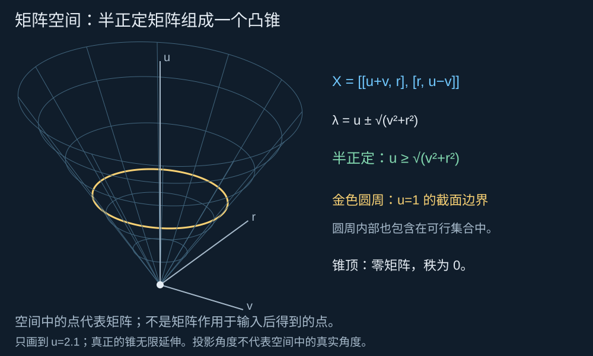
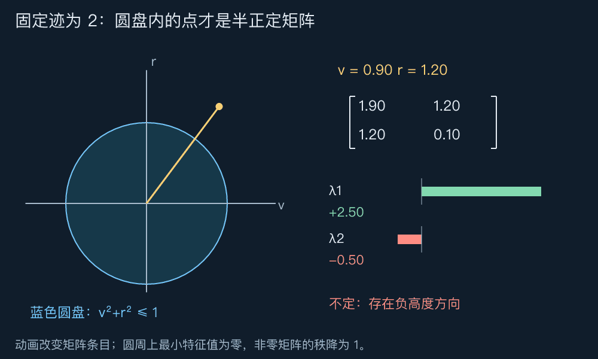
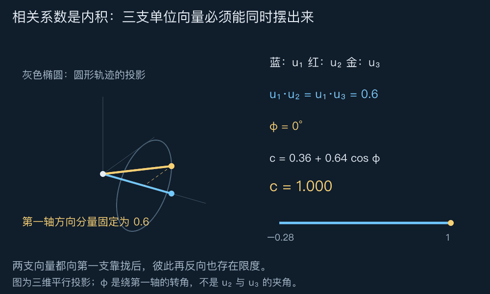
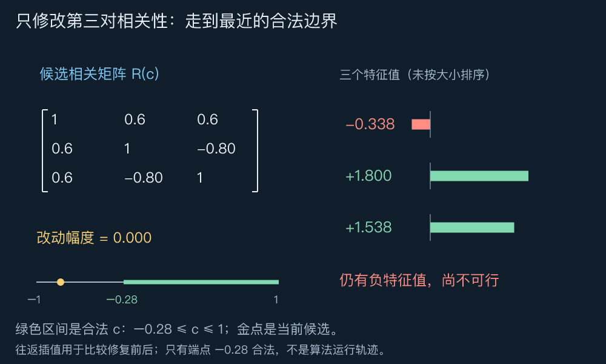
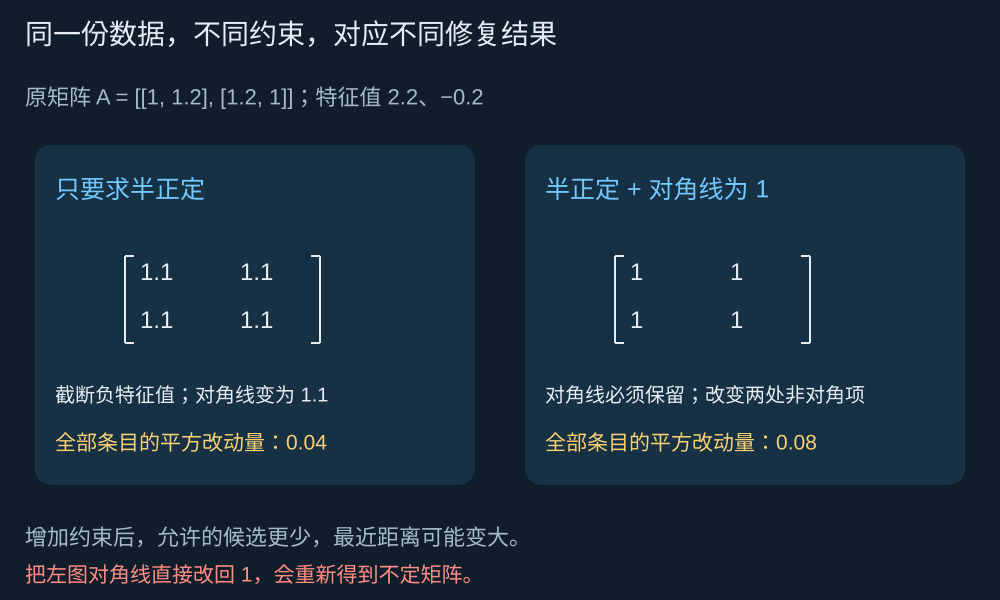

# DAY 6：怎样找到一个合理的矩阵？｜PSD 锥、矩阵不等式、SDP、相关矩阵修复与数值检查

[六天路线](../README.md) · [上一课：二次型与凸优化](./05二次型与凸优化.md)

前五天，我们通常拿到一个矩阵，问它怎样变换空间、丢掉哪些方向、产生怎样的曲率。最后一天把问题反过来： **如果矩阵还没确定，怎样从许多候选矩阵中，找到一个既符合数据又满足几何约束的矩阵？**

贯穿案例是三个传感器的误差相关性。我们会发现：每对传感器的关系看起来都合理，放在一起却可能自相矛盾。修复它，需要把整个矩阵当作未知量。

本课统一讨论实数与对称矩阵。先看图，再读计算；建议用 45 分钟理解矩阵空间与 PSD 锥，60 分钟完成修复案例，45 分钟做实验与结果检查，30 分钟复述六天主线。标准形式与平方损失的改写可第二遍阅读。

## 阅读导航

1. [三个看似正常的数字为什么会矛盾](#三个看似正常的数字为什么会矛盾)
2. [把一个矩阵看成空间里的一个点](#把一个矩阵看成空间里的一个点)
3. [矩阵不等式比较的是所有方向](#矩阵不等式比较的是所有方向)
4. [用三支单位向量理解相关矩阵](#用三支单位向量理解相关矩阵)
5. [从可行区间走到一个完整的 SDP](#从可行区间走到一个完整的-sdp)
6. [多项数据都能修改时怎样定义修复](#多项数据都能修改时怎样定义修复)
7. [把修好的矩阵交回传感器融合](#把修好的矩阵交回传感器融合)
8. [实验与数值结果怎样验收](#实验与数值结果怎样验收)
9. [把六天连成一条理解路径](#把六天连成一条理解路径)
10. [留给你的思考题](#留给你的思考题)
11. [思考题参考答案](#思考题参考答案)

## 三个看似正常的数字为什么会矛盾

假设三个无偏传感器的误差都已标准化，均值为 0、方差为 1。估计得到

$$\widehat R=\begin{pmatrix}
1&0.6&0.6\\
0.6&1&-0.8\\
0.6&-0.8&1
\end{pmatrix}.$$

对角线的 1 是各自的方差；非对角元素是两两相关系数。第一项与第二项同向，第一项与第三项也同向，第二项与第三项却强烈反向。

单看每一对，都满足相关系数介于 $-1$ 与 $1$ 之间。问题在于：三对关系能否同时成立？

取组合系数 $v=(-6/5,1,1)^\top$，可算出

$$v^\top\widehat Rv=-\frac{26}{25}<0.$$

若它真是误差向量 $\varepsilon$ 的协方差，这个数就应当等于 $\operatorname{Var}(v^\top\varepsilon)$。方差不可能为负，因此 $\widehat R$ 不是合法的相关矩阵。这里的 $v$ 只是检验方向，不必是非负、和为 1 的融合权重。

**相关矩阵必须整体半正定；逐项检查取值范围不够。** 后文会用单位向量解释这组数字为什么无法同时成立，并一步步找到最近的合法替代值。

这个例子是教学构造。完整、对齐的数据使用同一套样本计算规则得到的样本协方差，本来就具有半正定结构；出现明显负特征值，应检查是否拼接了不同样本窗口、分别估计了不同条目，或做了不保结构的近似。不能笼统地把所有不合法结果归因于“数据有噪声”。

## 把一个矩阵看成空间里的一个点

先从 $2\times2$ 对称矩阵开始。它只需三个数就能确定：

$$X=\begin{pmatrix}a&r\\r&b\end{pmatrix}.$$

所以可以把它看成三维“矩阵空间”中的一个点。这个空间的坐标记录的是矩阵条目， **不是被矩阵变换的输入向量坐标** 。这一区分贯穿本课。

为让形状更清楚，把两个对角元素换一种记录方式：

$$u=\frac{a+b}{2},\qquad v=\frac{a-b}{2},\qquad
X=\begin{pmatrix}u+v&r\\r&u-v\end{pmatrix}.$$

$u$ 是对角线的平均值，$v$ 是两者差的一半；并没有增加未知量。特征方程变成

$$(u-\lambda)^2-v^2-r^2=0,$$

所以两个特征值为 $u\pm\sqrt{v^2+r^2}$。最小特征值非负，等价于

$$u\geq\sqrt{v^2+r^2}.$$

这正是一座向上张开的实心圆锥。



**先看：锥里的每个点代表一个完整矩阵。** 图使用三维平行投影；画出的锥有高度截断，真正的锥向上无限延伸。这里用了专门的坐标 $(v,r,u)$，不是说任意大小的 PSD 集合都能画成普通三维圆锥。

固定 $u=1$，也就是固定迹 $a+b=2$，截面变成圆盘 $v^2+r^2\leq1$：



**先看：点越过圆周时，最小特征值经过零。** 圆盘内部的矩阵正定、秩为 2；圆周上半正定但秩为 1；圆盘外有负特征值。动画改变矩阵的条目，右侧显示该矩阵的特征值，不是在对某个输入反复乘矩阵。

### 为什么叫半正定锥，而且它是凸的

一般记实对称矩阵的集合为 $\mathbb S^n$，其中半正定矩阵的集合为 $\mathbb S_+^n$。若 $X,Y\succeq0$，对任意向量 $z$ 和非负数 $\alpha,\beta$，都有

$$z^\top(\alpha X+\beta Y)z
=\alpha z^\top Xz+\beta z^\top Yz\geq0.$$

因此 $\alpha X+\beta Y$ 仍半正定。可以沿原方向放大，也可以相加，这就是凸锥的性质。特别取 $\alpha=1-\theta,\beta=\theta$，就说明两点之间的整段线仍在集合中。

通俗地说，把两个都不会产生负平方高度的矩阵按非负比例混合，也不会混出负高度。 **这里证明的是所有方向的非负性，不是观察几张图后作出的猜测。**

## 矩阵不等式比较的是所有方向

上一课的 $w\geq0$ 表示每个权重非负；本课的 $X\succeq0$ 则表示每个方向的二次型非负。两者不是同一种比较。

对同阶对称矩阵，定义

$$X\succeq Y\quad\Longleftrightarrow\quad X-Y\succeq0.$$

也就是对每个 $z$，都有 $z^\top Xz\geq z^\top Yz$。如果两者都是协方差，含义是：任何线性组合在 $X$ 模型下的方差都不小于在 $Y$ 模型下的方差。

例如 $\begin{pmatrix}1&-1\\-1&1\end{pmatrix}\succeq0$，尽管它有负元素；而 $\begin{pmatrix}1&2\\2&1\end{pmatrix}$ 元素都正，却不半正定。矩阵之间也不一定能比出大小：$X=\operatorname{diag}(2,1)$、$Y=\operatorname{diag}(1,2)$ 的差不定，因此既没有 $X\succeq Y$，也没有 $Y\succeq X$。

如果希望每个单位方向都有至少 $\delta>0$ 的曲率，可以要求

$$X\succeq\delta I\quad\Longleftrightarrow\quad
z^\top Xz\geq\delta\lVert z\rVert^2\quad\text{对所有 }z.$$

这等价于最小特征值至少为 $\delta$，比单纯半正定更严格。它会改变允许的模型，不是输出后随手做一次四舍五入。

当矩阵条目依赖未知数 $x_1,\ldots,x_k$，并且写成

$$F(x)=F_0+x_1F_1+\cdots+x_kF_k\succeq0,$$

其中各 $F_i$ 为给定对称矩阵，这叫 **线性矩阵不等式** （LMI；表达式可以含常数项）。它对条目的依赖是仿射的，但在坐标图上可以形成弯曲边界，例如刚才的圆盘。

## 用三支单位向量理解相关矩阵

我们回到三个传感器。要理解它们为什么互相牵制，先把相关系数换成内积来看。

任何实对称半正定矩阵都有分解 $X=U^\top U$：由第四课的特征分解，只要令 $U=\Lambda^{1/2}Q^\top$ 即可。若 $U$ 的第 $i$ 列为 $u_i$，那么

$$X_{ij}=u_i^\top u_j.$$

这叫 Gram 矩阵。反过来，任意这样的矩阵都半正定，因为 $z^\top U^\top Uz=\lVert Uz\rVert^2\geq0$。若再要求 $X_{ii}=1$，每支 $u_i$ 就是单位向量，$X_{ij}$ 就是夹角的余弦。

这些向量是在表示误差相关性的几何结构，不必对应传感器真实的安装方向。矩阵的秩表示这些向量实际张成的维数。

### 固定两对关系，第三对还剩多少自由

把前两项相关系数固定为 $3/5$，只让第三对 $c$ 变化：

$$R(c)=\begin{pmatrix}
1&3/5&3/5\\
3/5&1&c\\
3/5&c&1
\end{pmatrix}.$$

选取一组具体单位向量：

$$u_1=(1,0,0)^\top,\qquad
u_2=(3/5,4/5,0)^\top,$$

$$u_3=(3/5,(4/5)\cos\varphi,(4/5)\sin\varphi)^\top.$$

$u_3$ 的第一坐标固定为 $3/5$，其余两项在半径 $4/5$ 的圆上转动。参数 $\varphi$ 表示绕第一根轴的转角，不是 $u_2$ 与 $u_3$ 的夹角。



**先看：金色向量怎么转，与蓝色向量的内积都不变；与红色向量的内积有明确下限。** 图为三维平行投影，向量长度与夹角以公式为准。每帧是一个可行的 Gram 矩阵，不是传感器在物理空间中转动。

计算第三对内积：

$$c=u_2^\top u_3=\frac9{25}+\frac{16}{25}\cos\varphi.$$

因为 $-1\leq\cos\varphi\leq1$，这一构造恰好覆盖

$$-\frac7{25}\leq c\leq1.$$

几何直觉是：两支向量都已向第一支靠拢到一定程度，剩余部分即使完全相反，也只能把内积降到 $-7/25=-0.28$；降不到原估计的 $-0.8$。

### 用平方展开证明这就是完整可行区间

上面的向量构造说明区间内每个数都能实现。还要排除区间外的可能。对任意检验向量 $z=(x,y,z_3)^\top$，直接配方得到

$$z^\top R(c)z=
\left(x+\frac35y+\frac35z_3\right)^2
+\frac{c+7/25}{2}(y+z_3)^2
+\frac{1-c}{2}(y-z_3)^2.$$

若 $-7/25\leq c\leq1$，三个系数都非负，因此半正定。若 $c<-7/25$，选 $(x,y,z_3)=(-6/5,1,1)$，只剩 $2(c+7/25)<0$；若 $c>1$，选 $(0,1,-1)$，只剩 $2(1-c)<0$。所以

$$R(c)\succeq0\quad\Longleftrightarrow\quad -7/25\leq c\leq1.$$

区间内部三个平方对应的线性表达式相互独立，故矩阵正定。两个端点都半正定但奇异；这正是向量共面的边界情况。

## 从可行区间走到一个完整的 SDP

我们已经知道哪些矩阵合法，现在要说清“修得最好”是什么意思。本例暂时信任对角线及前两对关系，只允许修改 $c$，希望它尽可能接近观测值 $-4/5$。

最直接的模型是

$$\min_c\ \lvert c+4/5\rvert\quad\text{s.t.}\quad R(c)\succeq0.$$

为了把目标写成线性的，引入一个实数 $t$，表示修改幅度的上界。条件 $\lvert c+4/5\rvert\leq t$ 等价于两个线性不等式，于是得到

$$\begin{aligned}
\min_{c,t}\quad&t\\
\text{s.t.}\quad&R(c)\succeq0,\\
&c+4/5\leq t,\\
&-(c+4/5)\leq t.
\end{aligned}$$

不必额外要求 $t\geq0$，后两条已经蕴含它。最优时 $t$ 一定等于实际修改幅度，否则还能继续减小目标。

这是 **SDP 的线性目标加 LMI 表达形式** 。变量虽然只有两个标量，约束中仍然有一个依赖它们的半正定矩阵；SDP 不要求代码里的变量必须声明成矩阵类型。



**先看：必须移到边界，最小特征值才不再为负。** 动画展示从观测值到修复值的插值并往返播放，途中大多数点仍不可行；它不代表求解器必须走这条路径。

由完整可行区间，距离 $-4/5$ 最近的点是左端点。因此

$$c_*=-\frac7{25},\qquad t_*=\frac{13}{25}=0.52,$$

$$R_* =\begin{pmatrix}
1&3/5&3/5\\
3/5&1&-7/25\\
3/5&-7/25&1
\end{pmatrix}.$$

这不仅是一个可行猜测：任何可行 $c$ 都至少为 $-7/25$，所以任何可行修改幅度都至少为 $13/25$；$R_*$ 正好达到这个下界，故已证明全局最优。

原矩阵的 $(2,3)$ 和 $(3,2)$ 是同一个相关系数的两处对称记录，修复时必须一起改。若用全部矩阵条目的平方差衡量改动，数值为 $2(13/25)^2=338/625$，不是 $13/25$。目标的单位和定义必须说清。

### 标准 SDP 中的迹究竟在做什么

常见标准形式写成

$$\min_{X\in\mathbb S^n}\ \operatorname{tr}(CX)
\quad\text{s.t.}\quad
\operatorname{tr}(A_iX)=b_i,\quad X\succeq0.$$

$X$ 是待选矩阵，$C,A_i,b_i$ 是已知数据。迹 $\operatorname{tr}$ 是对角线元素之和；对于对称 $C,X$，

$$\operatorname{tr}(CX)=\sum_{i,j}C_{ij}X_{ij}.$$

它只是对矩阵条目做加权求和。看起来有矩阵乘法，但 $C$ 固定，所以目标对未知条目是线性的。

例如用 $A_i=e_ie_i^\top$ 就能读出 $X_{ii}$；要读 $X_{23}$，应令 $A$ 的 $(2,3)$ 与 $(3,2)$ 都为 $1/2$、其余为零，两份加起来恰好是 $X_{23}$。这与第一课“列记录作用”、第三课“内积做比较”是同一套坐标语言。

我们的小例子可以写成标准形式：构造块对角矩阵

$$Z=\operatorname{diag}\bigl(R(c),\ t-c-4/5,\ t+c+4/5\bigr).$$

后两块是 $1\times1$ 的矩阵。$Z\succeq0$ 等价于前面三条约束；各块的条目关系可用线性等式固定，目标 $t=(Z_{44}+Z_{55})/2$ 也线性。因此 LMI 写法与这种标准写法没有本质冲突。对照定义可参阅 [CVXPY 的 SDP 示例](https://www.cvxpy.org/examples/basic/sdp.html)。

## 多项数据都能修改时怎样定义修复

刚才只改一个相关系数，是因为我们明确假设其余条目可信。若所有估计都带误差，可以让整个矩阵 $X$ 变化，同时保留对称、对角线为 1 和半正定约束。此时“最合理”必须配上一个明确的距离标准。

### 为什么不能只把负特征值改成零

对给定对称矩阵 $A=Q\operatorname{diag}(\lambda_i)Q^\top$，若只要求 $X\succeq0$，以 Frobenius 范数衡量最近距离，解为

$$X_+=Q\operatorname{diag}(\max(\lambda_i,0))Q^\top.$$

Frobenius 范数 $\lVert E\rVert_F=(\sum_{i,j}E_{ij}^2)^{1/2}$，就是把所有条目排成一个向量后计算长度。特征值截断确实解决了这个特定的最近矩阵问题，参见 [Higham 对最近半正定矩阵的说明](https://nhigham.com/2021/01/26/what-is-the-nearest-positive-semidefinite-matrix/)。

但它通常不保留对角线。例如

$$A=\begin{pmatrix}1&1.2\\1.2&1\end{pmatrix}
\quad\longrightarrow\quad
X_+=\begin{pmatrix}1.1&1.1\\1.1&1.1\end{pmatrix}.$$

负特征值 $-0.2$ 被抬到零，正特征值 $2.2$ 保留。新矩阵半正定，但对角线不再为 1，因此不是相关矩阵。若另加对角线固定为 1 的约束，本例的最近相关矩阵反而是全为 1 的矩阵。



**先看：不是两种算法在争同一个答案，而是可行范围不同。** 把截断后的对角线强行改回 1，还可能重新破坏半正定；有额外约束时应统一建模。

### 线性绝对误差，或平方误差

一种容易写成 SDP 的选择是对上三角不同条目计算绝对误差之和：引入 $t_{ij}$，解

$$\begin{aligned}
\min_{X,t}\quad&\sum_{i<j}t_{ij}\\
\text{s.t.}\quad&X\succeq0,\quad X_{ii}=1,\\
&-t_{ij}\leq X_{ij}-\widehat R_{ij}\leq t_{ij}\quad(i<j).
\end{aligned}$$

这里只数每对关系一次。若某些条目更可信，可给相应误差更大权重，或固定为等式；固定条件彼此冲突时，问题可能不可行，PSD 约束无法替我们保留互相矛盾的要求。

另一种选择是最小化 $\lVert X-\widehat R\rVert_F^2$。它是凸二次目标加 PSD 约束， **原写法不是刚才的线性目标标准形式** 。可以通过增加变量等价改写，但要说明改写过程。

先把误差矩阵的所有 $n^2$ 个条目按固定顺序排成向量 $e$，那么 $e^\top e=\lVert X-\widehat R\rVert_F^2$。引入误差平方和的上界 $\tau$，有

$$\begin{pmatrix}\tau&e^\top\\e&I_{n^2}\end{pmatrix}\succeq0
\quad\Longleftrightarrow\quad \tau\geq e^\top e.$$

不用先记住一个新定理：对任意标量 $s$ 与向量 $y$，左边矩阵的二次型等于

$$\tau s^2+2s e^\top y+y^\top y
=\lVert y+se\rVert^2+s^2(\tau-e^\top e).$$

若右侧差非负，整个式子非负；若差为负，取 $s=1,y=-e$ 就得到负数。这证明了等价关系，也是 Schur 补的一种具体用法。

于是最小化 $\tau$，同时约束这个块矩阵半正定、$X\succeq0$ 和单位对角线，就得到线性目标的 SDP 表达。它用于理解建模，不表示实际软件必须采用这么大的 $n^2+1$ 阶块；求解工具可以使用更紧凑的等价形式。

## 把修好的矩阵交回传感器融合

现在才把修复结果交给第五课的权重优化。这里假设三项误差的方差本来就都是 1，因此 $R_*$ 也就是协方差。若原标准差分别为 $s_i>0$，必须先恢复 $\Sigma=DR_*D$，其中 $D=\operatorname{diag}(s_i)$，不能直接把相关系数当作原测量单位下的协方差。

考虑

$$\min_w w^\top R_*w\quad\text{s.t.}\quad
w_1+w_2+w_3=1,\quad w\geq0.$$

第二、第三项在模型中地位对称。把权重写成

$$w_1=t,\qquad w_2=\frac{1-t}{2}+d,\qquad
w_3=\frac{1-t}{2}-d.$$

$t$ 表示分给第一项的权重，$d$ 表示后两项偏离平均分配的程度。可行条件为 $0\leq t\leq1$、$\lvert d\rvert\leq(1-t)/2$。代入得到

$$w^\top R_*w=\frac9{25}+\frac{12}{25}t+\frac4{25}t^2+\frac{64}{25}d^2.$$

所有附加项都非负，且同时为零只可能在 $t=d=0$。因此

$$w_*=(0,1/2,1/2)^\top,\qquad
\operatorname{Var}(w_*^\top\varepsilon)=\frac9{25}=0.36.$$

即使 $R_*$ 本身有零特征值，这个带约束的权重问题仍有唯一解。唯一性要看可行方向，不能只看整个矩阵是否正定。

零方向恰好为 $(-6/5,1,1)^\top$。如果去掉非负限制，把它归一化到权重和为 1，会得到 $(-3/2,5/4,5/4)^\top$，模型给出的方差为零。这是边界模型中的精确线性依赖，不是传感器真的实现了绝对无误差；估计略有变化，这种抵消关系就可能改变。

若希望避开这种退化，可考虑 $X\succeq\delta I$，但要重新求解修复问题，并说明选择 $\delta$ 的依据。简单加上 $\delta I$ 会把相关矩阵的对角线从 1 改成 $1+\delta$，并不满足原约束。

## 实验与数值结果怎样验收

### 先运行不依赖求解器的完整小例子

在专题根目录运行：

```sh
python3 codes/06_experiment.py
```

[实验脚本](../codes/06_experiment.py)使用标准库。它先以有理数核对负方差反例、修复下界及可行性，再用二分搜索逼近 PSD 边界，最后核对融合权重与方差。二分搜索解的是本例化简后的一维问题，不是通用 SDP 算法。

关键预期结果为：$c_*=-0.28$、最小改动 $0.52$、修复矩阵特征值 $0,1.28,1.72$、融合权重 $(0,0.5,0.5)$、融合方差 $0.36$。可行解加已证明的目标下界，在这个小例子中组成可核对的最优性证明。

### 对照真实建模接口

[可选 CVXPY 脚本](../codes/06_sdp_cvxpy.py)将同一个问题直接交给支持 SDP 的求解器。核心表达如下：

```python
c = cp.Variable()
t = cp.Variable()
R = cp.bmat([[1.0, 0.6, 0.6],
             [0.6, 1.0, c],
             [0.6, c, 1.0]])
problem = cp.Problem(cp.Minimize(t),
                     [R >> 0, c + 0.8 <= t, -(c + 0.8) <= t])
```

`R >> 0` 是半正定约束；`R >= 0` 在 CVXPY 中是逐元素不等式，表达的完全是另一个问题。这里的矩阵表达式已经对称；声明一般矩阵变量时，应明确使用对称变量或 PSD 属性，见 [CVXPY 的半正定约束文档](https://www.cvxpy.org/tutorial/constraints/index.html#semidefinite-matrices)。

本次环境未安装 NumPy、CVXPY 及 SDP 求解器，因此只运行了标准库实验；可选脚本做了语法检查，没有把预期结果冒充求解器实测输出。已具备这些依赖的环境可运行 `python3 codes/06_sdp_cvxpy.py`，脚本会检查支持的求解器并打印状态与残差，不会自动安装软件。

### 看到 optimal 之后，还要看什么

“满足半正定”在数学上是精确关系，浮点求解只能在容差内满足。应当先检查问题状态，再检查数值。

| 检查项 | 在本例中的含义 |
| --- | --- |
| 对称性与对角线 | $\lVert X-X^\top\rVert_F$ 应接近零，$X_{ii}$ 应接近 1 |
| 固定条目 | 前两对相关系数应接近 0.6 |
| 半正定残差 | 对对称部分计算 $\lambda_{\min}$，观察其是否显著低于零 |
| 幅度约束 | $\max(0,\lvert c+0.8\rvert-t)$ 应接近零 |
| 最优性 | 本例可与精确下界 $0.52$ 比较；一般问题需结合对偶界或求解器间隙 |

`optimal_inaccurate` 表示精度较低，不能直接当作已通过全部检查；`infeasible` 表示在模型约束下找不到可行点，`unbounded` 表示目标可无界改善，而不是“再迭代几次就好”。状态定义见 [CVXPY 入门文档](https://www.cvxpy.org/tutorial/intro/index.html#other-problem-statuses)。

若条目尺度约为 1，计算出现 $-10^{-9}$ 的最小特征值可能是容差效应；$-0.2$ 则不能用同一理由轻轻带过。具体阈值需要结合数据尺度、求解器设置与实际用途。对本例边界解，最小特征值理论上就是零，所以应预期它对浮点误差敏感。

可行不等于最优，模型最优也不等于数据可信。修复前应查明矛盾来源；修复后仍需检查对数据和约束选择的敏感性。

## 把六天连成一条理解路径


第一天，矩阵的列记录基本方向的去向。第二天，秩与零空间说明哪些区别被保留、哪些被压掉。第三天，投影把“最接近”变成空间中的距离比较。第四天，特征分解让每个特殊方向有独立的数值含义。第五天，半正定与凸性帮助我们判断二次优化。第六天，把所有这些条件放回矩阵空间，寻找一个符合要求的矩阵。

本课的修复可以看作一次矩阵空间中的“找近点”，但距离未必是第三课的欧氏距离、可行集合也未必是线性子空间，不能直接套用投影矩阵公式。我们使用明确的目标与凸约束来完成这件事。

到这里，六天的概念主线闭合了。你不需要记住每个求解器选项，但应能面对一个矩阵模型回答：输入与未知量是什么，哪些方向决定性质，约束表达什么，输出如何核对。内点法、对偶理论与大规模数值算法可以作为后续专题；这六天没有替代它们的完整课程。

## 留给你的思考题

每题先说清未知量、可行范围和要判断的性质，再计算。保留个人作答位置，[参考答案](#思考题参考答案)附在后面，可先尝试再对照。

### 1．矩阵空间中的点，与输入空间中的箭头有什么区别

对 $X=\begin{pmatrix}1+v&r\\r&1-v\end{pmatrix}$，分别取 $(v,r)=(0,0)$、$(3/5,4/5)$、$(0,6/5)$。判断特征值、秩及正定性；解释为什么第二个点虽然不在原点，却有一个输入方向被压成零。

我的回答：

### 2．半正定与逐元素非负能否互相替代

给出两类反例，并解释 $X\succeq\delta I$ 对任意输入向量意味着什么。如果 $X$ 是单位对角线的相关矩阵，为什么不能任意选择大于 1 的 $\delta$？

我的回答：

### 3．两对相关系数固定后，第三对能取多少

将正文两处 $3/5$ 同时改为 $1/2$。利用单位向量构造或平方配方，求第三对系数 $c$ 的完整可行区间。如果观测为 $-4/5$，只修复这一对时，最近合法值与修改幅度分别是多少？

我的回答：

### 4．迹怎样读取一个矩阵条目

构造对称矩阵 $C$，使 $\operatorname{tr}(CX)=2X_{11}-3X_{23}$。为什么把 $C_{23}$ 和 $C_{32}$ 都写成 $-3$ 会重复计数？

我的回答：

### 5．为什么特征值截断不够

对 $A=\begin{pmatrix}1&1.2\\1.2&1\end{pmatrix}$，写出只要求半正定的最近矩阵，以及同时要求单位对角线的最近矩阵。分别计算全部条目的平方改动量，解释较大的改动量为什么不意味着算法更差。

我的回答：

### 6．修复后出现零特征值，就说明修复失败了吗

验证正文 $R_*$ 的零空间方向，并解释允许负权重后为何能得到模型内零方差。再说明非负融合为什么仍有唯一最优解，以及要求 $X\succeq\delta I$ 会怎样改变原问题。

我的回答：

### 7．怎样区分一个好看的结果与一个可核对的解

某程序报告最优，但单位对角线残差为 0.1，最小特征值为 $-0.2$。这些信息是否足以接受结果？若残差都是 $10^{-9}$ 量级，又是否已经证明最优？分别说出还需要哪些信息。

我的回答：

### 最后的综合复述

面对一份不合法的相关矩阵，用自己的话串起：怎样发现矛盾、为什么整体修复、如何选择哪些条目允许修改、怎样写目标与 PSD 约束、怎样验证结果，以及为什么修复矩阵与选择融合权重是两个不同的优化问题。

我的复述：

## 思考题参考答案

每题先区分正在观察哪一个空间、什么是未知量，再进行计算。上面的个人作答位置保留，便于以后对照自己的理解。

### 第 1 题：矩阵是一个点，它的零空间是另一空间里的方向

$(v,r)$ 记录的是矩阵的条目；输入向量 $z=(z_1,z_2)^\top$ 则是被这个矩阵作用的对象。两者都用两个数表示，却不是同一种坐标。

这里的特征方程为

$$\det(X-\lambda I)=(1-\lambda)^2-v^2-r^2=0,$$

所以特征值为 $1\pm\sqrt{v^2+r^2}$。逐一代入：

| 矩阵参数 $(v,r)$ | 特征值 | 秩 | 类别 |
| --- | --- | --- | --- |
| $(0,0)$ | $1,1$ | 2 | 正定 |
| $(3/5,4/5)$ | $2,0$ | 1 | 半正定但不正定 |
| $(0,6/5)$ | $11/5,-1/5$ | 2 | 不定 |

第一种情况下 $X=I$。所以参数平面的原点并不是零矩阵，而是固定迹为 2 的截面中心。

第二种情况下

$$X=\begin{pmatrix}8/5&4/5\\4/5&2/5\end{pmatrix},\qquad
X\begin{pmatrix}1\\-2\end{pmatrix}=\begin{pmatrix}0\\0\end{pmatrix}.$$

它还满足 $X(2,1)^\top=2(2,1)^\top$。于是沿 $(2,1)$ 的输入分量被放大两倍，沿 $(1,-2)$ 的分量被压成零；输出只剩一条直线。

在矩阵参数空间里，这个点位于圆周上；在输入空间里，它对应的线性变换有一条零空间。 **一个矩阵不等于零矩阵，并不妨碍它把某些非零输入变成零。**

第三种情况有负特征值，但没有零特征值，因此仍是满秩可逆矩阵。负倍数意味着沿一个方向反向，不意味着该方向消失。这也把第二天的秩与第四天的特征值区分开了。

### 第 2 题：元素的符号，不能代替所有方向的检查

先看一个半正定却含负元素的矩阵：

$$H=\begin{pmatrix}1&-1\\-1&1\end{pmatrix},\qquad
z^\top Hz=(z_1-z_2)^2\geq0.$$

再看一个元素全正、却不是半正定的矩阵：

$$K=\begin{pmatrix}1&2\\2&1\end{pmatrix},\qquad
(1,-1)K(1,-1)^\top=-2.$$

第一种比较逐个看条目，第二种比较看组合后的二次型；组合时正负坐标可以相互抵消，所以不能互相替代。

要求 $X\succeq\delta I$，就是要求 $X-\delta I$ 半正定，因此对任意输入 $z$，

$$z^\top Xz\geq\delta z^\top z=\delta\lVert z\rVert^2.$$

对单位方向，二次型至少为 $\delta$；对长度放大为两倍的输入，下界也随长度平方放大四倍。这个条件给每个方向设定了统一的高度下界。

若 $X_{ii}=1$，取第 $i$ 个标准基向量 $e_i$，就得到 $1=e_i^\top Xe_i\geq\delta$。因此任何 $\delta>1$ 都不可行，并非只是“比较难求解”。$\delta\leq1$ 是必要条件；若还固定了其他条目，它未必充分。

### 第 3 题：两支向量都靠向同一方向，彼此反向就有了限度

现在固定两处相关系数为 $1/2$，待选矩阵为

$$R(c)=\begin{pmatrix}1&1/2&1/2\\1/2&1&c\\1/2&c&1\end{pmatrix}.$$

为了让前两对内积都等于 $1/2$，可以摆出三支单位向量：

$$u_1=(1,0,0)^\top,\qquad
u_2=(1/2,\sqrt3/2,0)^\top,$$

$$u_3=(1/2,(\sqrt3/2)\cos\varphi,(\sqrt3/2)\sin\varphi)^\top.$$

第三对内积便是

$$c=u_2^\top u_3=\frac14+\frac34\cos\varphi.$$

同向时取 1，绕到另一侧时取 $-1/2$；中间值也都能连续取到。所以 $[-1/2,1]$ 中的每个 $c$ 都能形成合法 Gram 矩阵。

还要证明区间外不可能。对检验向量 $z=(x,y,s)^\top$ 配方：

$$z^\top R(c)z=
\left(x+\frac{y+s}{2}\right)^2
+\frac{c+1/2}{2}(y+s)^2
+\frac{1-c}{2}(y-s)^2.$$

区间内三个系数非负，故半正定；若 $c<-1/2$，选 $(-1,1,1)^\top$，得到 $2(c+1/2)<0$；若 $c>1$，选 $(0,1,-1)^\top$，得到 $2(1-c)<0$。这就证明完整可行区间恰好为 $[-1/2,1]$。

观测值 $-4/5$ 位于区间左侧，最近合法值为 $c_*=-1/2$，这一对相关系数的修改幅度为

$$\left| -\frac12+\frac45\right|=\frac3{10}=0.3.$$

任何合法值都不小于 $-1/2$，因此都不可能改得更少。若计算全部矩阵条目的平方改动量，则是 $2(3/10)^2=9/50$；对称位置会记录两次同一修改。

### 第 4 题：迹把两处对称记录一起计入

我们要让迹只读出 $X_{11}$ 与 $X_{23}$，其他条目的系数都为零。对称 $X$ 满足

$$\operatorname{tr}(CX)=\sum_{i,j}C_{ij}X_{ij}.$$

因此可以取

$$C=\begin{pmatrix}
2&0&0\\
0&0&-3/2\\
0&-3/2&0
\end{pmatrix}.$$

此时

$$\operatorname{tr}(CX)=2X_{11}-\frac32X_{23}-\frac32X_{32}
=2X_{11}-3X_{23}.$$

如果两处都填 $-3$，会得到 $-3X_{23}-3X_{32}=-6X_{23}$，正好多算一倍。对角条目只出现一次，非对角条目在对称矩阵中有两处记录，所以系数分配不同。

例如 $X_{11}=1,X_{23}=X_{32}=0.6$ 时，正确结果是 $2-1.8=0.2$；错误填法得到 $2-3.6=-1.6$。这是一种读取条目的线性运算，不是在把目标改成二次函数。

### 第 5 题：先固定距离与约束，再谈哪个矩阵最近

本题用全部条目的平方改动量 $\lVert X-A\rVert_F^2$ 衡量距离；它与 Frobenius 范数本身有相同的最小点，但数值不同。

$A$ 沿 $(1,1)^\top$ 的特征值是 $2.2$，沿 $(1,-1)^\top$ 的特征值是 $-0.2$。只要求半正定时，保留前者、把后者改为零，得到

$$X_+=\begin{pmatrix}1.1&1.1\\1.1&1.1\end{pmatrix}.$$

这里也能直接证明它最近。在单位特征基下，原矩阵为 $\operatorname{diag}(2.2,-0.2)$。任何候选半正定矩阵在同一基下写作 $Y=\begin{pmatrix}\alpha&\beta\\\beta&\gamma\end{pmatrix}$，必有 $\alpha,\gamma\geq0$。正交换基保持 Frobenius 范数，因此平方距离为

$$(\alpha-2.2)^2+2\beta^2+(\gamma+0.2)^2\geq0.04.$$

取 $\alpha=2.2,\beta=\gamma=0$，候选确实半正定并达到下界。换回原坐标就是 $X_+$。逐条目核对：

$$\lVert X_+-A\rVert_F^2=4\cdot0.1^2=0.04.$$

若同时固定单位对角线，候选只能写成 $X(r)=\begin{pmatrix}1&r\\r&1\end{pmatrix}$。特征值 $1\pm r$ 非负要求 $-1\leq r\leq1$，平方距离为 $2(r-1.2)^2$。区间内离 1.2 最近的是 1，所以

$$X_* =\begin{pmatrix}1&1\\1&1\end{pmatrix},\qquad
\lVert X_*-A\rVert_F^2=2\cdot0.2^2=0.08.$$

增加约束后，原来距离较小的 $X_+$ 已不在可行集合里，因此最近距离变大很正常。不能用不同约束下的目标值直接评判算法优劣。

另外，若把 $X_+$ 的对角线直接改回 1，会得到 $\begin{pmatrix}1&1.1\\1.1&1\end{pmatrix}$，其最小特征值为 $-0.1$，再次不合法。这说明各项要求需要一起处理。

### 第 6 题：边界解可以正确，零方差却需要谨慎理解

正文的修复矩阵为

$$R_* =\begin{pmatrix}1&3/5&3/5\\3/5&1&-7/25\\3/5&-7/25&1\end{pmatrix}.$$

它与 $v=(-6/5,1,1)^\top$ 相乘，三行分别给出

$$-6/5+3/5+3/5=0,$$

$$-18/25+1-7/25=0,\qquad -18/25-7/25+1=0.$$

所以 $R_*v=0$。另两个特征值为 $32/25,43/25$，都为正，因此秩为 2，零空间正是 $v$ 张成的一条直线。

本例的修复目标要求尽量少改动，观测位于 PSD 集合外，最近合法位置恰好落在边界；零特征值没有违反半正定要求，不能据此判断修复失败。

$v$ 的坐标和是 $4/5$。若允许负权重，将它除以这个和，便得到

$$w=\frac{v}{4/5}=(-3/2,5/4,5/4)^\top,\qquad
\mathbf1^\top w=1,\quad w^\top R_*w=0.$$

这说明模型中存在精确抵消误差的线性组合。它依赖修复后的退化协方差；真实数据或估计稍有变化，这种精确关系就可能不再成立。不能把模型内的零方差理解为物理测量必然没有误差。

加回非负约束后，这份权重不可行。将所有可行权重写成

$$w_1=t,\quad w_2=(1-t)/2+d,\quad w_3=(1-t)/2-d,$$

其中 $0\leq t\leq1$、$\lvert d\rvert\leq(1-t)/2$，则

$$w^\top R_*w=\frac9{25}+\frac{12}{25}t+\frac4{25}t^2+\frac{64}{25}d^2.$$

后三项非负，且同时为零必须有 $t=d=0$。所以唯一最优解为 $(0,1/2,1/2)^\top$，方差为 $9/25$。矩阵在全空间存在平坦方向，但这个方向不允许我们在保持权重和为 1 的同时自由移动：零空间生成向量 $v$ 的坐标和并不为零。

若改为要求 $X\succeq\delta I$，且 $\delta>0$，原来的 $R_*$ 会被排除，因为在零方向上 $v^\top R_*v=0<\delta\lVert v\rVert^2$。必须重新寻找修复矩阵；最小改动可能增大，约束过严时也可能不可行。

新约束还意味着，对任何和为 1 的权重，

$$w^\top Xw\geq\delta\lVert w\rVert^2\geq\frac\delta3>0.$$

最后一步来自 $(w_1+w_2+w_3)^2\leq3(w_1^2+w_2^2+w_3^2)$。因此即使允许负权重，也不能再出现模型内零方差。这个改动具有实际的建模含义，不能视作不影响问题的“数值清理”。

### 第 7 题：可行性检查与最优性证明分两步完成

对单位对角线的相关矩阵问题，0.1 的对角线残差表示没有很好地满足原约束；最小特征值 $-0.2$ 表示存在单位方向 $z$ 使 $z^\top Xz=-0.2$。在本课约为 1 的数据尺度下，这些不是可以忽略的尾数误差。即使程序显示最优，也不能直接接受。

应先核对实际求解的模型是否与预期相同，包括 PSD 约束有没有误写为逐元素不等式、哪些条目被固定、矩阵是否对称，以及状态、求解器容差和终止原因。

如果所有可行性残差都在 $10^{-9}$ 量级，可以结合尺度与用途判断候选是否足够接近可行，但这仍不是最优性证明。一个具体反例是本课选择 $c=0,t=0.8$：固定条目和幅度约束都精确满足，$R(0)$ 正定，可行性残差可以为零；可是目标 0.8 明显大于已知最优值 0.52。

因此还要核对目标值。本例已经证明任何可行目标都不低于 $13/25=0.52$，又给出了达到它的候选，所以能严格证明最优。数值结果若接近这个值，并满足足够精确的可行性检查，就能与精确解交叉核对。

一般问题没有手算解时，可以寻找对偶可行解给出的下界：原问题可行候选给出上界，对偶可行候选给出下界，两者差距说明尚有多少改进空间。数值报告中的间隙也需要结合双方可行性与尺度来解释；不能只看一个很小的间隙数字，更不能把浮点近似直接说成严格相等。

### 最后的综合复述：先修模型，再用模型选择行动

可以按下面的顺序完整说明这个案例：

1. **发现矛盾。** 检查对称性、单位对角线和半正定性。负特征值或负二次型说明某个误差组合被赋予了负方差，需要检查数据来源与估计过程；每个相关系数单独落在 $[-1,1]$ 还不够。
2. **确定允许修改的内容。** 根据数据来源与可信程度，决定哪些条目固定、哪些可以调整。固定条件互相冲突时，不能要求求解器同时满足它们。
3. **写清修复目标。** 把待修复矩阵记为数据 $\widehat R$，把候选记为未知量 $X$，选择绝对误差或平方误差等明确度量，并加上 $X\succeq0$、单位对角线及必要的固定条目约束。线性目标配合 LMI 可以写成 SDP；非线性目标需要说明是否以及怎样等价改写。
4. **核对求解结果。** 检查状态和全部约束残差，再用已知下界或对偶信息判断最优性。边界上的零特征值不一定是错误，但应检查结果对数据变化是否敏感。
5. **进行融合。** 将相关矩阵按原标准差恢复为协方差后，把它作为已知输入，另行优化权重 $w$，使融合方差小，并满足权重和及非负等约束。

第一阶段是在选择一个自洽的误差模型，第二阶段是在给定模型下选择融合权重。两者的未知量、目标和约束都不同；修复得最近，并不自动表示对后续任务最有用，也不自动证明这份模型准确描述真实误差。模型假设、计算结果与实际效果需要分别核对。

## 延伸阅读

- [Boyd 与 Vandenberghe：Convex Optimization](https://web.stanford.edu/~boyd/cvxbook/)：选读凸锥、半正定规划和对偶部分，后续再学习求解算法。
- [CVXPY：Semidefinite program](https://www.cvxpy.org/examples/basic/sdp.html)：对照标准形式及矩阵变量写法。
- [Higham：What Is the Nearest Positive Semidefinite Matrix?](https://nhigham.com/2021/01/26/what-is-the-nearest-positive-semidefinite-matrix/)：区分距离度量与额外约束，理解特征值截断的适用范围。

参考入口核对日期：2026-11-12。矩阵、数据与图形均为教学构造。
